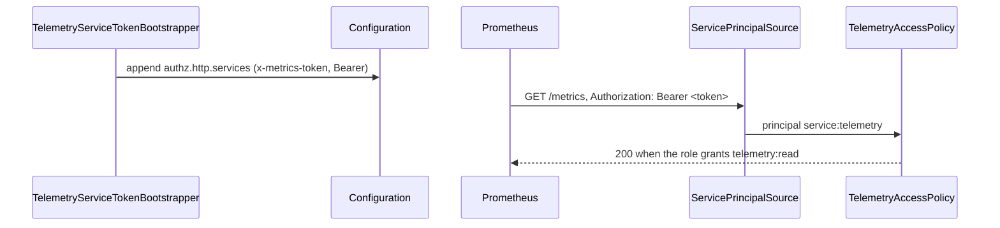

# Scrape token

`telemetry.auth.token` lets a Prometheus scraper read the telemetry endpoints with one shared secret. At bootstrap the token becomes a header-token service principal, `service:telemetry`, in `authz.http.services`. The package config gives that principal the RBAC role `telemetry`, which grants `telemetry:read`.

## How it works

1. `TelemetryServiceTokenBootstrapper.bootstrap()` resolves `Configuration` and calls `bridgeTelemetryToken(cfg, log)`.
2. `bridgeTelemetryToken()`:
   1. reads `telemetry.auth.token`; anything but a non-empty string ends here;
   2. reads `authz.http.services`; a value that is not an array is left for `@spinajs/authz-http` to report;
   3. when the list already holds an entry named `telemetry` that the bridge did not add, logs once that the token key is ignored and stops;
   4. otherwise appends two entries: `{ name: 'telemetry', header: 'x-metrics-token', token }` and `{ name: 'telemetry', header: 'authorization', token: 'Bearer <token>' }`. A second run adds nothing.
3. Per request, the `ServicePrincipalSource` of `@spinajs/authz-http` compares a header's whole value with each entry. A match makes the principal `service:telemetry`; a wrong token makes no principal, so a guarded endpoint answers 401.
4. The `'AccessPolicy'` slot checks `telemetry:read`. With `@spinajs/authz-rbac`, `authz.rbac.serviceRoles['service:telemetry'] = ['telemetry']` gives the principal the role `telemetry`, which grants it.



## Configuration

| Key | Type | Default | Allowed values | Meaning |
| --- | --- | --- | --- | --- |
| `telemetry.auth.token` | `string` | `''` | any string; empty disables the bridge | The shared scrape token |
| `authz.http.services` | array | `[]` | entries `{ name, header, token }` | An entry named `telemetry` here wins over `telemetry.auth.token` |
| `authz.rbac.roles.telemetry` | object | `{ grants: ['telemetry:read'] }` | role definition | Set by the package config |
| `authz.rbac.serviceRoles['service:telemetry']` | `string[]` | `['telemetry']` | role names | Set by the package config |

```ts
export default {
  telemetry: { auth: { token: process.env.METRICS_TOKEN } },
};
```

## Services and extension points

| Service | DI token and lifetime | Default implementation | Alternatives | How to replace or extend |
| --- | --- | --- | --- | --- |
| Token bridge | `Bootstrapper` list, registered by `@Injectable(Bootstrapper)` at import of the barrel | `TelemetryServiceTokenBootstrapper` calling `bridgeTelemetryToken()` | an explicit `telemetry` entry in `authz.http.services` | Define the entry yourself (several tokens, another header); or `DI.unregister(TelemetryServiceTokenBootstrapper)` and call `bridgeTelemetryToken()` from your own bootstrapper |
| Bridge function | plain function `bridgeTelemetryToken(cfg, log?)`; `cfg` needs only `get()` and `set()` | none | none | Call it on any configuration after you load the token from a secret store |
| Principal name | `TELEMETRY_SERVICE` (`'telemetry'`) | constant | none | Grant permissions to `service:telemetry` in any authz model |

### Token bridge: load the token from a secret store

Replace the bootstrapper when the token is not in configuration at startup. This one reads it from a secret store, then runs the same bridge.

```ts sample
import { Bootstrapper, DI, Injectable } from '@spinajs/di';
import { Configuration } from '@spinajs/configuration';
import { TelemetryServiceTokenBootstrapper, bridgeTelemetryToken } from '@spinajs/telemetry';

declare function readSecret(name: string): Promise<string>;

@Injectable(Bootstrapper)
export class SecretStoreTokenBootstrapper extends Bootstrapper {
  public async bootstrap(): Promise<void> {
    const cfg = await DI.resolve(Configuration);
    cfg.set(['telemetry', 'auth', 'token'], await readSecret('telemetry/scrape-token'));
    bridgeTelemetryToken(cfg, { info: (message: string) => console.info(message) });
  }
}

DI.unregister(TelemetryServiceTokenBootstrapper);
```

### Explicit service entry: rotate tokens without downtime

An explicit entry accepts several tokens, so old and new work side by side during a rotation. The bridge then ignores `telemetry.auth.token` and logs one line.

```ts sample
export default {
  authz: {
    http: {
      services: [
        { name: 'telemetry', header: 'x-metrics-token', token: [process.env.METRICS_TOKEN_NEW ?? '', process.env.METRICS_TOKEN_OLD ?? ''] },
        { name: 'telemetry', header: 'authorization', token: [`Bearer ${process.env.METRICS_TOKEN_NEW ?? ''}`, `Bearer ${process.env.METRICS_TOKEN_OLD ?? ''}`] },
      ],
    },
  },
};
```

## Important behaviour

- The token is read once, at bootstrap. A change needs a restart; a configuration reload drops the bridged entries, so the token gets 401 until the restart.
- The bridge runs only when the app loads the package barrel (`import '@spinajs/telemetry'`). Without it the token grants nothing.
- `service:telemetry` is authenticated on every route, not only the telemetry ones. A route that only asks for a signed-in principal lets it through.
- The Bearer form exists because stock Prometheus and OTel collector scrape configs send only `Authorization: Bearer <token>`. The header value must match exactly, `Bearer ` prefix included.
- With the token middleware of `@spinajs/authn-http` loaded, a Bearer scrape also costs an access-token lookup and a rejected-token warning. Prefer `x-metrics-token` there.
- Config arrays concatenate: an app cannot remove `serviceRoles['service:telemetry']` by setting `[]`.
- An app whose `authz.rbac.stores.roles` omits `ConfigRoleStore` must define the `telemetry` role itself. Without RBAC, or another model granting `service:telemetry` the permission, the token gets 403.

## Best practices

- Keep the token out of config files; set it from the environment or a secret store.
- Grant `service:telemetry` only telemetry permissions; it is a principal on every route.
- Send `x-metrics-token` when the scraper can set headers.

## Patterns and antipatterns

```ts
// Don't: the deprecated policy; it bypasses authz and answers 403 for a missing token
telemetry: { auth: { policies: { metrics: 'TelemetryTokenPolicy' } } }

// Do: the default 'AccessPolicy' slot and the bridged service principal
telemetry: { auth: { token: process.env.METRICS_TOKEN } }
```

## Examples

### Scrape with the token

```bash
curl -H "x-metrics-token: $METRICS_TOKEN" http://localhost:8080/metrics
curl -H "Authorization: Bearer $METRICS_TOKEN" http://localhost:8080/telemetry/stats
```

### Bridge a token in a unit test

```ts sample
import { bridgeTelemetryToken } from '@spinajs/telemetry';

const data: Record<string, unknown> = { 'telemetry.auth.token': 'test-token' };
const cfg = {
  get: <T>(path: string[] | string, def?: T): T => ((data[([] as string[]).concat(path).join('.')] as T) ?? (def as T)),
  set: (path: string[] | string, value: unknown): void => {
    data[([] as string[]).concat(path).join('.')] = value;
  },
};

bridgeTelemetryToken(cfg);
console.log(data['authz.http.services']);
// [{ name: 'telemetry', header: 'x-metrics-token', token: 'test-token' }, { name: 'telemetry', header: 'authorization', token: 'Bearer test-token' }]
```

## Related

- [Endpoint access](10-endpoint-access.md): the `'AccessPolicy'` slots the principal must pass.
- [Setup and configuration](01-setup-and-configuration.md): the bootstrappers and the package config.
- [`@spinajs/authz` HTTP adapter](../authz/README.md#http-spinajsauthz-http): `authz.http.services` and service principals.
