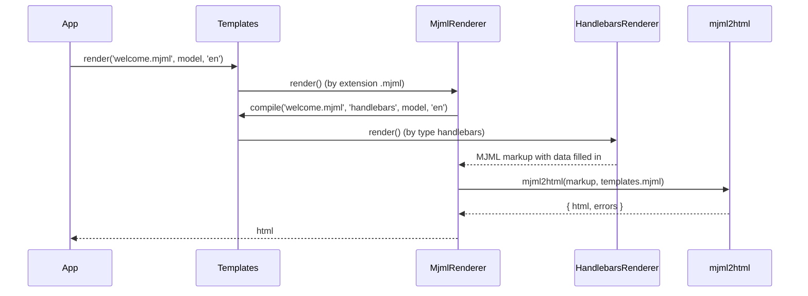

# Rendering MJML templates

`MjmlRenderer` turns a `.mjml` file plus a model into one HTML document. Use it for transactional mail: MJML handles the table layout and inlined CSS that mail clients need, and Handlebars fills in the data.

## How it works

1. You call `Templates.render(template, model, language?, options?)` or `Templates.renderToFile(...)`. `template` is a local path (absolute, or relative to `process.cwd()`) or an `fs://<provider>/<path>` URI.
2. `Templates` takes `extname(template)`, finds the first registered `TemplateRenderer` whose `Extension` is `.mjml`, and wraps the call in a `template.render` perf span. No match throws `InvalidOperation: No renderer for file ...`.
3. `MjmlRenderer.render()` asks `Templates.compile(template, 'handlebars', model, language)` for the Handlebars pass. That runs `HandlebarsRenderer.render()` on the `.mjml` file inside a nested `template.compile` span:
   - the source is read with `resolveContent()` (local disk, or `@spinajs/fs` for `fs://`);
   - the compiled Handlebars delegate is cached per path by `templates.cache.mode`;
   - the delegate gets the model merged with `lang` (the resolved language). No `'handlebars'` renderer throws `InvalidOperation: No renderer for handlebars`.
4. `MjmlRenderer` passes the Handlebars output and the `templates.mjml` options to `mjml2html()`.
5. Every MJML validation error is logged as a `warn` on the `renderer` logger (`MJML error: ...`). The flow does not stop on them unless `validationLevel` is `'strict'`, which makes `mjml2html()` throw `ValidationError`.
6. `render()` returns `result.html`. `renderToFile()` creates the parent folder of `filePath` with `ensureParentDir()` and writes the HTML with `fs.writeFileSync()`.



## Configuration

`templates.mjml` is the `MJMLParsingOptions` object (from `mjml-core`) handed to `mjml2html()` as is. The package ships no defaults; an unset key means MJML's own defaults. It is read on every render, so a config change applies to the next render.

| Key | Type | Default | Allowed values | Meaning |
| --- | --- | --- | --- | --- |
| `templates.mjml` | `MJMLParsingOptions` | not set | object | All MJML compiler options; the rows below are the common ones. |
| `templates.mjml.validationLevel` | `string` | `'soft'` | `'soft'`, `'strict'`, `'skip'` | `soft`: render and log errors. `strict`: throw `ValidationError`. `skip`: no validation. |
| `templates.mjml.minify` | `boolean` | `false` | `true`, `false` | Minify the HTML with htmlnano. Wins over `beautify`. |
| `templates.mjml.minifyOptions` | `MJMLMinifyOptions` | `{}` | htmlnano options | Used when `minify` is `true`. |
| `templates.mjml.beautify` | `boolean` | `false` | `true`, `false` | Pretty-print the HTML. |
| `templates.mjml.keepComments` | `boolean` | `true` | `true`, `false` | Keep HTML comments in the output. |
| `templates.mjml.fonts` | `Record<string, string>` | five Google fonts (Open Sans, Droid Sans, Lato, Roboto, Ubuntu) | font name to CSS URL | Fonts imported when the template uses them. |
| `templates.mjml.filePath` | `string` | `'.'` (current directory) | an existing file or folder | Base for relative `mj-include` paths. Shared by every template. |
| `templates.mjml.ignoreIncludes` | `boolean` | `false` | `true`, `false` | Skip `mj-include` elements. |
| `templates.mjml.preprocessors` | `((xml: string) => string)[]` | none | functions | Run on the markup before MJML parses it. |
| `templates.mjml.skeleton` | `string \| (() => string)` | MJML's skeleton | module path or function | Replaces the HTML skeleton around the body. |
| `templates.mjml.mjmlConfigPath` | `string` | not set | path to a `.mjmlconfig` file or its folder | Loads custom MJML components from `.mjmlconfig` on every call. |
| `templates.mjml.useMjmlConfigOptions` | `boolean` | `false` | `true`, `false` | Also take compiler options from `.mjmlconfig`; `templates.mjml` keys win. |
| `templates.mjml.printerSupport` | `boolean` | `false` | `true`, `false` | Add print media queries; may hurt mail client support. |
| `templates.cache.mode` | `string` | `'always'` in development, `'cache'` otherwise | `'cache'`, `'revalidate'`, `'always'` | Cache of the **Handlebars** delegate. The MJML compile is never cached. See [`@spinajs/templates`](../templates/README.md). |

```ts
// config/templates.ts in your app
export default {
  templates: {
    cache: { mode: 'revalidate' },
    mjml: {
      validationLevel: 'strict',
      minify: true,
      keepComments: false,
      filePath: './templates/mail',
      fonts: { Inter: 'https://fonts.googleapis.com/css2?family=Inter:wght@400;600' },
    },
  },
};
```

## Services and extension points

| Service | DI token and lifetime | Default implementation | Alternatives | How to replace or extend |
| --- | --- | --- | --- | --- |
| MJML renderer | `TemplateRenderer` list element, singleton | `MjmlRenderer` | your subclass | See [Replacing or extending `MjmlRenderer`](02-mjml-renderer-extension.md). |
| Handlebars pre-pass | `TemplateRenderer` with `Type` `'handlebars'` | `HandlebarsRenderer` | any renderer with that `Type` | See [The Handlebars pre-pass](02-mjml-renderer-extension.md#the-handlebars-pre-pass). |

## Important behaviour

- **Handlebars runs first, MJML second.** `{{...}}` expressions are resolved before MJML sees the markup, so a value can produce MJML tags only through triple braces (`{{{block}}}`).
- **Included files skip Handlebars.** MJML reads `mj-include` files after the Handlebars pass, so `{{name}}` inside an included file reaches the output literally. Put data-bound parts in the main template.
- **`mj-include` paths do not follow the template.** Relative include paths resolve against `templates.mjml.filePath` (default: the current directory), the same base for every template. An `fs://` template still reads includes from local disk.
- **Soft validation never fails a render.** With the default `'soft'` level, broken markup is logged as `warn` and the HTML is returned. Use `'strict'` in CI to catch it.
- **Errors bubble through `Templates`.** A missing file, an empty file (`IOFail: Template file ... is empty`) or a strict validation failure rejects `render()`. When you pass `options.redact`, `Templates` replaces each secret in the error message with `[redacted]`.
- **`options.onProgress` is never called.** `MjmlRenderer` ignores `IRenderOptions`; it reports no progress phases.
- **`lang` is in the model.** The Handlebars pass adds `lang` (the explicit language, else the ambient one, else the default locale) to a copy of the model; the caller's object is not changed.
- **Calling `MjmlRenderer` directly needs a resolved `Templates`.** It reaches `Templates` through `@LazyInject` on the root container. Render through `Templates`; then the facade is already resolved.

## Best practices

- Import `@spinajs/templates-handlebars` and `@spinajs/templates-mjml` once at app start, before the first `DI.resolve(Templates)`.
- Set `templates.mjml.validationLevel: 'strict'` in development and CI, and keep `'soft'` in production so a cosmetic error does not drop a mail.
- Turn on `minify` for mail: Gmail clips messages over about 100 KB.
- Use the translation helpers of `@spinajs/templates-handlebars` (`{{__ "welcome.title"}}`) and pass the recipient's language as `language`; one template then serves every locale.

## Patterns and antipatterns

```ts
// Don't: data inside an included file is never filled in
// footer.mjml: <mj-text>Unsubscribe {{email}}</mj-text>
// welcome.mjml: <mj-include path="./footer.mjml" />

// Do: keep data-bound markup in the main template, include only static parts
// welcome.mjml: <mj-include path="./brand-header.mjml" /> ... <mj-text>Unsubscribe {{email}}</mj-text>
```

```ts
// Don't: render() on the class you resolved yourself; Templates may not be resolved yet
const html = await (await DI.resolve(MjmlRenderer)).render('welcome.mjml', model);

// Do: go through the facade, which picks the renderer by extension
const html = await (await DI.resolve(Templates)).render('welcome.mjml', model);
```

## Examples

### Render an order confirmation in the customer's language

`templates/order-confirmed.mjml`:

```xml
<mjml>
  <mj-body>
    <mj-section>
      <mj-column>
        <mj-text font-size="20px">{{__ "order.confirmed"}} #{{orderNo}}</mj-text>
        {{#each items}}
        <mj-text>{{qty}} x {{name}}</mj-text>
        {{/each}}
        <mj-button href="{{trackingUrl}}">{{__ "order.track"}}</mj-button>
      </mj-column>
    </mj-section>
  </mj-body>
</mjml>
```

```ts sample
import '@spinajs/templates-handlebars';
import '@spinajs/templates-mjml';
import { DI } from '@spinajs/di';
import { Templates } from '@spinajs/templates';

interface OrderLine {
  name: string;
  qty: number;
}

export async function orderConfirmationHtml(orderNo: string, items: OrderLine[], trackingUrl: string, language: string): Promise<string> {
  const templates = await DI.resolve(Templates);

  return await templates.render('./templates/order-confirmed.mjml', { orderNo, items, trackingUrl }, language);
}
```

### Pre-render a newsletter to a file

```ts sample
import '@spinajs/templates-handlebars';
import '@spinajs/templates-mjml';
import { DI } from '@spinajs/di';
import { Templates } from '@spinajs/templates';

export async function publishNewsletter(issue: number, headline: string): Promise<string> {
  const templates = await DI.resolve(Templates);
  const target = `./public/newsletter/${issue}.html`;

  // missing folders are created
  await templates.renderToFile('fs://newsletters/issue.mjml', { issue, headline }, target, 'en');
  return target;
}
```

### Send an MJML mail through the SMTP transport

`@spinajs/email-smtp-transport` downloads `IEmail.template` and renders it with `Templates.render()`, so a `.mjml` file name selects `MjmlRenderer`.

```ts sample
import '@spinajs/templates-handlebars';
import '@spinajs/templates-mjml';
import { DI } from '@spinajs/di';
import { EmailService } from '@spinajs/email';

export async function sendPasswordChanged(to: string, firstName: string): Promise<void> {
  const emails = await DI.resolve(EmailService);

  await emails.send({
    connection: 'main',
    to: [to],
    subject: 'Your password was changed',
    template: 'password-changed.mjml',
    model: { firstName },
    lang: 'en',
  });
}
```

## Related

- [Replacing or extending `MjmlRenderer`](02-mjml-renderer-extension.md): swap the renderer or add a variant.
- [`@spinajs/templates`](../templates/README.md): `Templates`, `TemplateRenderer`, cache modes and `IRenderOptions`.
- [`@spinajs/templates-handlebars`](../templates-handlebars/README.md): helpers available in `.mjml` templates.
- [`@spinajs/email`](../email/01-sending-email.md): the `IEmail` fields `template`, `model` and `lang`.
- [`@spinajs/fs`](../fs/README.md): providers behind `fs://` URIs.
