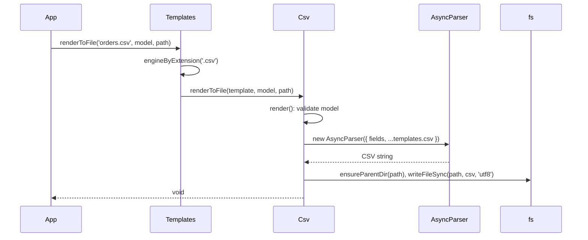

# Rendering CSV

Render a list of rows to CSV through the `Templates` service, as a string or into a file. Use it for exports, reports and data feeds where the columns are known in code.

## How it works

1. The caller calls one of the `Templates` methods from `@spinajs/templates`:
   - `render(template, model)` and `renderToFile(template, model, filePath)` pick the renderer by the template's extension (`path.extname`). Any name ending in `.csv` selects `Csv`.
   - `compile(template, 'csv', model)` and `compileToFile(template, 'csv', model, filePath)` pick the renderer by its `Type`, `csv`. The template name is then free-form.
   - No renderer for the extension or type: `InvalidOperation` (`No renderer for file ... with extension ...` or `No renderer for csv`).
2. `Templates` wraps the call in a `Perf.measure()` span, `template.render` or `template.compile`, labelled `engine: 'csv'`.
3. `Csv.render()` checks the model: `fields` must be an array and `data` must not be `null` or `undefined`. Otherwise it throws `InvalidArgument('csv render model requires { fields: string[], data }')`.
4. `Csv.render()` builds a json2csv `AsyncParser` with `{ fields: model.fields, ...templates.csv }` (see [CSV format options](02-csv-format-options.md)).
5. `parser.parse(model.data).promise()` converts the rows and resolves with the whole CSV as one string.
6. For the file variants, `Csv.renderToFile()` then:
   1. creates missing parent directories of `filePath` (`ensureParentDir`);
   2. writes the string with `fs.writeFileSync(filePath, csv, 'utf8')`, replacing an existing file;
   3. logs `trace` before and after, and `error` with the template and path when any step fails, then rethrows.



## The model: `IJsonToCsvOptions`

| Field | Type | Required | Meaning |
| --- | --- | --- | --- |
| `fields` | `string[]` | yes | Columns in output order. Each entry is a property name or a lodash path (`customer.name`, `lines[0].sku`). The entry is also the header label |
| `data` | `unknown` | yes, not `null` | The rows; see the accepted shapes below |

### Accepted `data` shapes

| Shape | Result |
| --- | --- |
| Array of objects | One row per element; `null` elements are skipped |
| A single object | One row |
| JSON text (`string`, `Buffer`, typed array) | Parsed as a JSON array or object; with `templates.csv.ndjson: true`, as newline-delimited JSON |
| `Readable` stream in object mode | One row per object, read as it arrives |
| `Readable` stream in byte mode | Parsed as JSON text, like a string |
| Anything else (number, boolean) | Rejects with json2csv's `Data should be a JSON object, JSON array, typed array, string or stream` |

Malformed JSON text rejects with `Data should be a JSON object or array`.

## Configuration

| Key | Type | Default | Allowed values | Meaning |
| --- | --- | --- | --- | --- |
| `templates.csv` | object | unset | json2csv parser options | Spread into every parser; see [CSV format options](02-csv-format-options.md) |

`templates.cache.mode` from `@spinajs/templates` has no effect: `Csv` compiles nothing and caches nothing.

## Services and extension points

| Service | DI token and lifetime | Default implementation | Alternatives | How to replace or extend |
| --- | --- | --- | --- | --- |
| CSV renderer | `TemplateRenderer` and `Csv`, singleton, registered on import | `Csv` | none shipped | See [Extending and replacing the CSV renderer](03-csv-renderer-service.md) |
| Renderer lookup | `Templates`, singleton, injects every `TemplateRenderer` | first renderer whose `Extension` or `Type` matches | none | Register renderers before `Templates` is first resolved |

## Important behaviour

- The template file is never opened. `'orders.csv'`, `'exports/2026/orders.csv'` and a name that does not exist all behave the same.
- The `language` argument and the `IRenderOptions` argument (`onProgress`) are ignored by `Csv`. `options.redact` still works: `Templates` redacts the listed secrets from any render error.
- Header labels are the `fields` entries as written, so a path field gives a header like `"customer.name"`. Rename columns by mapping the rows first.
- Strings are quoted with `"` and inner quotes are doubled; numbers and booleans are bare; `null` and `undefined` become an empty cell; nested objects are written as quoted JSON.
- Lines end with `os.EOL` unless `templates.csv.eol` is set: `\r\n` on Windows, `\n` on Linux. The output has no trailing line break.
- A row whose every cell is empty (all fields `null` or missing) is dropped unless `templates.csv.includeEmptyRows` is `true`.
- `data: []` gives the header line only.
- The whole CSV is held in memory, also for `renderToFile()` and for a stream as `data`. The file write is synchronous.
- `Csv` must be loaded at runtime. A type-only import (`import { IJsonToCsvOptions } from '@spinajs/templates-csv'`) is removed by TypeScript and registers nothing.

## Best practices

- Name templates after the export (`orders-2026-10.csv`); the name shows in logs and perf spans as `template`.
- Pass `fields` explicitly in the order your consumers expect; json2csv never guesses columns here.
- Map domain objects to flat rows keyed by the header you want, then list those keys in `fields`.
- Set `templates.csv.eol` when the file leaves the server, so the output does not depend on the host OS.

## Patterns and antipatterns

```ts
// Don't: a type-only import is erased, Csv never registers, and render throws "No renderer for file"
import { IJsonToCsvOptions } from '@spinajs/templates-csv';

// Do: load the package for its side effect, then import types as needed
import '@spinajs/templates-csv';
import { IJsonToCsvOptions } from '@spinajs/templates-csv';
```

```ts
// Don't: Csv ignores the file; a template on disk suggests a layout that is never used
await templates.renderToFile('templates/orders.csv', { fields, data }, out);

// Do: name the export, keep the columns in code
await templates.renderToFile('orders-export.csv', { fields: ['id', 'customer', 'total'], data }, out);
```

## Examples

### Write a monthly invoice export with nested fields

```ts sample
import '@spinajs/templates-csv';
import { join } from 'path';
import { DI } from '@spinajs/di';
import { Templates } from '@spinajs/templates';
import { IJsonToCsvOptions } from '@spinajs/templates-csv';

interface Invoice {
  number: string;
  issuedAt: string;
  customer: { name: string; taxId: string | null };
  total: number;
}

async function exportInvoices(month: string, invoices: Invoice[]): Promise<string> {
  const templates = await DI.resolve(Templates);
  const out = join(process.cwd(), 'exports', month, 'invoices.csv');

  const model: IJsonToCsvOptions = {
    fields: ['number', 'issuedAt', 'customer.name', 'customer.taxId', 'total'],
    data: invoices,
  };

  // Creates exports/<month>/ when missing and overwrites an older export.
  await templates.renderToFile('invoices.csv', model, out);
  return out;
}

void exportInvoices('2026-10', [
  { number: 'FV/1/2026', issuedAt: '2026-10-01', customer: { name: 'ACME', taxId: null }, total: 1230 },
]);
```

### Rename columns and select the renderer by type

```ts sample
import '@spinajs/templates-csv';
import { DI } from '@spinajs/di';
import { Templates } from '@spinajs/templates';

interface User {
  id: number;
  email: string;
  lastLogin: Date | null;
}

async function usersReport(users: User[]): Promise<string> {
  const templates = await DI.resolve(Templates);

  const rows = users.map((u) => ({
    'User ID': u.id,
    'E-mail': u.email,
    'Last login': u.lastLogin?.toISOString() ?? null,
  }));

  // compile() looks the renderer up by Type, so the name needs no extension.
  return templates.compile('users-report', 'csv', {
    fields: ['User ID', 'E-mail', 'Last login'],
    data: rows,
  });
}

void usersReport([{ id: 7, email: 'ann@example.com', lastLogin: null }]).then((csv) => console.log(csv));
// "User ID","E-mail","Last login"
// 7,"ann@example.com",
```

### Export rows produced by a stream

```ts sample
import '@spinajs/templates-csv';
import { Readable } from 'stream';
import { DI } from '@spinajs/di';
import { Templates } from '@spinajs/templates';

async function* auditEvents(): AsyncGenerator<{ at: string; actor: string; action: string }> {
  yield { at: '2026-10-17T08:00:00Z', actor: 'ann', action: 'login' };
  yield { at: '2026-10-17T08:05:00Z', actor: 'ann', action: 'export' };
}

async function exportAudit(): Promise<string> {
  const templates = await DI.resolve(Templates);

  // An object-mode stream gives one row per object; the result is still one string.
  return templates.render('audit.csv', {
    fields: ['at', 'actor', 'action'],
    data: Readable.from(auditEvents()),
  });
}

void exportAudit().then((csv) => console.log(csv));
```

## Related

- [CSV format options](02-csv-format-options.md): delimiter, line endings, BOM and formatters applied in step 4.
- [Extending and replacing the CSV renderer](03-csv-renderer-service.md): change what `Csv.render()` does.
- [`@spinajs/templates`](../templates/README.md): `Templates` methods, renderer lookup and error redaction.
