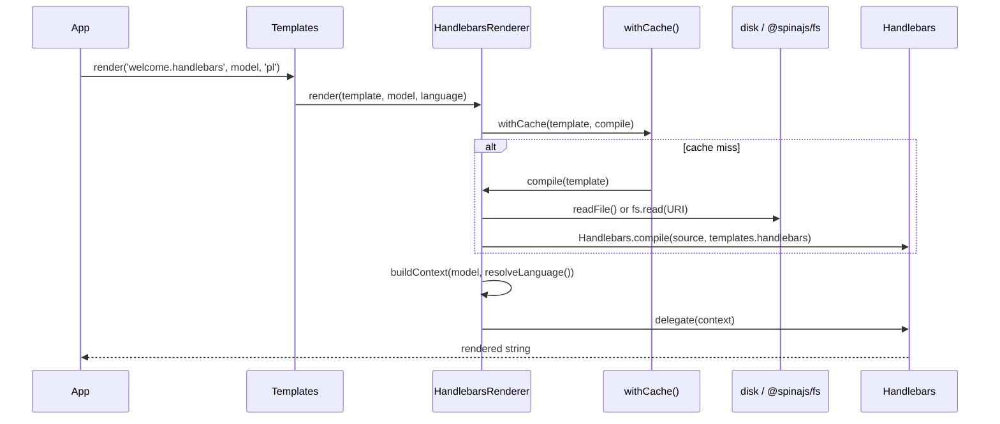

# Rendering templates

`HandlebarsRenderer` compiles `.handlebars` files with [Handlebars](https://handlebarsjs.com/) and renders them with your model. You never call it directly: import the package, then render through the `Templates` service from `@spinajs/templates`.

## How it works

1. `Templates.render(template, model, language?, options?)` takes the extension of `template` (`path.extname`) and picks the `TemplateRenderer` whose `Extension` is `.handlebars`. No match throws `InvalidOperation('No renderer for file ...')`.
   - `Templates.compile(template, 'handlebars', model, language?, options?)` picks by `Type` instead, so any file name works.
   - `renderToFile()` and `compileToFile()` do the same and write the result to a file.
2. `Templates` wraps the call in a `Perf.measure()` span: `template.render` (by extension) or `template.compile` (by type), labelled `engine: 'handlebars'`. A failure is re-thrown redacted when `options.redact` lists secrets.
3. `CompiledTemplateRenderer.render()` throws `InvalidArgument` for an empty template name, then logs a `trace` line and starts a timer on the `renderer` logger.
4. `TemplateRenderer.withCache()` returns the cached delegate for this template, or calls `HandlebarsRenderer.compile()` on a miss. See [Caching](#caching).
5. `HandlebarsRenderer.compile()` reads the source with `resolveContent()`:
   - a bare path is read from local disk with `fs/promises.readFile()`, relative to the process working directory;
   - an `fs://provider/path` URI is read through `@spinajs/fs` (`fs.read(new URI(...))`).
6. An empty source throws `IOFail('Template file <template> is empty')`. Otherwise `Handlebars.compile(content, Options)` returns the delegate, with `Options` read from `templates.handlebars`.
7. `CompiledTemplateRenderer.resolveLanguage(language)` picks the render language: the `language` argument, else `guessLanguage()` (the language in the async request store), else `defaultLanguage()` (`intl.defaultLocale`).
8. `HandlebarsRenderer.buildContext(model, language)` builds the template context: `_.merge({}, model ?? {}, { lang: language })`. The caller's model is never mutated.
9. The delegate runs with that context and returns the string. Handlebars parses the source on this first call, so a syntax error is thrown here, not in step 6.
10. `renderToFile()` creates the parent directory when missing and writes the string with `fs.writeFileSync()`.



## Template context

| Name in the template | Source | Notes |
| --- | --- | --- |
| Every model property | `model`, deep-merged into a new object | Own and inherited enumerable properties; class getters and methods of the top-level model are not copied |
| `lang` | The resolved render language | Overwrites a `lang` property of the model; the translation helpers read it as `@root.lang` |
| `@root`, `@index`, `@key`, `@first`, `@last` | Handlebars data variables | Standard Handlebars |

```handlebars
<p>{{__ "Order"}} #{{order.number}}, {{formatDate order.placedAt "dd.MM.yyyy"}}</p>
{{#each order.lines}}
  <tr class="{{#if (isOdd @index)}}odd{{/if}}">
    <td>{{name}}</td><td>{{currency price "EUR" @root.lang}}</td>
  </tr>
{{/each}}
```

## Configuration

| Key | Type | Default | Allowed values | Meaning |
| --- | --- | --- | --- | --- |
| `templates.handlebars` | Handlebars `CompileOptions` | unset | `data`, `compat`, `knownHelpers`, `knownHelpersOnly`, `noEscape`, `strict`, `assumeObjects`, `preventIndent`, `ignoreStandalone`, `explicitPartialContext` | Passed as the second argument of `Handlebars.compile()` for every template this renderer compiles |
| `templates.cache.mode` | `'cache' \| 'revalidate' \| 'always'` | unset: `always` when `configuration.isDevelopment` is `true`, else `cache` | `cache`, `revalidate`, `always` | How compiled delegates are reused; see [Caching](#caching) |
| `configuration.isDevelopment` | `boolean` | `false` | `true`, `false` | Picks the cache mode when `templates.cache.mode` is unset |
| `intl.defaultLocale` | `string` | set by `@spinajs/intl` | any loaded locale | Render language when neither the argument nor the request store gives one |

```ts
// config/templates.ts in your app
export default {
  templates: {
    handlebars: {
      strict: true, // a missing property throws instead of rendering ""
      preventIndent: true,
    },
    cache: {
      mode: 'revalidate',
    },
  },
};
```

Runtime options such as `allowProtoPropertiesByDefault` are **not** compile options; the config key cannot set them. Pass them from a subclass, see [Customizing the renderer](04-customizing-the-renderer.md#compile-pre-process-sources-or-pass-runtime-options).

## Caching

The cache lives in `TemplateRenderer` and is keyed by the normalized path or the untouched `fs://` URI.

| Mode | On every render | Picks up an edited template |
| --- | --- | --- |
| `cache` | Returns the cached delegate; compiles once per template | Never, until the process restarts |
| `revalidate` | Stats the source; recompiles when the change token differs. Local files: `mtime` and size. `fs://`: the provider's `Version`, else modified time and size | On the next render |
| `always` | Recompiles; nothing is cached | On the next render |

A failed stat in `revalidate` mode logs a warning and serves the cached delegate when there is one.

## Services and extension points

| Service | DI token and lifetime | Default implementation | Alternatives | How to replace or extend |
| --- | --- | --- | --- | --- |
| Handlebars engine | `TemplateRenderer` (list element) and `HandlebarsRenderer`; singleton | `HandlebarsRenderer` | `PugRenderer` (`@spinajs/templates-pug`), `MjmlRenderer` (`@spinajs/template-mjml`) and other engines for other extensions | Subclass and swap it, see [Customizing the renderer](04-customizing-the-renderer.md) |
| Helpers and partials | The default `handlebars` module environment | 95 helpers, no partials | Your helpers and partials | `Handlebars.registerHelper()` / `registerPartial()`, see [Custom helpers and partials](03-custom-helpers-and-partials.md) |
| Template source | `@spinajs/fs` provider named in the `fs://` URI | Local disk for bare paths | Any `fs` provider (`fs-s3`, `fs-ftp`, ...) | Configure a provider in `fs.providers`; see [Providers and configuration](../fs/01-providers-and-configuration.md) |
| Render language | `AsyncLocalStorage` store read by `guessLanguage()` | `intl.defaultLocale` | Your language source | Run the render inside `store.run({ language }, ...)`; see [Request language](../intl/04-request-language.md) |

## Important behaviour

- **The context is a deep copy of plain data.** Plain objects and arrays are copied; `Date`, luxon `DateTime` and other class instances inside the model are kept by reference.
- **Getters and methods on class instances do not render.** Handlebars 4.6+ denies access to properties that are not own properties: `{{user.fullName}}` on a class getter renders `""` and logs a warning to the console. Pass plain data (`model.toJSON()`).
- **`lang` is reserved.** A model property `lang` is replaced by the render language.
- **Syntax errors appear at render time** and the broken delegate is cached. In `cache` mode every render of that template throws until restart, even after the file is fixed.
- **Bare relative paths resolve against `process.cwd()`**, not against `system.dirs.templates`. Use absolute paths or `fs://` URIs.
- **A missing local file throws Node's `ENOENT` error** from `readFile()`; it is not wrapped.
- **`templates.handlebars` is read at compile time.** A changed value applies only to templates compiled afterwards.
- **`IRenderOptions.onProgress` is ignored.** Text engines report no progress; `redact` is applied by `Templates`.
- **`noEscape: true` disables HTML escaping for every template** of this renderer, user input included.
- **The translation helpers need `Intl` resolved.** `Templates` injects `Intl`, so rendering through it works. Resolving `HandlebarsRenderer` alone and calling `render()` before `Intl` exists makes `{{__ ...}}` throw a `TypeError`.

## Best practices

- Render through `Templates.render()` and let the extension pick the engine; use `Templates.compile(path, 'handlebars', ...)` only for files with another extension.
- Set `templates.cache.mode: 'revalidate'` when templates live in an `fs` provider that editors change at runtime.
- Turn on `templates.handlebars.strict` in test configuration to catch misspelled model properties.
- Pass the language explicitly for background jobs; outside a request there is no store for `guessLanguage()` to read.
- Pass `options.redact` when the model carries a token, so a failed render does not leak it to logs and spans.

## Patterns and antipatterns

```ts
// Don't: an ORM model's getters and relations are prototype properties; Handlebars renders them as ""
await templates.render(path, { user });

// Do: hand the template plain data
await templates.render(path, { user: user.toJSON() });
```

```handlebars
{{!-- Don't: triple braces skip escaping, a user-supplied name can inject markup --}}
<p>{{{user.displayName}}}</p>

{{!-- Do: double braces escape; use triple braces only for HTML you produced --}}
<p>{{user.displayName}}</p>
```

## Examples

### Send a password reset mail in the user's language

```ts sample
import '@spinajs/templates-handlebars';
import { join } from 'path';
import { DI } from '@spinajs/di';
import { Templates } from '@spinajs/templates';

interface ResetMailModel {
  name: string;
  link: string;
  expiresAt: string;
}

async function renderResetMail(model: ResetMailModel, language: string, token: string): Promise<string> {
  const templates = await DI.resolve(Templates);

  // reset-password.handlebars:
  //   <p>{{__ "Hello"}} {{capitalize name}},</p>
  //   <a href="{{link}}">{{__ "Reset password"}}</a>
  //   <p>{{__ "Link valid until"}} {{formatDate expiresAt "dd.MM.yyyy HH:mm"}}</p>
  return await templates.render(join(process.cwd(), 'templates', 'reset-password.handlebars'), model, language, {
    redact: [token],
  });
}

void renderResetMail({ name: 'anna', link: 'https://example.com/reset?t=abc', expiresAt: '2026-10-18T12:00:00Z' }, 'pl', 'abc');
```

### Render editable templates from S3 and pick up changes

With `templates.cache.mode: 'revalidate'` and an `fs` provider named `mail-templates`, an edited template is recompiled on the next render.

```ts sample
import '@spinajs/templates-handlebars';
import { DI } from '@spinajs/di';
import { Templates } from '@spinajs/templates';

async function renderInvoiceMail(invoiceNumber: string, total: number) {
  const templates = await DI.resolve(Templates);
  return await templates.render('fs://mail-templates/invoice.handlebars', { invoiceNumber, total }, 'en');
}

void renderInvoiceMail('FV/2026/10/42', 1299.5);
```

### Render a plain-text mail body from a `.txt` file

`.txt` has no renderer of its own, so pick the engine by type.

```ts sample
import '@spinajs/templates-handlebars';
import { join } from 'path';
import { DI } from '@spinajs/di';
import { Templates } from '@spinajs/templates';

async function renderTextBody(name: string) {
  const templates = await DI.resolve(Templates);
  return await templates.compile(join(process.cwd(), 'templates', 'welcome.txt'), 'handlebars', { name }, 'en');
}

void renderTextBody('Anna');
```

### Write a static report page to disk

```ts sample
import '@spinajs/templates-handlebars';
import { join } from 'path';
import { DI } from '@spinajs/di';
import { Templates } from '@spinajs/templates';

async function writeMonthlyReport(rows: { day: string; orders: number }[]) {
  const templates = await DI.resolve(Templates);
  const out = join(process.cwd(), 'public', 'reports', '2026-10.html');

  // Creates public/reports when it does not exist.
  await templates.renderToFile(join(process.cwd(), 'templates', 'report.handlebars'), { rows }, out, 'en');
}

void writeMonthlyReport([{ day: '2026-10-01', orders: 12 }]);
```

## Related

- [Built-in helpers](02-built-in-helpers.md): what the templates above can call.
- [Customizing the renderer](04-customizing-the-renderer.md): change the context, the compile step or the extension.
- [Request language](../intl/04-request-language.md): how `guessLanguage()` finds the language of the current request.
- [Providers and configuration](../fs/01-providers-and-configuration.md): configure the provider an `fs://` URI names.
- [Performance measurement](../log/15-performance-measurement.md): the `template.render` and `template.compile` spans.
- [Secret redaction](../email/07-secret-redaction.md): the same `redact` rules for mail.
