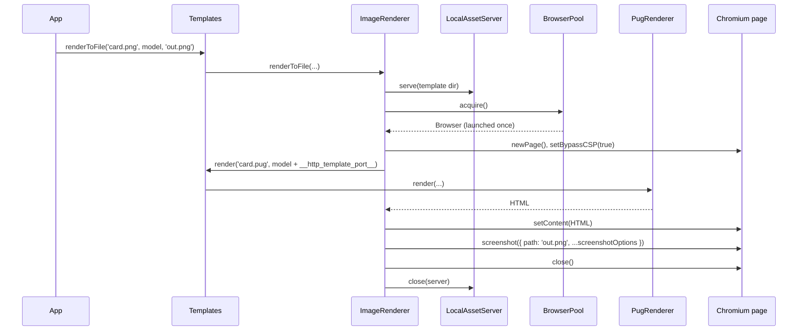

# Image renderer

`ImageRenderer` renders a Pug template or a raw HTML string to an image file with a Chromium screenshot. Use it for social cards, receipts as images, chart snapshots and CI screenshots.

Two ways in:

- Through the `Templates` facade: `templates.renderToFile('card.png', model, 'out.png')`. The `.png` extension selects the renderer.
- Through a renderer you resolve with screenshot options: `DI.resolve(ImageRenderer, [{ type: 'jpeg', quality: 80 }])`. Use it for JPEG, WebP, full-page captures, clipping and raw HTML.

## How it works

### Rendering a template to a file

1. `Templates.renderToFile(template, model, filePath, language?, options?)` takes `extname(template)` and picks the first registered `TemplateRenderer` whose `Extension` equals it. For the `ImageRenderer` that `Templates` holds, `Extension` is `.png`. No match throws `InvalidOperation('No renderer for file ... with extension ...')`.
2. `Templates` wraps the call in `Perf.measure('template.render')` with the label `engine: 'image'`. When `options.redact` is set, a failure is rethrown with those values replaced by `[redacted]`.
3. `ImageRenderer.renderToFile()` (inherited from `PuppeteerRenderer`) builds the Pug source path: the template's directory, plus its file name without `Extension`, plus `.pug`. `templates/card.png` becomes `templates/card.pug`.
4. `PuppeteerRenderer.renderContentToFile()` runs the shared render:
   1. reports the `starting` phase to `options.onProgress`;
   2. `LocalAssetServer.serve()` starts an Express static server on `127.0.0.1` for the template's directory, on a port from `templates.image.static.portRange`;
   3. `BrowserPool.acquire()` returns the renderer's Chromium, launching it on first use with `templates.image.args` and `executablePath`;
   4. `browser.newPage()` opens a fresh page; timeouts and the render watchdog are armed unless `debug.close` is `false`;
   5. page `console`, `pageerror`, `response` and `requestfailed` events are logged to the `puppeteer-templates` logger.
5. In the `preparing` phase the page gets `setBypassCSP(true)`, then `Templates.render()` compiles the `.pug` file with `language` and the model plus two extra keys: `__http_template_port__` and `__http_template_address__` (`http://localhost:<port>`).
6. In the `loading` phase `page.setContent()` loads the HTML and its images, styles and fonts.
7. In the `rendering` phase `ImageRenderer.performRender()` calls `page.screenshot({ path: filePath, ...screenshotOptions })`.
8. The `done` phase is reported. In all cases the page and the asset server are closed; the browser stays in the pool. A render slower than `renderDurationWarning` logs a warning.

Any error in steps 4 to 7 reports the `failed` phase with the error message, is logged and is rethrown.



### Rendering raw HTML to a file

`renderHtmlToFile(html, filePath, options?)` skips the Pug step. It runs the same steps 4 and 6 to 8, with these differences:

- The asset server serves `options.assetBasePath`, or the output file's directory when it is not set.
- `options.viewport` (`{ width, height, deviceScaleFactor? }`) is applied with `page.setViewport()` before the content loads.
- A `<base href="http://127.0.0.1:<port>/">` is inserted into `<head>` so relative URLs (`logo.svg`, `css/card.css`) load from the asset server. HTML that already has a `<base>` tag is left as it is.

`Templates` has no method for raw HTML; resolve the renderer to call it.

## Configuration

The renderer reads `templates.image` on every render. See [Configuration](02-configuration.md) for every key.

## Services and extension points

| Service | DI token and lifetime | Default implementation | Alternatives | How to replace or extend |
| --- | --- | --- | --- | --- |
| `ImageRenderer` as a template engine | `TemplateRenderer` list (`@Injectable(TemplateRenderer)`), `@PerInstanceCheck()`; `Templates` injects the list with `@Autoinject(TemplateRenderer)` when it is first resolved | `ImageRenderer`, `Type` `image`, `Extension` `.png` | `PdfRenderer` (`@spinajs/templates-pdf`, `.pdf`), `PugRenderer` (`.pug`), your own renderers | Add a renderer for another extension, or unregister `ImageRenderer` and register a subclass. See [Custom image renderers](04-custom-image-renderers.md) |
| `ImageRenderer` by class | `ImageRenderer` (registered as self by `@Injectable`), `@PerInstanceCheck()`; `DI.resolve(ImageRenderer, [screenshotOptions])` returns a `Promise` | `ImageRenderer` | none shipped | `DI.register(MySubclass).as(ImageRenderer)`. The `render-image` command resolves this token |
| Screenshot options | Constructor argument `screenshotOptions: ScreenshotOptions` (Puppeteer type), the first element of the `resolve()` options | `undefined` in the `Templates` instance | Any `ScreenshotOptions`: `type`, `quality`, `fullPage`, `clip`, `omitBackground` | Pass them to `DI.resolve()`, or fix them in a subclass constructor |
| Browser and asset server | `BrowserPool` and `LocalAssetServer` from `@spinajs/templates-puppeteer`, created lazily per renderer instance; not in DI | One Chromium per renderer instance | none | Override the protected `browserPool` or `assetServer` getters in a subclass |
| Template compilation | `Templates` (`@LazyInject()` on `TemplatingService`), which selects the `.pug` renderer | `PugRenderer` from `@spinajs/templates-pug` | none | Replace the `.pug` renderer in `@spinajs/templates-pug` |

### `ImageRenderer` members

| Member | Effect |
| --- | --- |
| `Type` | `'image'`. Used by `Templates.compileToFile(template, 'image', ...)`. |
| `Extension` | `.<screenshotOptions.type>`, or `.png` when no type is set. Used to pick the renderer by file extension and to strip the extension before adding `.pug`. |
| `ServiceName` | Same as `Extension` (from `TemplateRenderer`); the key when the renderers are injected as a map. |
| `renderToFile(template, model, filePath, language?, options?)` | Compiles `<template without Extension>.pug` and screenshots it to `filePath`. `options.onProgress` receives progress. |
| `renderHtmlToFile(html, filePath, options?)` | Screenshots raw HTML. `options`: `assetBasePath`, `viewport`, `onProgress`. |
| `render()` | Throws `NotSupported('cannot render puppeteer template to string')`. |
| `dispose()` | Closes the pooled browser, then runs `AsyncService.dispose()`. `DI.dispose()` calls it. |

## Important behaviour

- **Only `.png` goes through `Templates`.** The instance `Templates` holds is built without screenshot options, so its `Extension` is `.png`. `templates.renderToFile('card.jpeg', ...)` throws `InvalidOperation`. Resolve a JPEG renderer for JPEG.
- **The image format follows the output path.** The `Templates` instance passes no `type` to `page.screenshot()`, so Puppeteer derives the format from the extension of `filePath`.
- **The source is always `.pug`.** `card.png` reads `card.pug`; `card` (no extension) also reads `card.pug`. A path whose extension differs from the renderer's `Extension` keeps it: a JPEG renderer given `card.png` reads `card.png.pug`.
- **`render()` and `Templates.render()` throw** for `.png`: there is no string output.
- **One Chromium per renderer instance.** It launches on the first render, relaunches when it crashes or disconnects, and closes only on `dispose()`. Concurrent renders share it; each gets its own page and its own asset server.
- **Dispose in one-shot scripts.** Until `dispose()` or `DI.dispose()` runs, the browser keeps the Node process alive.
- **Each `DI.resolve(ImageRenderer, [options])` builds a new instance**, with its own browser, even for equal options: `__checkInstance__` compares the stored options with the whole `resolve()` options array, so it never matches. Keep the resolved renderer and reuse it, or override `__checkInstance__` ([Custom image renderers](04-custom-image-renderers.md#reuse-one-renderer-per-option-set)).
- **Everything in the served directory is reachable** from the page while it renders. The server listens on `127.0.0.1` only and closes after each render. Keep secrets out of template and asset directories.
- **CSP is bypassed** on every page (`setBypassCSP(true)`), so inline scripts and styles in templates run.
- **`__http_template_address__` uses `localhost`** while the server binds `127.0.0.1`. Where `localhost` resolves to `::1` first, those URLs fail. Build URLs from `__http_template_port__` instead.
- **Timeouts close the page, not the browser.** When `renderTimeout` passes, the watchdog closes the page and the pending Puppeteer call rejects. Other renders on the same browser continue.
- **Progress callbacks are fire-and-forget.** `onProgress` is never awaited and its errors are swallowed. Phases: `starting`, `preparing`, `loading`, `rendering`, `done` or `failed`. See [`@spinajs/templates-puppeteer`](../templates-puppeteer/README.md) for the counters and the `__spinajs_progress__:` console protocol.

## Best practices

- Reference assets in templates with relative URLs plus `__http_template_port__`: `img(src=`http://127.0.0.1:${__http_template_port__}/logo.png`)`.
- Pass `viewport` to `renderHtmlToFile()` for captures you compare across runs; the default viewport is Puppeteer's.
- Resolve one renderer per output format at startup and keep it; each instance owns a Chromium process.
- Wait for web fonts before the screenshot when a template uses `@font-face`: override `performRender()` ([Custom image renderers](04-custom-image-renderers.md)).
- Set `options.redact` on `Templates.renderToFile()` when the model carries tokens or personal data that can appear in a compile error.

## Patterns and antipatterns

```ts
// Don't: `new` skips DI, and `card.pug` with Extension `.png` reads `card.pug.pug`
const renderer = new ImageRenderer({ type: 'png' });
await renderer.renderToFile('templates/card.pug', model, 'out/card.png');

// Do: resolve through DI and name the template by the renderer's extension
const renderer = await DI.resolve(ImageRenderer, [{ type: 'png' }]);
await renderer.renderToFile('templates/card.png', model, 'out/card.png');
```

```ts
// Don't: a new renderer, and a new Chromium, for every request
app.get('/cards/:id', async (req) => {
  const renderer = await DI.resolve(ImageRenderer, [{ type: 'jpeg', quality: 80 }]);
  await renderer.renderToFile('templates/card.jpeg', await loadCard(req.params.id), `out/${req.params.id}.jpeg`);
});

// Do: resolve once, reuse the pooled browser
const jpegRenderer = await DI.resolve(ImageRenderer, [{ type: 'jpeg', quality: 80 }]);
```

## Examples

### Generate an Open Graph image for a blog post

```ts sample
import { DI } from '@spinajs/di';
import { Configuration } from '@spinajs/configuration';
import { RenderPhase, Templates } from '@spinajs/templates';
import '@spinajs/templates-image';

interface BlogPost {
  slug: string;
  title: string;
  author: string;
}

async function renderOgImage(post: BlogPost): Promise<string> {
  await DI.resolve(Configuration);
  const templates = await DI.resolve(Templates);
  const output = `public/og/${post.slug}.png`;

  // Compiles templates/og/post.pug and screenshots it; `en` selects the translation file.
  await templates.renderToFile('templates/og/post.png', { title: post.title, author: post.author }, output, 'en', {
    onProgress: (p) => {
      if (p.phase === RenderPhase.Failed) {
        console.error(`OG image for ${post.slug} failed: ${p.message ?? ''}`);
      }
    },
  });

  return output;
}

void renderOgImage({ slug: 'hello-world', title: 'Hello, world', author: 'Anna' });
```

### Render a JPEG receipt from HTML you already have

```ts sample
import { DI } from '@spinajs/di';
import { Configuration } from '@spinajs/configuration';
import { ImageRenderer } from '@spinajs/templates-image';

async function receiptToJpeg(receiptHtml: string, orderId: string): Promise<void> {
  await DI.resolve(Configuration);
  const renderer = await DI.resolve(ImageRenderer, [{ type: 'jpeg', quality: 85, fullPage: true }]);

  try {
    await renderer.renderHtmlToFile(receiptHtml, `receipts/${orderId}.jpeg`, {
      // `` in the HTML loads from this directory
      assetBasePath: 'assets/receipts',
      viewport: { width: 600, height: 800, deviceScaleFactor: 2 },
    });
  } finally {
    await renderer.dispose();
  }
}

void receiptToJpeg('<html><body><h1>Order 1042</h1></body></html>', '1042');
```

### Capture one region of a dashboard

```ts sample
import { DI } from '@spinajs/di';
import { ImageRenderer } from '@spinajs/templates-image';

/** Resolved once at startup; the clip applies to every render of this instance. */
let chartRenderer: ImageRenderer | undefined;

async function chartSnapshot(dashboardHtml: string, file: string): Promise<void> {
  chartRenderer ??= await DI.resolve(ImageRenderer, [{ type: 'png', clip: { x: 0, y: 120, width: 960, height: 400 }, omitBackground: true }]);

  await chartRenderer.renderHtmlToFile(dashboardHtml, file, { viewport: { width: 960, height: 720 } });
}

void chartSnapshot('<html><body><div id="chart"></div></body></html>', 'reports/weekly-chart.png');
```

## Related

- [Configuration](02-configuration.md): the `templates.image` keys the renderer reads.
- [Custom image renderers](04-custom-image-renderers.md): subclass, replace or add renderers.
- [`@spinajs/templates`](../templates/README.md): `Templates`, `TemplateRenderer`, `IRenderOptions` and progress types.
- [`@spinajs/templates-puppeteer`](../templates-puppeteer/README.md): the base class, browser pool and asset server.
- [Lifetimes](../di/04-lifetimes.md): how `@PerInstanceCheck()` picks an instance.
