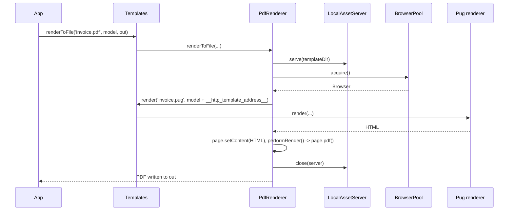

# Rendering PDFs

`PdfRenderer` prints a page in headless Chromium to a PDF file. Feed it a Pug template (template mode) or a ready HTML string (HTML mode).

| Entry point | Input | PDF options | Use it when |
| --- | --- | --- | --- |
| `Templates.renderToFile(template, model, filePath, language?, options?)` | A path ending in `.pdf`; the sibling `.pug` file is compiled | none: Puppeteer defaults | The app already renders other formats through `Templates` |
| `Templates.compileToFile(template, 'pdf', model, filePath, language?, options?)` | Same, engine picked by its `Type` | none: Puppeteer defaults | The template path does not end in `.pdf` |
| `PdfRenderer.renderToFile(template, model, filePath, language?, options?)` | Same as `Templates.renderToFile()` | The `PDFOptions` the renderer was resolved with | You need a paper format, margins, header or footer |
| `PdfRenderer.renderHtmlToFile(html, filePath, options?)` | An HTML string | The `PDFOptions` the renderer was resolved with | The HTML comes from another engine, a CMS or a test fixture |

## How it works

Template mode, started by `Templates.renderToFile('templates/invoice.pdf', model, 'out/invoice.pdf')`:

1. `Templates.renderToFile()` picks the renderer whose `Extension` is `.pdf` (`PdfRenderer`). No such renderer throws `InvalidOperation`. The call runs inside a `Perf.measure('template.render')` span labelled `engine: 'pdf'`.
2. `PuppeteerRenderer.renderToFile()` takes the template's directory as the asset base and calls `renderContentToFile()`.
3. Phase `starting`: `LocalAssetServer.serve()` starts an Express static server for the asset base on `127.0.0.1`, on a random port from `templates.pdf.static.portRange`.
4. `BrowserPool.acquire()` returns the pooled Chromium, launching it on first use; `browser.newPage()` opens a fresh page.
5. `armRenderWatchdog()` and `configurePageTimeouts()` arm the timeouts; `addPageEventListeners()` logs the page's console, errors and responses.
6. Phase `preparing`: `page.setBypassCSP(true)`, then `Templates.render()` compiles `templates/invoice.pug` with the model plus `__http_template_port__` and `__http_template_address__`.
7. Phase `loading`: `page.setContent()` loads the compiled HTML and its resources.
8. Phase `rendering`: `PdfRenderer.performRender()` calls `page.pdf({ path: filePath, ...pdfOptions })`.
9. Phase `done`. The page and the asset server close; the browser stays open for the next render.

An error in steps 3 to 8 is logged, reported as phase `failed` and rethrown. HTML mode (`renderHtmlToFile()`) runs the same steps, but step 6 sets the viewport (when given) and inserts `<base href="http://127.0.0.1:<port>/">` into the HTML instead of compiling a template.



## Configuration

The renderer reads `templates.pdf`; see [Renderer configuration](02-renderer-configuration.md). Template lookup and the compiled-template cache (`templates.cache.mode`) belong to [`@spinajs/templates`](../templates/README.md).

## Services and extension points

| Service | DI token and lifetime | Default implementation | Alternatives | How to replace or extend |
| --- | --- | --- | --- | --- |
| `PdfRenderer` | `TemplateRenderer` (list) and `PdfRenderer` (self), `@PerInstanceCheck` | `PdfRenderer` | `ImageRenderer` (`@spinajs/templates-image`) for screenshots | [Customizing the PDF renderer](06-customizing-the-pdf-renderer.md) |
| `Templates` | `Templates`, singleton, injected lazily into the renderer | `Templates` | none | Compiles the `.pug` source; see [`@spinajs/templates`](../templates/README.md) |
| Template engine for the source | `TemplateRenderer` with extension `.pug` | Pug (`@spinajs/templates-pug`) | none in template mode | Use `renderHtmlToFile()` with HTML from any other engine |

## Important behaviour

- The template path names the **output** format: `invoice.pdf` compiles `invoice.pug` from the same directory. The `.pug` extension is hard-coded, so `Templates.compileToFile('invoice.pug', 'pdf', ...)` looks for `invoice.pug.pug`.
- Template mode compiles only Pug. For Handlebars, MJML or any other engine, compile with `Templates.render()` and pass the HTML to `renderHtmlToFile()`.
- Through `Templates`, `PdfRenderer` has no `PDFOptions`, so Puppeteer defaults apply: Letter paper, no background colours or images. Resolve the renderer with options when the layout needs A4 or backgrounds; see [Renderer instances and PDF options](03-renderer-instances-and-pdf-options.md).
- Template mode loads the HTML into `about:blank` without a `<base>`: relative URLs do not resolve. Reference assets with `#{__http_template_address__}/logo.png`.
- HTML mode adds a `<base href>` unless the HTML already declares `<base ...>`. The asset base defaults to the output file's directory.
- The asset server serves the whole asset directory to the page, with CORS enabled, on loopback only. Keep templates and their assets in a directory that holds nothing else.
- The page's Content-Security-Policy is bypassed (`page.setBypassCSP(true)`).
- `render()` throws `NotSupported`, so `Templates.render('x.pdf', ...)` and `Templates.compile(..., 'pdf', ...)` reject.
- `PdfRenderer` does not create the output directory; the `render-pdf` command does.
- `IRenderOptions.redact` is applied by `Templates` only. A direct `PdfRenderer` call rethrows errors unredacted.
- Renders share one Chromium per renderer instance, each in its own page, so concurrent renders run in parallel.

## Best practices

- Keep one directory per document type (`templates/invoice/invoice.pug`, `logo.png`, `invoice.css`): it is both the template lookup and the asset base.
- Set `printBackground: true` whenever the template uses coloured tables or a background logo; Chromium drops them otherwise.
- Call `DI.dispose()` (or the renderer's `dispose()`) in scripts, workers and tests: the pooled Chromium keeps the process alive.

## Patterns and antipatterns

```ts
// Don't: relative URLs do not resolve in template mode, the logo is missing from the PDF
img(src='logo.png')

// Do
img(src=`${__http_template_address__}/logo.png`)
```

```ts
// Don't: a .pug path with the 'pdf' engine resolves to invoice.pug.pug
await templates.compileToFile('templates/invoice.pug', 'pdf', model, 'out/invoice.pdf');

// Do: name the output format, or pass the path without an extension
await templates.compileToFile('templates/invoice.pdf', 'pdf', model, 'out/invoice.pdf');
```

## Examples

### Print an A4 invoice with backgrounds

```ts sample
import { DI } from '@spinajs/di';
import { Configuration } from '@spinajs/configuration';
import { PdfRenderer } from '@spinajs/templates-pdf';

interface InvoiceModel {
  number: string;
  customer: string;
  lines: { name: string; qty: number; price: number }[];
}

export async function printInvoice(invoice: InvoiceModel, language: string): Promise<string> {
  await DI.resolve(Configuration);

  const renderer = await DI.resolve(PdfRenderer, [{ format: 'A4', printBackground: true, margin: { top: '20mm', bottom: '20mm' } }]);
  const output = `./storage/invoices/${invoice.number.replace(/\//g, '-')}.pdf`;

  try {
    // compiles ./templates/invoice/invoice.pug
    await renderer.renderToFile('./templates/invoice/invoice.pdf', invoice, output, language);
  } finally {
    await renderer.dispose();
  }

  return output;
}
```

### Print HTML produced by another engine

```ts sample
import { DI } from '@spinajs/di';
import { Templates } from '@spinajs/templates';
import { PdfRenderer } from '@spinajs/templates-pdf';
import '@spinajs/templates-handlebars';

export async function printReport(month: string, rows: { region: string; revenue: number }[]): Promise<void> {
  const templates = await DI.resolve(Templates);
  const html = await templates.render('./templates/reports/monthly.handlebars', { month, rows });

  const renderer = await DI.resolve(PdfRenderer, [{ format: 'A4', landscape: true, printBackground: true }]);
  try {
    await renderer.renderHtmlToFile(html, `./storage/reports/${month}.pdf`, {
      // chart.png and report.css next to the template resolve through the injected <base href>
      assetBasePath: './templates/reports',
    });
  } finally {
    await renderer.dispose();
  }
}
```

## Related

- [Renderer configuration](02-renderer-configuration.md): ports, timeouts and Chromium launch options used in the flow above.
- [Render progress](04-render-progress.md): the phases reported in steps 3 to 9.
- [`@spinajs/templates`](../templates/README.md): `Templates`, the engine lookup and template caching.
- [`@spinajs/templates-pug`](../templates-pug/README.md): the Pug compiler and its `__()` translation helper.
