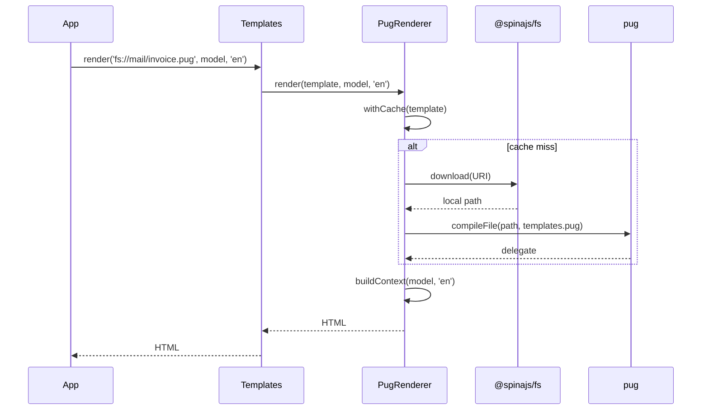

# Rendering pug templates

`Templates` routes every file ending in `.pug` to `PugRenderer`, which compiles it with `pug.compileFile()` and runs it with your model. Use it for HTML pages, mail bodies and anything else you write in pug.

## How it works

1. You call `Templates.render(template, model, language?, options?)` or `Templates.renderToFile(template, model, filePath, language?, options?)`. `Templates` takes `path.extname(template)` and picks the first registered `TemplateRenderer` whose `Extension` is `.pug`. No match throws `InvalidOperation` (`No renderer for file ... with extension ...`).
2. `Templates.compile(template, 'pug', ...)` and `Templates.compileToFile(template, 'pug', ...)` pick the renderer by `Type` instead, whatever the file extension. An unknown type throws `InvalidOperation` (`No renderer for ...`).
3. `CompiledTemplateRenderer.render()` (the base of `PugRenderer`) throws `InvalidArgument` for an empty template name, then asks `TemplateRenderer.withCache()` for the compiled delegate.
4. On a cache miss, `PugRenderer.compile()` runs:
   - `resolveLocalPath()` returns a bare path unchanged. An `fs://<provider>/<path>` URI goes through `fs.download()`: a local provider returns the real file path, a remote one (S3, FTP, ...) downloads a temp copy.
   - `pug.compileFile(path, options)` compiles the file with the `templates.pug` options. A missing file or a pug syntax error throws pug's own error.
5. `resolveLanguage()` picks the language: the `language` argument, else the language in the async context, else `intl.defaultLocale`. See [Translation helpers](02-translation-helpers.md).
6. `PugRenderer.buildContext()` merges the model and the translation helpers into a new object; the delegate renders it to a string.
7. `renderToFile()` creates the parent folder of `filePath` when missing and writes the result with `fs.writeFileSync`, overwriting an existing file.
8. `Templates` measures every call as a `template.render` (`render`, `renderToFile`) or `template.compile` (`compile`, `compileToFile`) perf span labelled `engine: pug`. With `options.redact`, a failed render rethrows an error whose message has those values replaced by `[redacted]`.



## Configuration

| Key | Type | Default | Allowed values | Meaning |
| --- | --- | --- | --- | --- |
| `templates.pug` | `pug.Options` | unset (pug defaults) | Any [pug option](https://pugjs.org/api/reference.html#options): `basedir`, `doctype`, `filters`, `globals`, `compileDebug`, `self`, `plugins`, ... | Passed to every `pug.compileFile()` call. `filename` is set by pug from the path |
| `templates.cache.mode` | `'cache' \| 'revalidate' \| 'always'` | unset: `always` when `configuration.isDevelopment` is `true`, else `cache` | `cache`, `revalidate`, `always` | Owned by [`@spinajs/templates`](../templates/README.md). `cache` compiles once per template; `revalidate` stats the source on every render and recompiles when its mtime and size (or remote version) change; `always` recompiles on every render |
| `configuration.isDevelopment` | `boolean` | `false` | | Picks the cache mode when `templates.cache.mode` is unset |

The package ships no config file, so `templates.pug` is unset until you set it.

```ts
// config/templates.ts in your app
import { join } from 'path';

export default {
  templates: {
    pug: {
      // absolute includes (`include /partials/footer`) resolve against this folder
      basedir: join(process.cwd(), 'templates'),
      doctype: 'html',
      // compile-time filters: `:shout` in a template
      filters: {
        shout: (text: string) => text.toUpperCase(),
      },
    },
    cache: {
      mode: 'revalidate',
    },
  },
};
```

## Services and extension points

| Service | DI token and lifetime | Default implementation | Alternatives | How to replace or extend |
| --- | --- | --- | --- | --- |
| `.pug` engine | `TemplateRenderer` (plus `PugRenderer` itself), singleton; registered by `@Injectable(TemplateRenderer)` when the package is imported; injected into `Templates` as `Array.ofType(TemplateRenderer)` | `PugRenderer` | None shipped | Subclass and swap it: see [Customizing `PugRenderer`](03-customizing-pug-renderer.md). Add more pug engines: see [Additional pug engines](04-additional-pug-engines.md) |
| Pug compiler options | config key `templates.pug`, read on every compile | unset | | Set the key; or override `compile()` to compute options per template |

## Important behaviour

- **Extension match is exact.** `extname('Invoice.PUG')` is `.PUG`, which no renderer claims. `extname('welcome.email.pug')` is `.pug`.
- **Relative paths resolve against the process working directory**, not against a templates folder.
- **Includes in remote templates.** A template from a remote `fs://` provider compiles from a temp copy, so its relative `include` and `extends` resolve against the temp folder and fail. Keep layouts and partials on a local provider, or use absolute includes with `templates.pug.basedir` set to a local folder. Local `fs://` providers compile the real file, so relative includes work.
- **Partials are not watched.** The cache key and the `revalidate` change token cover the entry template only. Editing an included or extended file does not trigger a recompile in `cache` or `revalidate` mode.
- **Do not set `templates.pug.cache`.** Pug then keeps its own cache by file name, and `revalidate` and `always` keep getting the old compile.
- **The model is copied, not mutated.** `buildContext()` merges it into a fresh object with lodash `merge`. Top-level getters and prototype methods of a class instance are lost; nested objects are passed by reference. Wrap a class instance: `{ invoice }`, not `invoice`.
- **Helper names win.** A model key named `__`, `__n`, `__l` or `__h` is overwritten by the translation helper.
- **`IRenderOptions.onProgress` is ignored.** `PugRenderer` never reports progress; `redact` still works because `Templates` applies it.
- **Output is written synchronously.** `renderToFile()` uses `fs.writeFileSync`, which blocks the event loop for large files.
- **Remote templates in `always` mode** are downloaded again on every render.

## Best practices

- Render through `Templates`, not by resolving `PugRenderer`: you get the perf span, `redact` and engine selection by extension.
- Set `templates.cache.mode: 'revalidate'` on servers whose templates change without a restart; leave it unset in development to recompile on each render.
- Pass `fs://` URIs to keep template locations in config: `fs://mail-templates/invoice.pug` works on a local folder in development and on S3 in production, as long as partials use absolute includes.
- Set `doctype: 'html'` in `templates.pug` when templates are partials without a `doctype` line, so boolean attributes render in HTML style.

## Patterns and antipatterns

```ts
// Don't: the ORM model is a class instance; its getters (eg. `totalGross`) are not copied into the template locals
await templates.render(invoiceTemplate, invoice, 'pl');

// Do: nest the instance, it is passed by reference with its prototype
await templates.render(invoiceTemplate, { invoice }, 'pl');
```

```ts
// Don't: relative include in a template stored on S3 resolves against the temp copy and fails
//   invoice.pug:  include ./partials/footer.pug

// Do: absolute include, resolved against templates.pug.basedir on local disk
//   invoice.pug:  include /partials/footer.pug
```

## Examples

### Render an invoice to an HTML file

```ts sample
import { join } from 'path';
import { DI } from '@spinajs/di';
import { Templates } from '@spinajs/templates';
import '@spinajs/templates-pug';

interface InvoiceLine {
  description: string;
  quantity: number;
  unitPrice: number;
}

async function writeInvoiceHtml(invoiceNo: string, lines: InvoiceLine[], customerLanguage: string): Promise<string> {
  const templates = await DI.resolve(Templates);
  const output = join(process.cwd(), 'storage', 'invoices', `${invoiceNo}.html`);

  // the `invoices` folder is created when missing
  await templates.renderToFile(
    'fs://billing-templates/invoice.pug',
    { invoiceNo, lines, total: lines.reduce((sum, l) => sum + l.quantity * l.unitPrice, 0) },
    output,
    customerLanguage,
  );

  return output;
}
```

```pug
//- invoice.pug on the billing-templates provider
h1= __('invoice.title') + ' ' + invoiceNo
table
  each line in lines
    tr
      td= line.description
      td= line.quantity
      td= line.unitPrice.toFixed(2)
p= __('invoice.total') + ': ' + total.toFixed(2)
```

### Render a pug file by engine type

`compile()` selects the engine by `Type`, so it works for files whose extension no engine claims.

```ts sample
import { DI } from '@spinajs/di';
import { Templates } from '@spinajs/templates';
import '@spinajs/templates-pug';

async function renderLegacyTemplate(path: string, model: Record<string, unknown>): Promise<string> {
  const templates = await DI.resolve(Templates);

  // eg. path = '/srv/legacy/order-confirmation.tpl'
  return await templates.compile(path, 'pug', model);
}
```

### Keep a reset link out of render errors

```ts sample
import { DI } from '@spinajs/di';
import { Templates } from '@spinajs/templates';
import '@spinajs/templates-pug';

async function renderResetMail(resetUrl: string, language: string): Promise<string> {
  const templates = await DI.resolve(Templates);

  // a failed render rethrows with the URL replaced by [redacted], so logs never see it
  return await templates.render('fs://mail-templates/password-reset.pug', { resetUrl }, language, { redact: [resetUrl] });
}
```

## Related

- [Translation helpers](02-translation-helpers.md): the functions merged into every model.
- [Customizing `PugRenderer`](03-customizing-pug-renderer.md): change the context or the compile step.
- [`@spinajs/templates`](../templates/README.md): `Templates`, cache modes, `IRenderOptions`.
- [`@spinajs/fs`](../fs/README.md): providers behind `fs://` URIs.
