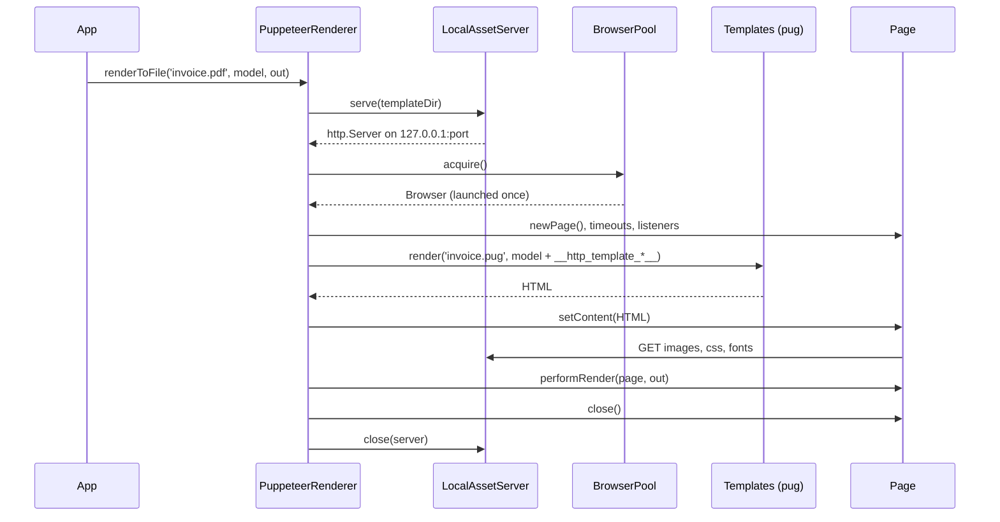

# Rendering to files

`PuppeteerRenderer` turns a Pug template or a raw HTML string into a file by loading it in headless Chromium. The concrete output (PDF, screenshot) comes from a subclass: `PdfRenderer` in `@spinajs/templates-pdf`, `ImageRenderer` in `@spinajs/templates-image`, or your own.

Use `renderToFile()` for templates and `renderHtmlToFile()` when you already have HTML (CI screenshots, HTML built by another engine).

## How it works

### `renderToFile(template, model, filePath, language?, options?)`

1. `renderToFile()` takes the directory of `template` as the asset base path. A `template` ending in a string engine's extension (eg. `.pug`) is compiled as is. Otherwise the source path is `<dir>/<basename>.pug`, with the extension stripped when it is this renderer's `Extension` or another Puppeteer renderer's.
2. `renderContentToFile()` creates a `RenderProgressReporter` for `options.onProgress` and emits `starting`.
3. `LocalAssetServer.serve()` starts an Express static server on `127.0.0.1` that serves the asset base path. See [Local asset server](05-local-asset-server.md).
4. `BrowserPool.acquire()` returns the pooled Chromium, launching it on first use. `browser.newPage()` opens a fresh page. See [Browser pool](04-browser-pool.md).
5. Unless `debug.close` is `false`, `armRenderWatchdog()` arms the render timeout and `configurePageTimeouts()` sets the page timeouts.
6. `addPageEventListeners()` forwards the page's console, page errors, responses and failed requests to the `puppeteer-templates` logger.
7. The reporter emits `preparing`. `page.setBypassCSP(true)` runs.
8. `Templates.render()` compiles the source with the model plus `__http_template_port__` and `__http_template_address__`.
9. The reporter emits `loading`. `page.setContent()` loads the HTML and its resources.
10. The reporter emits `rendering`. The subclass's `performRender(page, filePath)` writes the file.
11. The reporter emits `done`.
12. In `finally`: the reporter detaches, a slow render is logged, the page closes (the browser stays), and the asset server closes. With `debug.close: false` both the page and the asset server stay open.

Any error is logged, reported as `failed` with the error message, and rethrown.

### `renderHtmlToFile(html, filePath, options?)`

Steps 2 to 7 and 9 to 12 are the same. Step 8 differs:

- No template engine runs.
- `options.viewport` is applied with `page.setViewport()` when given.
- `injectBaseHref()` adds `<base href="http://127.0.0.1:<port>/">` so relative URLs in the HTML load from `options.assetBasePath`. The asset base path defaults to the directory of `filePath`.



## Template variables

`renderToFile()` adds two keys to the model before it compiles the template:

| Key | Value | Use |
| --- | --- | --- |
| `__http_template_port__` | Port of the asset server for this render | Build your own asset URLs |
| `__http_template_address__` | `http://127.0.0.1:<port>` | Prefix for absolute asset URLs, eg. `img(src=__http_template_address__ + '/logo.png')` |

The asset server serves the template's own directory. A model key with the same name wins over the generated one.

## Configuration

`PuppeteerRenderer` has no configuration path of its own. Each subclass reads an `IPuppeteerRendererOptions` object from its own key with `@Config()`: `templates.pdf` for `PdfRenderer`, `templates.image` for `ImageRenderer`. Below, `<key>` stands for that path.

| Key | Type | Default | Allowed values | Meaning |
| --- | --- | --- | --- | --- |
| `<key>.static.portRange` | `number[]` | `[3000, 4000]` for `templates.pdf` and `templates.image` | `[min, max]`; unset or `[]` for an OS-assigned port | Ports the asset server picks from at random; the last two elements are read |
| `<key>.args` | `LaunchOptions` (puppeteer) | `{ headless: true }` | Any puppeteer launch options | Passed to `puppeteer.launch()` |
| `<key>.executablePath` | `string` | none | Path to Chrome or Chromium | Overrides `args.executablePath` |
| `<key>.navigationTimeout` | `number` (ms) | `30000` when unset | `>= 0`; `0` disables it | `page.setDefaultNavigationTimeout()` |
| `<key>.renderTimeout` | `number` (ms) | `30000` when unset | `>= 0`; `0` disables both | `page.setDefaultTimeout()` and the watchdog that closes the page |
| `<key>.renderDurationWarning` | `number` (ms) | `5000` when unset | `> 0` | Logs a warning when a render takes longer |
| `<key>.debug.close` | `boolean` | closes the page | `false` keeps it open | `false` keeps the page and its asset server open and disarms all timeouts |

This package ships the `templates.pdf` defaults (`static.portRange`, `args`, and an `options: {}` key that no renderer reads). `@spinajs/templates-pdf` and `@spinajs/templates-image` ship their own.

```ts
// config/templates.ts in your app
export default {
  templates: {
    pdf: {
      args: {
        headless: true,
        args: ['--no-sandbox', '--disable-dev-shm-usage'],
      },
      executablePath: '/usr/bin/chromium',
      navigationTimeout: 20000,
      renderTimeout: 60000,
      renderDurationWarning: 10000,
    },
  },
};
```

## Services and extension points

| Service | DI token and lifetime | Default implementation | Alternatives | How to replace or extend |
| --- | --- | --- | --- | --- |
| `PuppeteerRenderer` | Abstract; each subclass registers itself under `TemplateRenderer` with `@Injectable(TemplateRenderer)`, usually `@PerInstanceCheck()` | none | `PdfRenderer`, `ImageRenderer` | Subclass it; see [Custom Puppeteer renderers](03-custom-renderers.md) |
| `Templates` | `@LazyInject()` property `TemplatingService` | `Templates` from `@spinajs/templates` | none | Compiles the template source; `@spinajs/templates-pug` is imported by this package |
| `LocalAssetServer` | Not in DI; built by the `assetServer` getter, one per renderer | `LocalAssetServer` | Your subclass | Override the `assetServer` getter; see [Local asset server](05-local-asset-server.md) |
| `BrowserPool` | Not in DI; built by the `browserPool` getter, one per renderer | `BrowserPool` | Your subclass | Override the `browserPool` getter and `dispose()`; see [Browser pool](04-browser-pool.md) |
| `RenderProgressReporter` | Not in DI; one per render, created in `renderContentToFile()` | `RenderProgressReporter` | none | Wrap `renderContentToFile()`; see [Render progress](02-render-progress.md) |

## Important behaviour

- `renderToFile()` maps an output path to its **`.pug`** source: `reports/invoice.pdf` compiles `reports/invoice.pug`. A path ending in a string engine's extension, eg. `invoice.pug`, is compiled as is, so `Templates.compileToFile('invoice.pug', 'pdf', ...)` works. A path with an extension no engine owns gets `.pug` appended: `invoice.v2` compiles `invoice.v2.pug`.
- `render()` throws `NotSupported`: a Puppeteer renderer cannot render to a string. `Templates.render('invoice.pdf', ...)` and `Templates.compile(..., 'pdf', ...)` fail; use `renderToFile()` or `compileToFile()`.
- The asset server for `renderToFile()` serves the **template's directory**. For `renderHtmlToFile()` it serves `assetBasePath`, or the **output file's directory** when you omit it.
- `renderToFile()` does **not** add a `<base>` tag. The page has no URL of its own, so a relative `img(src='logo.png')` in a template does not load. Use `__http_template_address__` or declare the `<base>` yourself.
- `injectBaseHref()` (raw HTML only) leaves HTML that already has a `<base ...>` tag untouched. Without a `<head>` it adds one inside `<html>`; without `<html>` it prepends the tag.
- `page.setBypassCSP(true)` runs on every page: a Content-Security-Policy in your HTML does not block local assets.
- The watchdog starts before the template compiles. Compile time, resource loading and output all count toward `renderTimeout`. When it fires it closes the page, and the pending Puppeteer call rejects.
- `renderTimeout: 0` disables the page timeout and the watchdog; `navigationTimeout: 0` disables the navigation timeout. `debug.close: false` turns both off too.
- With `debug.close: false` the page and its asset server stay open after the render, so the page can be reloaded. The server is never closed and the page only by `dispose()`; use it only while debugging. Combine it with `args.headless: false` to see the window.
- Concurrent renders on one renderer share one Chromium. Each render gets its own page and its own asset server on its own port.
- The browser stays alive between renders. A one-shot script must call `dispose()` on the renderer, or `DI.dispose()`, or the process does not exit.
- An array in your app config replaces the package default, also `static.portRange` and `args.args` (see [Arrays](../configuration/01-configuration-service.md#arrays)). Package configs concatenate among themselves, so `templates.pdf.static.portRange`, which this package and `@spinajs/templates-pdf` both ship, holds four numbers unless your app sets it; the asset server reads the **last** two elements.

## Best practices

- Resolve a renderer once and reuse it. The pooled browser makes the second render much faster than the first.
- Keep images, fonts and CSS next to the `.pug` template and reference them through `__http_template_address__`, or add `base(href=__http_template_address__ + '/')` to the template's `head` and use relative URLs. Chromium cannot read `file://` paths from a page set with `setContent()`.
- Pass a fixed `viewport` to `renderHtmlToFile()` for screenshot comparisons in CI; the default viewport is Puppeteer's.

## Patterns and antipatterns

```ts
// Don't: resolves a new renderer (and a new Chromium) per invoice and never closes it
for (const invoice of invoices) {
  const renderer = await DI.resolve(PdfRenderer, [{ format: 'A4' }]);
  await renderer.renderHtmlToFile(invoice.html, `out/${invoice.no}.pdf`);
}

// Do: one renderer, one browser, disposed at the end
const renderer = await DI.resolve(PdfRenderer, [{ format: 'A4' }]);
try {
  for (const invoice of invoices) {
    await renderer.renderHtmlToFile(invoice.html, `out/${invoice.no}.pdf`);
  }
} finally {
  await renderer.dispose();
}
```

```pug
//- Don't: absolute file paths do not load inside the page
img(src='/srv/app/templates/logo.png')

//- Do: an URL on the asset server, which serves the template directory
img(src=__http_template_address__ + '/logo.png')
```

## Examples

### Render a monthly invoice template to PDF

`templates/invoice.pug` sits next to `templates/logo.png`:

```pug
html
  body
    img(src=__http_template_address__ + '/logo.png')
    h1 Invoice #{number}
    p Total: #{total} EUR
```

```ts sample
import { DI } from '@spinajs/di';
import { Configuration } from '@spinajs/configuration';
import { Templates } from '@spinajs/templates';
import '@spinajs/templates-pdf';

async function renderInvoice(number: string, total: number): Promise<string> {
  await DI.resolve(Configuration);
  const templates = await DI.resolve(Templates);
  const out = `out/invoice-${number}.pdf`;

  // `.pdf` selects PdfRenderer, which compiles the sibling `invoice.pug`.
  await templates.renderToFile('templates/invoice.pdf', { number, total }, out, 'en');

  return out;
}

void renderInvoice('2026/10/0042', 1250).finally(() => DI.dispose());
```

### Screenshot a static HTML report in CI

```ts sample
import { DI } from '@spinajs/di';
import { Configuration } from '@spinajs/configuration';
import { ImageRenderer } from '@spinajs/templates-image';
import { readFile } from 'fs/promises';

async function snapshotReport(): Promise<void> {
  await DI.resolve(Configuration);
  const renderer = await DI.resolve(ImageRenderer, [{ type: 'png', fullPage: true }]);

  try {
    const html = await readFile('build/report/index.html', 'utf-8');

    // relative `` resolve against build/report
    await renderer.renderHtmlToFile(html, 'screenshots/report.png', {
      assetBasePath: 'build/report',
      viewport: { width: 1280, height: 800, deviceScaleFactor: 1 },
    });
  } finally {
    await renderer.dispose();
  }
}

void snapshotReport();
```

## Related

- [Render progress](02-render-progress.md): the phases this flow reports.
- [Custom Puppeteer renderers](03-custom-renderers.md): write `performRender()` and override the hooks used above.
- [`@spinajs/templates`](../templates/README.md): `Templates`, `TemplateRenderer` and `IRenderOptions`.
- [`@spinajs/templates-pug`](../templates-pug/README.md): compiles the `.pug` source in step 8.
- [`@spinajs/configuration`](../configuration/README.md): how config files merge, including arrays.
