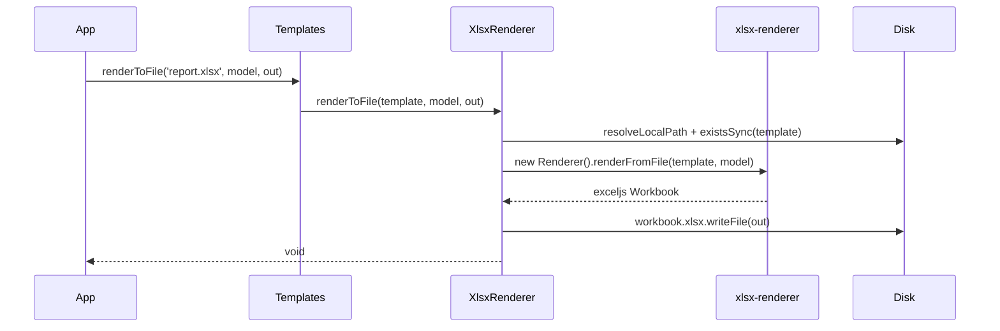

# Rendering XLSX files

Fill an Excel workbook template with a model and write the result to a new `.xlsx` file. Use it for reports and exports that must keep the formatting, formulas and layout someone designed in Excel.

## How it works

1. You call `Templates.renderToFile(template, model, filePath)` with a template ending in `.xlsx`, or `Templates.compileToFile(template, 'xlsx', model, filePath)`.
2. `Templates` picks the renderer: by extension (`.xlsx`) for `renderToFile()`, by type (`xlsx`) for `compileToFile()`. No match throws `InvalidOperation`.
3. `Templates` wraps the call in a `Perf.measure()` span (`template.render` or `template.compile`, label `engine: xlsx`) and, when `options.redact` is set, redacts secrets from a thrown error.
4. `XlsxRenderer.renderToFile()` resolves the template to a local path (`fs://` URIs are downloaded) and checks it with `fs.existsSync()`. A missing file throws `IOFail`.
5. It creates a new `xlsx-renderer` `Renderer` and calls `renderFromFile(template, model)`, which loads the workbook with `exceljs` and evaluates every template cell against `model`.
6. It creates the parent folder of `filePath` if needed and writes the rendered workbook with `workbook.xlsx.writeFile()`, replacing an existing file.
7. It logs the render time at `trace` level on the `renderer` logger and resolves with `void`.



## API

| Member | Signature | Behaviour |
| --- | --- | --- |
| `XlsxRenderer.Type` | `string` | `'xlsx'`: the name `Templates.compileToFile()` and `compile()` look up |
| `XlsxRenderer.Extension` | `string` | `'.xlsx'`: the extension `Templates.renderToFile()`, `render()` and `getRendererFor()` look up |
| `XlsxRenderer.ServiceName` | `string` | `'.xlsx'`, inherited from `TemplateRenderer` (`IMappableService`) |
| `XlsxRenderer.renderToFile()` | `(template: string, model: unknown, filePath: string, language?: string) => Promise<void>` | Renders `template` with `model` into `filePath`; `language` is ignored |
| `XlsxRenderer.render()` | `(templateName: string, model: unknown, language?: string) => Promise<string>` | Always rejects with `NotSupported('Cannot render xlsx to memory')` |

## Template syntax

The cell commands belong to `xlsx-renderer` 2.4; this table lists the common ones. A command is the whole text of a cell. Paths are dot-separated keys into the model.

| Cell text | Effect |
| --- | --- |
| `## customer.name` | Writes the value at `customer.name`. An undefined value prints a `console.warn` |
| `` #` Invoice ${invoice.no} for ${customer.name} `` | Writes the string with every `${path}` replaced |
| `#! FOR_EACH row rows` | Repeats the rows up to the matching `END_LOOP` once per item of `rows`; inside, `## row.region` reads the current item |
| `#! END_LOOP row` | Closes the `FOR_EACH` loop named `row` |
| `#! END_ROW` | Ends the current output row |
| `#! SUM row`, `#! AVERAGE row` | Writes a `sum(...)` or `average(...)` formula over the rows the `row` loop produced, in this cell's column |
| `#! DUMP_COLS path` | Writes the items of the array at `path` into consecutive cells of the row |
| `#! HYPERLINK labelPath urlPath` | Writes a link; nothing when the value at `urlPath` is not a string |
| `#! WS_NAME path` | Names the output worksheet after the value at `path` (or the literal `path`), cut to 31 characters |
| `#! FINISH`, `#! FINISH path` | Ends the sheet and moves to the next template sheet; with `path`, repeats the sheet while the value is falsy |
| `#! DELETE key` | Removes `key` from the model for the rest of the render |

Any other cell, including formulas and styles, is copied as it is. Cells starting with `#=` are formula templates. See the [`xlsx-renderer` docs](https://siemienik.com/docs/xlsx-renderer) for the full command list.

## Configuration

`XlsxRenderer` reads no configuration key of its own.

| Key | Type | Default | Allowed values | Meaning |
| --- | --- | --- | --- | --- |
| `templates.cache.mode` | `string` | unset | `cache`, `revalidate`, `always` | Inherited from `TemplateRenderer`, but **ignored**: `XlsxRenderer` never calls `withCache()` and reads the template from disk on every render |
| `intl.*` | object | see [`@spinajs/intl`](../intl/README.md) | | `Templates` injects `Intl`, so the `intl` section must be valid even though this engine ignores the language |

## Services and extension points

| Service | DI token and lifetime | Default implementation | Alternatives | How to replace or extend |
| --- | --- | --- | --- | --- |
| `XlsxRenderer` | `TemplateRenderer` list element and `XlsxRenderer`, singleton, registered at import | `XlsxRenderer` | none shipped | See [Custom XLSX renderer](02-custom-xlsx-renderer.md) |
| `Templates` | `Templates`, singleton, from `@spinajs/templates` | `Templates` | | Injects every `TemplateRenderer` with `@Autoinject(TemplateRenderer)` when it resolves |

## Important behaviour

- **No in-memory output.** `Templates.render('x.xlsx', …)` and `Templates.compile(…, 'xlsx', …)` reject with `NotSupported`. Render to a file and read it back when you need a `Buffer`.
- **Local paths and `fs://` URIs.** A bare path must be one `fs.existsSync()` accepts, absolute or relative to `process.cwd()`; `system.dirs.templates` is not searched. An `fs://` URI is downloaded to local storage first. A missing file throws `IOFail`.
- **The output folder is created.** `XlsxRenderer` creates the parent folder of `filePath` when it is missing. An existing file is overwritten.
- **No cache.** Every render loads and parses the template again, regardless of `templates.cache.mode`.
- **`language` and `options.onProgress` are ignored.** Translate in the model before rendering. `options.redact` still works, because the `Templates` facade applies it.
- **Each render is independent.** A new `xlsx-renderer` `Renderer` is created per call, so concurrent renders do not share state.
- **Missing model values do not fail.** `xlsx-renderer` writes an empty cell and prints a `console.warn`, outside the SpinaJS logger.

## Best practices

- Call `templates.renderToFile()` with the `.xlsx` extension in the template name; use `compileToFile(…, 'xlsx', …)` only when the template file has another extension.
- Build absolute template paths (`path.join(templatesDir, 'sales-report.xlsx')`) so the render does not depend on the process working directory.
- Shape the model for the sheet: flat arrays of rows for `FOR_EACH`, formatted strings for dates and money. `xlsx-renderer` has no formatting helpers.

## Patterns and antipatterns

```ts
// Don't: XlsxRenderer cannot render to memory, this always rejects with NotSupported
const xlsx = await templates.render('./templates/sales-report.xlsx', model);

// Do: render to a file, then read the bytes
await templates.renderToFile('./templates/sales-report.xlsx', model, output);
const bytes = await readFile(output);
```

## Examples

### Export an invoice list as an Excel attachment

```ts sample
import '@spinajs/templates-xlsx';
import { DI } from '@spinajs/di';
import { Templates } from '@spinajs/templates';
import { readFile, rm } from 'fs/promises';
import { join } from 'path';
import { tmpdir } from 'os';

interface InvoiceRow {
  no: string;
  customer: string;
  issuedAt: string;
  total: number;
}

export async function buildInvoiceExport(month: string, invoices: InvoiceRow[]): Promise<Buffer> {
  const templates = await DI.resolve(Templates);
  const template = join(process.cwd(), 'templates', 'invoices.xlsx');
  const output = join(tmpdir(), 'invoice-exports', `invoices-${month}.xlsx`);

  try {
    // invoices.xlsx holds `## month`, `#! FOR_EACH invoice invoices`, `## invoice.no`, ... and `#! END_LOOP invoice`
    await templates.renderToFile(template, { month, invoices }, output);
    return await readFile(output);
  } finally {
    await rm(output, { force: true });
  }
}
```

### Pick the engine by type for a template stored under another name

```ts sample
import '@spinajs/templates-xlsx';
import { DI } from '@spinajs/di';
import { Templates } from '@spinajs/templates';

export async function renderStockReport(templatePath: string, output: string, items: { sku: string; qty: number }[]): Promise<void> {
  const templates = await DI.resolve(Templates);

  // the template file is uploaded as `stock-template.bin`, so extension lookup would fail
  await templates.compileToFile(templatePath, 'xlsx', { items, generatedAt: new Date().toISOString() }, output);
}
```

## Related

- [Custom XLSX renderer](02-custom-xlsx-renderer.md): add progress or custom cell commands.
- [`@spinajs/templates`](../templates/README.md): the `Templates` facade and `IRenderOptions`.
- [`@spinajs/intl`](../intl/README.md): configuration `Templates` needs to resolve.
