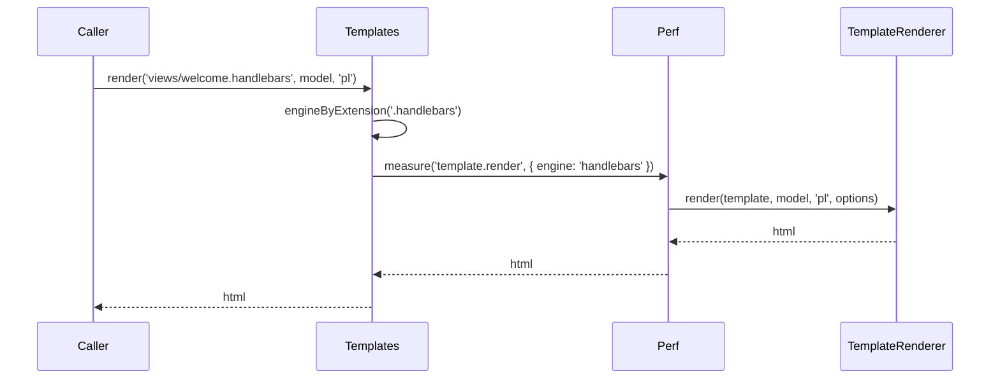

# Rendering templates

`Templates` is the entry point for every render. It picks a renderer by the template's file extension (`render`, `renderToFile`) or by renderer type (`compile`, `compileToFile`), runs it inside a perf span, and returns the output or writes it to a file.

## How it works

`Templates.render(template, model, language?, options?)`:

1. Your code, `@spinajs/email-smtp-transport`, `@spinajs/http` or the `@spinajs/queue-templates-pdf` worker calls `render()`.
2. `engineByExtension()` reads `path.extname(template)` and takes the **first** renderer in `Renderers` whose `Extension` equals it. No match throws `InvalidOperation` `No renderer for file <template> with extension <ext>`.
3. `Perf.measure('template.render', ...)` wraps the call, with the label `engine` (the renderer's `Type`) and the field `template`.
4. The renderer's `render(template, model, language, options)` produces the string. A renderer that only writes files (pdf, image, xlsx) throws `NotSupported` here.
5. When the renderer throws and `options.redact` is set, the error is replaced by a redacted copy before the span records it ([Secret redaction](05-secret-redaction.md)).
6. The string is returned.

`renderToFile()` follows the same steps and calls the renderer's `renderToFile(template, model, filePath, language, options)`.

`compile()` and `compileToFile()` replace step 2 with `engineByType()`: the first renderer whose `Type` equals the `renderer` argument. No match throws `InvalidOperation` `No renderer for <type>`. Their span is named `template.compile`.



## API

| Member | Selects the renderer by | Returns | Perf span |
| --- | --- | --- | --- |
| `render(template, model, language?, options?)` | extension of `template` | `Promise<string>` | `template.render` |
| `renderToFile(template, model, filePath, language?, options?)` | extension of `template` | `Promise<void>` | `template.render` |
| `compile(template, renderer, model, language?, options?)` | `renderer` = `Type` | `Promise<string>` | `template.compile` |
| `compileToFile(template, renderer, model, filePath, language?, options?)` | `renderer` = `Type` | `Promise<void>` | `template.compile` |
| `getRendererFor(extname)` | extension, with the dot (`'.pug'`) | the renderer, or `undefined` | none |

`template` is a local path or an `fs://<provider>/<path>` URI ([Template sources](02-template-sources.md)). `language` is passed to the renderer untouched; compiled engines fall back to the ambient request language ([Compiled template renderer](07-compiled-template-renderer.md#how-it-works)). `options` is an `IRenderOptions`:

| Field | Type | Meaning |
| --- | --- | --- |
| `onProgress` | `RenderProgressCallback` | Progress updates; only network-backed renderers report ([Render progress](04-render-progress.md)) |
| `redact` | `readonly string[]` | Secret values to strip from a render error ([Secret redaction](05-secret-redaction.md)) |

## Shipped renderers

| `Type` | `Extension` | Class | Package | `render()` to string |
| --- | --- | --- | --- | --- |
| `handlebars` | `.handlebars` | `HandlebarsRenderer` | `@spinajs/templates-handlebars` | yes |
| `pug` | `.pug` | `PugRenderer` | `@spinajs/templates-pug` | yes |
| `mjml` | `.mjml` | `MjmlRenderer` | `@spinajs/templates-mjml` | yes; the file is compiled by the `handlebars` renderer first |
| `csv` | `.csv` | `Csv` | `@spinajs/templates-csv` | yes; the model is `{ fields, data }`, the template path is ignored |
| `xlsx` | `.xlsx` | `XlsxRenderer` | `@spinajs/templates-xlsx` | no, `renderToFile` only |
| `pdf` | `.pdf` | `PdfRenderer` | `@spinajs/templates-pdf` | no, `renderToFile` only; renders `<name>.pug` next to `<name>.pdf` |
| `image` | `.png` (or the screenshot `type`) | `ImageRenderer` | `@spinajs/templates-image` | no, `renderToFile` only |

## Services and extension points

| Service | DI token and lifetime | Default implementation | Alternatives | How to replace or extend |
| --- | --- | --- | --- | --- |
| `Templates` | The class `Templates`; no lifetime decorator, so a singleton. Resolved by `DI.resolve(Templates)`, `@Autoinject(Templates)` or `@Inject(Templates)`. `@Inject(Intl)` resolves `Intl` first | `Templates` | none shipped | Subclass and `DI.register(MyTemplates).as(Templates)` before the first resolve. See [Replacing the `Templates` service](08-replacing-the-templates-service.md) |
| Renderer list | `@Autoinject(TemplateRenderer)` on `Templates.Renderers`, ie. `Array.ofType(TemplateRenderer)`, resolved once when `Templates` is built | none in this package | The renderers in the table above | Add one with `@Injectable(TemplateRenderer)`. See [Custom renderers](06-custom-renderers.md) |

## Important behaviour

- The first registered renderer wins an extension or a type. Registration order is module import order. A second renderer for `.handlebars` is never picked while the first one stays registered.
- `Renderers` is filled once, when `Templates` is first resolved. Import every renderer module before that; a renderer registered later is ignored by the existing `Templates` instance.
- `render()` and `renderToFile()` need an extension in the path. `templates.render('mail/welcome', ...)` throws `InvalidOperation`, because `extname()` returns an empty string.
- `getRendererFor()` is typed `TemplateRenderer` but returns `undefined` when no renderer matches. Check the result.
- A failed render is still recorded as a perf span with `error` set, and the error is rethrown. See [Performance measurement](../log/15-performance-measurement.md).
- The perf field `template` holds the template path, never the model.

## Best practices

- Use `render()` when the file extension names the engine; use `compile()` when the engine is chosen elsewhere, eg. in config, or the template path has no meaningful extension (csv).
- Inject `Templates` with `@Autoinject(Templates)` instead of calling `DI.resolve()` inside each method.
- Pass `language` explicitly in background jobs. Outside an HTTP request there is no ambient language, so compiled engines use `intl.defaultLocale`.

## Patterns and antipatterns

```ts
// Don't: assumes a renderer exists and crashes with a TypeError when it does not
const pdf = templates.getRendererFor('.pdf');
await pdf.renderToFile('views/invoice.pdf', model, './out/invoice.pdf');

// Do: let Templates select it and throw InvalidOperation with a clear message
await templates.renderToFile('views/invoice.pdf', model, './out/invoice.pdf');
```

## Examples

### Send a translated welcome page from your own service

```ts sample
import '@spinajs/templates-handlebars';
import { Autoinject, DI } from '@spinajs/di';
import { Templates } from '@spinajs/templates';

interface IWelcomeModel {
  name: string;
  activationUrl: string;
}

class WelcomePageBuilder {
  @Autoinject(Templates)
  protected Templates: Templates;

  public async build(model: IWelcomeModel, language: string): Promise<string> {
    return await this.Templates.render('./views/mail/welcome.handlebars', model, language);
  }
}

async function main() {
  const builder = await DI.resolve(WelcomePageBuilder);
  console.log(await builder.build({ name: 'Alice', activationUrl: 'https://app.example.com/activate/1' }, 'pl'));
}

void main();
```

### Export orders to a CSV file by renderer type

The csv renderer ignores the template path, so the call names the engine with `compileToFile()`.

```ts sample
import '@spinajs/templates-csv';
import { DI } from '@spinajs/di';
import { Templates } from '@spinajs/templates';

async function exportOrders() {
  const templates = await DI.resolve(Templates);

  await templates.compileToFile(
    'orders',
    'csv',
    {
      fields: ['id', 'customer', 'total'],
      data: [
        { id: 1, customer: 'Alice', total: 120.5 },
        { id: 2, customer: 'Bob', total: 80 },
      ],
    },
    './exports/orders.csv',
  );
}

void exportOrders();
```

## Related

- [Template sources](02-template-sources.md): what `template` may be.
- [Custom renderers](06-custom-renderers.md): add an engine to the list.
- [Replacing the `Templates` service](08-replacing-the-templates-service.md): change how renderers are picked.
- [Multiple implementations](../di/06-multiple-implementations.md): how `Array.ofType` builds the renderer list.
- [HTTP responses](../http/10-responses.md): HTML answers rendered through `Templates`.
