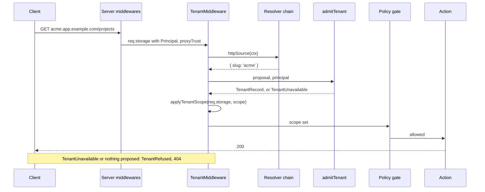

# `TenantMiddleware` and route declarations

`TenantMiddleware` sets the tenant scope of a request before the policy gate, so the policies, the action and everything it calls run in that scope. Each route declares what it needs: one tenant (`@TenantRoute()`), no tenant (`@NoTenant()`), or every tenant (`@AllTenants(reason)`). A route that needs a tenant and gets none is refused with one answer that does not tell which tenants exist.

## How it works

**At startup**, for each route, `BaseController` builds the route middlewares (see [Route middlewares](../http/14-route-middlewares.md)):

1. `TenantMiddleware` is mounted by `http.routes.middlewares: ['TenantMiddleware']` (every route; a tenant is then required), by a route decorator on the controller or the route, or by `@Middleware(TenantMiddleware, declaration)`. It is `@NewInstance()`: each mount gets its own instance with its own declaration.
2. The constructor checks the declaration: `tenancy` must be `'required'`, `'none'` or `'all'`, and `'all'` needs a non-blank `reason`. Anything else throws `InvalidArgument`, and the route fails to register.
3. `isEnabled(route, controller)` keeps exactly one instance per route: the route's own declaration wins over the controller's, and either wins over the global entry. Of two declarations on one target, the one written higher (applied last) wins.
4. `resolve()` of a `'required'` instance builds the resolver chain from `tenancy.http.resolvers` with `tenantResolvers()`. A bad name fails the startup with `InvalidOption`.

**Per request**, `onBefore(ctx)` runs in the `'beforePolicy'` stage:

1. `scopeOf(ctx)` picks the scope by the declaration:
   - `'none'`: no scope;
   - `'all'`: `allTenantsScope(reason)`, `{ kind: 'all', reason }`;
   - `'required'`: `admit(ctx)` runs `resolveTenant(chain, httpSource(ctx))` (see [Tenant resolvers](01-tenant-resolvers.md)) and gives `tenantScopeOf(tenant)`.
2. `admit()` throws `TenantRefused` when the proposed tenant is refused (`TenantUnavailable`) or when no resolver proposed one. Any other error (a registry outage) is thrown as itself and answered 500.
3. `applyTenantScope(ctx.storage, scope)` of `@spinajs/tenancy` writes the scope to `req.storage.Tenant`, or deletes it for `'none'`. A change of scope also drops the authz cache loaded under the previous one, and runs the guards registered with `onTenantScopeChange()`. A switch from one tenant to another throws `TenantSwitchDenied`.
4. The policy gate, the later middlewares and the action run with that store, so `tenantScope()`, `currentTenant()` and `requireTenant()` answer the request's tenant. A refused request reaches neither the policies nor the action.



### The refusal

`TenantRefused` extends `CodedHttpException` with the code `tenant.unavailable`:

| `tenancy.http.unknownTenant` | Status | Message |
| --- | --- | --- |
| `404` (default) | 404 | `Not found` |
| `403` | 403 | `Forbidden` |

An unknown, inactive, forbidden or missing tenant gets the same status, headers and body; the body includes `{ status: 404, code: 'tenant.unavailable', detail: 'Not found' }`. The reason stays on the server: `refusal.inner` holds the `TenantUnavailable`, whose `reason` is `'unknown'`, `'inactive'` or `'forbidden'`. A request that names no tenant at all has the reason `'unknown'`.

### Reading the scope

`@spinajs/tenancy-http` adds `Tenant?: TenantScope` to `IActionLocalStoregeContext`, so `req.storage.Tenant` is typed. Inside the action, read it with `tenantScope()` or `currentTenant()` of `@spinajs/tenancy`. A later `'beforePolicy'` middleware or a policy reads `req.storage.Tenant`; `onBefore` hooks run outside the request's AsyncLocalStorage context.

## Decorators

| Decorator | Target | Options | Effect |
| --- | --- | --- | --- |
| `@TenantRoute()` | class or method | none | Mounts `TenantMiddleware` with `{ tenancy: 'required' }`: the request is refused unless a resolver names a tenant it may enter |
| `@NoTenant()` | class or method | none | Mounts `{ tenancy: 'none' }`: the route runs with no tenant scope, and a scope already in the store is removed. For login, health checks, a tenant picker |
| `@AllTenants(reason)` | class or method | `reason`: non-blank text, trimmed | Mounts `{ tenancy: 'all', reason }`: the route runs in the cross-tenant scope. A blank reason throws `InvalidArgument` at import |
| `@Middleware(TenantMiddleware, declaration?)` (`@spinajs/http`) | class or method | a `TenantRouteDeclaration`; none means `'required'` | The same as the decorators above; a declaration they could not write fails the route registration |

Precedence on one route:

1. A declaration on the route wins over one on its controller.
2. Of two declarations stacked on one method, the upper one wins.
3. A subclass's class declaration wins over its parent's for the inherited routes; a route the subclass overrides takes its own declaration.
4. Without any declaration, the global `http.routes.middlewares` entry applies (`'required'`). Without that entry, the route has no `TenantMiddleware` and its scope is left as the store has it.

The build records the reason of `@AllTenants(reason)` in the manifest's `tenancy` section when it is a string literal written in place (see [Tenancy facts](../manifest/README.md#tenancy-facts)).

## Configuration

| Key | Type | Default | Allowed values | Meaning |
| --- | --- | --- | --- | --- |
| `http.routes.middlewares` (`@spinajs/http`) | entry[] | `[]` | add `'TenantMiddleware'` | Mounts `TenantMiddleware` on every route, requiring a tenant where no decorator says otherwise |
| `tenancy.http.resolvers` | string[] | `['domain', 'subdomain', 'path', 'header', 'principal', 'session']` | registered resolver names | The chain a `'required'` route asks |
| `tenancy.http.unknownTenant` | number | `404` | `404`, `403` | The status of `TenantRefused` |

```ts
http: { routes: { middlewares: ['TenantMiddleware'] } },
tenancy: { http: { unknownTenant: 404 } },
```

All `tenancy.http.*` keys are on the [Configuration](04-configuration.md) page.

## Services and extension points

| Service | DI token and lifetime | Default implementation | Alternatives | How to replace or extend |
| --- | --- | --- | --- | --- |
| `TenantMiddleware` | registered as `RouteMiddleware` and as itself; `@NewInstance()`, resolved per route with its declaration as the constructor argument | `TenantMiddleware` | your subclass | Subclass it, mark the subclass `@NewInstance()`, and `DI.register(Mine).as(TenantMiddleware)` before the controllers resolve. Override the protected `scopeOf(ctx)` to pick the scope differently, or `admit(ctx)` to wrap the admission |
| `TenantRefused` | none: thrown by `admit()` | `TenantRefused` | your own error from an `admit()` override | Shape the answer through the `@spinajs/http` error handling (see [Error handling](../http/11-error-handling.md)) |

### `TenantMiddleware`: custom implementation

Log why a request was refused its tenant, while the client keeps getting the same answer for every reason.

```ts sample
import { DI, NewInstance } from '@spinajs/di';
import type { IMiddlewareContext } from '@spinajs/http';
import { Log, Logger } from '@spinajs/log';
import { TenantUnavailable } from '@spinajs/tenancy';
import type { TenantRecord } from '@spinajs/tenancy';
import { TenantMiddleware, TenantRefused } from '@spinajs/tenancy-http';

@NewInstance()
export class LoggedTenantMiddleware extends TenantMiddleware {
  @Logger('tenancy')
  protected Log!: Log;

  protected override async admit(ctx: IMiddlewareContext): Promise<TenantRecord> {
    try {
      return await super.admit(ctx);
    } catch (err) {
      if (err instanceof TenantRefused) {
        const reason = err.inner instanceof TenantUnavailable ? err.inner.reason : 'unknown';
        this.Log.warn({ route: ctx.path, reason }, 'Tenant refused (${reason}) on ${route}');
      }
      throw err;
    }
  }
}

// The decorators and the 'TenantMiddleware' entry of http.routes.middlewares now build the subclass.
DI.register(LoggedTenantMiddleware).as(TenantMiddleware);
```

## Important behaviour

- **Opt-in.** Installing the package requires a tenant nowhere. Add `'TenantMiddleware'` to `http.routes.middlewares`, or decorate the controllers.
- **Before the policies.** `TenantMiddleware` runs in the `'beforePolicy'` stage, so policies see the scope; it runs after the server middlewares, so the principal and `req.storage.proxyTrust` are in the store. `TenantMiddleware` must be the first `'beforePolicy'` middleware: list `'TenantMiddleware'` first in `http.routes.middlewares` (global entries mount before decorator ones) and mount no other `'beforePolicy'` middleware ahead of it; one ahead of it runs without the scope.
- **One answer for every reason.** Unknown, suspended, forbidden and missing tenants answer alike; only `inner` tells them apart. `403` gives the same body with another status.
- **Fail closed.** A registry or access-check failure is thrown, never read as "no tenant": the request gets a 500 and the action does not run.
- **`@NoTenant()` clears.** A `'none'` route deletes any `Tenant` key already in the store, and the authz cache with it.
- **Only `'required'` builds a chain.** `'none'` and `'all'` instances never ask a resolver, so a bad `tenancy.http.resolvers` fails the startup only when some route requires a tenant.
- **Cross-tenant routes are not checked against the principal.** `@AllTenants` sets `{ kind: 'all' }` for every caller; restrict those routes with a policy.

## Best practices

- Mount `'TenantMiddleware'` globally and mark the few open routes `@NoTenant()`: a route forgotten by a developer then fails closed.
- Give `@AllTenants` a reason a reviewer understands (`'nightly billing export'`); it is the reason of the cross-tenant scope.
- Read the tenant in actions with `requireTenant()`: it throws `TenantRequired` when the route is open by mistake.
- Log refusals with their reason through an `admit()` override (see the sample above); the answer never carries it.

## Patterns and antipatterns

```ts
// Don't: read the tenant header in the action; it skips the admission and TenantAccess
@Get()
public list(@Header('x-tenant') tenant: string) {
  return this.Projects.of(tenant);
}

// Do: let TenantMiddleware admit it, then read the scope
@Get()
public list() {
  return this.Projects.of(requireTenant().id);
}
```

```ts
// Don't: a hand-written declaration with a typo fails the route registration
@Middleware(TenantMiddleware, { tenancy: 'None' })

// Do
@NoTenant()
```

## Examples

### A tenant API with an open login and an operator report

```ts sample
import { BaseController, BasePath, Get, Ok, Post } from '@spinajs/http';
import { currentTenant, requireTenant, tenantScope } from '@spinajs/tenancy';
import { AllTenants, NoTenant, TenantRoute } from '@spinajs/tenancy-http';

@BasePath('api')
@TenantRoute()
export class ApiController extends BaseController {
  @Get('me')
  public me() {
    return new Ok({ tenant: requireTenant().id });
  }

  @NoTenant()
  @Post('login')
  public login() {
    return new Ok({ tenant: currentTenant()?.id ?? null });
  }

  @AllTenants('operator usage report')
  @Get('usage')
  public usage() {
    // { kind: 'all', reason: 'operator usage report' }
    return new Ok({ scope: tenantScope() });
  }
}
```

### A policy that reads the tenant

```ts sample
import { BasePolicy } from '@spinajs/http';
import type { Request } from '@spinajs/http';
import { Forbidden } from '@spinajs/exceptions';
// Types req.storage.Tenant.
import '@spinajs/tenancy-http';

/** Only tenants on the beta list reach the routes it guards. */
export class BetaTenantsOnly extends BasePolicy {
  protected readonly beta = new Set(['acme']);

  public isEnabled(): boolean {
    return true;
  }

  public async execute(req: Request): Promise<void> {
    const scope = req.storage.Tenant;
    if (scope?.kind !== 'tenant' || !this.beta.has(scope.tenant.id)) {
      throw new Forbidden('beta tenants only');
    }
  }
}
```

## Related

- [Tenant resolvers and the request source](01-tenant-resolvers.md): what `admit()` asks.
- [Route middlewares](../http/14-route-middlewares.md): stages, global entries, `isEnabled`.
- [Policies](../http/13-policies.md): the gate that runs after the scope is set.
- [`@spinajs/tenancy`](../tenancy/README.md): `applyTenantScope`, `requireTenant`, `onTenantScopeChange`, `TenantSwitchDenied`.
