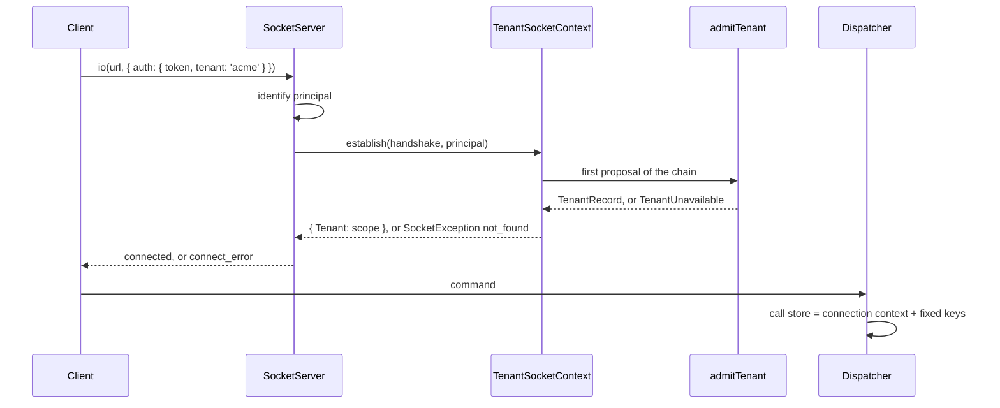

# Tenant of a socket connection

`TenantSocketContext` gives a socket connection one tenant, resolved once in the handshake through the same resolver chain as HTTP. Every command, event and connect or disconnect hook of the connection then runs in that tenant's scope. Turn it on with `import '@spinajs/tenancy-http/socket'`.

## How it works

1. `import '@spinajs/tenancy-http/socket'` registers `TenantSocketContext` with `@Injectable(SocketConnectionContext)`. `SocketServer` resolves the registered connection contexts on every handshake, so the import must run before the first handshake that should get a tenant.
2. In the handshake, after the principal is identified (`UNATTENDED` when no source resolved one), the socket server calls `TenantSocketContext.establish(handshake, principal)`.
3. On its first handshake, the instance builds the resolver chain from `tenancy.http.resolvers` with `tenantResolvers()`, and reads the proxy trust from the registered `RealIp` (`effectiveTrust()`): `http.trustProxy`, or `authn.http.trustProxy` with `@spinajs/authn-http`. Both are kept for later handshakes; a lookup that fails is not kept, so the next handshake tries again.
4. `socketSource(handshake, principal, header, trust)` builds the `TenantRequestSource`:
   - `host`: `X-Forwarded-Host` of the handshake when its TCP peer (`handshake.peerAddress`) is a trusted proxy, else `Host`; port removed, lower-cased;
   - `headers`: the handshake headers, with `handshake.auth.tenant` (a non-empty string) in place of the `tenancy.http.header` header;
   - `params`: `{}`; `session`: `undefined`; `principal`: the identified principal.
5. `resolveTenant()` walks the chain as for HTTP (see [Tenant resolvers](01-tenant-resolvers.md)). `auth.tenant` is read by the untrusted `header` resolver, so it counts only for an authenticated principal.
6. The result:
   - a tenant: `establish()` returns `{ Tenant: { kind: 'tenant', tenant: { id } } }`;
   - no proposal: it returns `{}`, and the connection runs with **no** tenant scope;
   - `TenantUnavailable`: the handshake is refused with `SocketException` `not_found` (`forbidden` when `tenancy.http.unknownTenant` is `403`) and the message `tenant not available`, the same for every reason. The reason goes to the `tenancy-http` logger at debug level;
   - any other error (a registry outage, an unknown resolver name): the handshake is refused with that error, mapped by http-socket (`internal` for an unmapped one).
7. http-socket keeps the returned keys with the connection and copies them into the store of every call. `tenantScope()` and `currentTenant()` inside a handler answer the connection's tenant.

How connection contexts are merged, kept across connection state recovery, and refused on a key two contexts both set is in [Connection context](../http-socket/18-connection-context.md) of `@spinajs/http-socket`.



## Configuration

`TenantSocketContext` reads the HTTP keys; there are no socket-only ones.

| Key | Type | Default | Allowed values | Meaning |
| --- | --- | --- | --- | --- |
| `tenancy.http.resolvers` | string[] | `['domain', 'subdomain', 'path', 'header', 'principal', 'session']` | registered resolver names | The chain; `path` and `session` never propose on a socket |
| `tenancy.http.header` | string | `'x-tenant'` | a header name | The header `auth.tenant` stands in for |
| `tenancy.http.unknownTenant` | number | `404` | `404`, `403` | `403` refuses with `forbidden`, anything else with `not_found` |
| `http.trustProxy` (`@spinajs/http`) | see [Client IP and trusted proxies](../http/17-client-ip-and-trust-proxy.md) | `null` | | Whether `X-Forwarded-Host` of the handshake counts |

```ts
tenancy: { http: { resolvers: ['subdomain', 'header', 'principal'], baseDomains: ['app.example.com'] } },
http: { trustProxy: ['uniquelocal'] },
```

## Services and extension points

| Service | DI token and lifetime | Default implementation | Alternatives | How to replace or extend |
| --- | --- | --- | --- | --- |
| `TenantSocketContext` | registered as `SocketConnectionContext` and as itself (singleton) by `import '@spinajs/tenancy-http/socket'`; resolved by `SocketServer` as `Array.ofType(SocketConnectionContext)` on every handshake | `TenantSocketContext` | your subclass | Subclass it, register the subclass with `@Injectable(SocketConnectionContext)`, and `DI.unregister(TenantSocketContext)` before the first handshake. Override the protected `scopeOf(handshake, principal)` to pick the scope, or `proxyTrust()` for another proxy trust |
| `SocketConnectionContext` (`@spinajs/http-socket`) | every registration, as a list | `TenantSocketContext` among others | your contexts | Add one with `@Injectable(SocketConnectionContext)`; it must not set the key `Tenant` |

### `TenantSocketContext`: refuse a connection that names no tenant

By default a socket that names no tenant connects with no scope. Override `scopeOf()` to refuse it instead. Keep only one context that sets `Tenant`: two of them refuse every handshake.

```ts sample
import { DI, Injectable } from '@spinajs/di';
import { SocketConnectionContext, SocketException } from '@spinajs/http-socket';
import type { ISocketHandshake } from '@spinajs/http-socket';
import type { Principal } from '@spinajs/principal';
import type { TenantScope } from '@spinajs/tenancy';
import { TenantSocketContext } from '@spinajs/tenancy-http/socket';

@Injectable(SocketConnectionContext)
export class RequiredTenantSocketContext extends TenantSocketContext {
  protected override async scopeOf(handshake: ISocketHandshake, principal: Principal): Promise<TenantScope | undefined> {
    const scope = await super.scopeOf(handshake, principal);
    if (scope === undefined) {
      throw new SocketException('not_found', 'tenant not available');
    }
    return scope;
  }
}

// Both contexts would set the key Tenant.
DI.unregister(TenantSocketContext);
```

## Important behaviour

- **One tenant per connection, checked once.** The tenant is not checked again while the connection lives: a tenant suspended after the handshake keeps its open connections in scope, and only new handshakes are refused. Principal revalidation does not re-resolve the tenant either. Close the connections of a suspended tenant yourself when that matters.
- **No tenant is not a refusal.** Unlike a route that requires a tenant, a handshake that names none connects with no scope, also when it names one without credentials. Guard handlers with `requireTenant()` or a policy, or refuse such connections as in the sample above.
- **Only the connection's context counts.** Each call's store is built from the connection's keys; a scope in the server's ambient AsyncLocalStorage context does not reach the calls, and one connection's tenant never reaches another's.
- **Same answer for every reason.** Unknown, inactive and forbidden tenants all refuse with `not_found` (or `forbidden`), message `tenant not available`, `retryable: false`.
- **Fail closed.** A registry failure refuses the handshake; the connection never runs without the scope it asked for.
- **Late errors.** An unknown name in `tenancy.http.resolvers` fails the HTTP startup when some route requires a tenant; on sockets it refuses handshakes instead, and every handshake tries the lookup again.
- **What a socket can name.** `path` and `session` resolvers never propose on a socket. The host resolvers read the `Host` the client connected to, and `X-Forwarded-Host` only from a trusted proxy.

## Best practices

- Send the tenant in the handshake `auth` object, next to the token: browsers cannot set headers on a WebSocket.
- Prefer subdomains for browser clients: the host is trusted and needs no credentials, while `auth.tenant` needs an authenticated principal.
- Import `@spinajs/tenancy-http/socket` next to the socket server setup, before the server starts listening.

## Patterns and antipatterns

```ts
// Don't: pass the tenant in the query string; it is never read, and URLs end up in access logs
const socket = io('https://app.example.com', { query: { tenant: 'acme' } });

// Do: name it in auth
const socket = io('https://app.example.com', { auth: { token, tenant: 'acme' } });
```

## Examples

### Tenant-scoped chat commands

```ts sample
import '@spinajs/tenancy-http/socket';
import { BaseSocketController, Command, Payload, SocketController } from '@spinajs/http-socket';
import { requireTenant } from '@spinajs/tenancy';

@SocketController('chat')
export class ChatSocket extends BaseSocketController {
  // A connection opened with auth: { token, tenant: 'acme' } posts into acme's rooms only.
  @Command('post', { schema: { type: 'object', required: ['text'], properties: { text: { type: 'string', minLength: 1 } } } })
  public async post(@Payload() req: { text: string }) {
    const tenant = requireTenant().id;
    return { room: `${tenant}:general`, text: req.text };
  }
}
```

## Related

- [Tenant resolvers and the request source](01-tenant-resolvers.md): the chain the handshake runs.
- [Connection context](../http-socket/18-connection-context.md): `SocketConnectionContext`, key collisions, recovery.
- [`@spinajs/http-socket`](../http-socket/README.md): the handshake order, error mapping.
- [Principal sources and handshake security](../http-socket/08-principal-sources.md): the principal `establish()` receives.
- [`@spinajs/tenancy`](../tenancy/README.md): `requireTenant`, `currentTenant` and the registry states.
