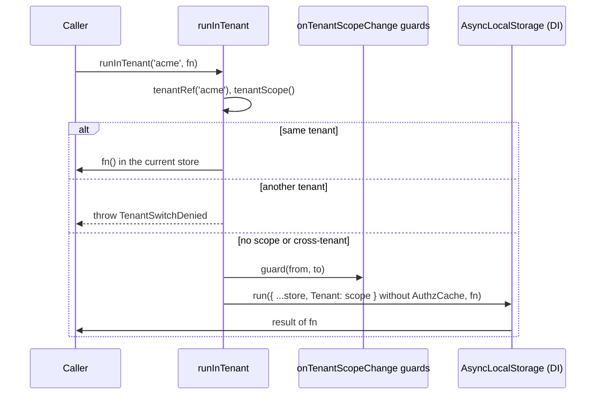

# Tenant scope

The tenant scope says which tenant the current unit of work belongs to. `runInTenant` and `runAcrossTenants` set it for an async function; `tenantScope`, `currentTenant` and `requireTenant` read it anywhere below, with no parameter passed down.

A scope is one of three states:

| State | Value of `tenantScope()` | `currentTenant()` | `requireTenant()` |
| --- | --- | --- | --- |
| No scope | `undefined` | `undefined` | throws `TenantRequired` |
| One tenant | `{ kind: 'tenant', tenant: { id } }` | `{ id }` | `{ id }` |
| Cross-tenant | `{ kind: 'all', reason }` | `undefined` | throws `TenantRequired`, naming the reason |

No scope is **not** the cross-tenant scope. Code that may touch every tenant enters it explicitly, with a reason.

## How it works

### Entering one tenant: `runInTenant(tenant, fn)`

1. `tenantRef(tenant)` checks the id: 1 to 64 characters of `a-z`, `0-9`, `_` and `-` (`TENANT_ID_PATTERN`). Another value throws `InvalidArgument`.
2. `tenantScope()` reads the current scope.
3. Already in the same tenant: `fn` runs in the current store. No guard is asked, and the authz cache stays.
4. In another tenant: the call throws `TenantSwitchDenied` ("cannot switch from tenant "acme" to tenant "globex"; leave the scope with runAcrossTenants(reason) first"). No guard is asked.
5. Otherwise (no scope, or the cross-tenant scope): every guard registered with `onTenantScopeChange` is called with `(from, to)`. A guard that throws refuses the change.
6. A shallow copy of the current store is made. The copy drops the `Tenant` and `AuthzCache` keys, gets the new frozen scope under `Tenant`, and `fn` runs inside it (`AsyncLocalStorage.run`).
7. The outer store is never changed. After `fn` settles, the outer scope is back in place, also when `fn` rejected.

### Entering the cross-tenant scope: `runAcrossTenants(reason, fn)`

1. `allTenantsScope(reason)` trims the reason. An empty reason throws `InvalidArgument` ("a cross-tenant scope needs a reason").
2. The guards are called with `(from, { kind: 'all', reason })`, from any scope, the cross-tenant one included.
3. Steps 6 and 7 above run with the cross-tenant scope.

`runAcrossTenants` is allowed from inside a tenant. It is the way out of a tenant: from the cross-tenant scope, `runInTenant` can enter any tenant.



## The shared request store

The scope lives in the request store the framework already shares: the `AsyncLocalStorage` registered in DI, resolved with `DI.resolve(AsyncLocalStorage)` on every call. `@spinajs/http` runs each action in it, and `@spinajs/log` reads it.

| Store key | Written by | Meaning |
| --- | --- | --- |
| `Tenant` | `runInTenant`, `runAcrossTenants`, `applyTenantScope` | The `TenantScope`; absent means no scope. Typed by `ITenantAsyncStorage`. |
| `AuthzCache` | `@spinajs/authz` | The authz request cache. Every change of scope drops it, so a new scope starts with an empty cache. |

- Every other key of the store (`requestId`, `Principal`, ...) is copied into the new scope.
- `tenantScope()` checks the `Tenant` key before it trusts it. A malformed value (`'acme'`, `{ kind: 'tenant' }`, an id outside the pattern, `{ kind: 'all' }` with no reason, `null`) reads as no scope.
- The scope object and its `tenant` are frozen.

## Building and checking tenant values

| Export | Effect |
| --- | --- |
| `TENANT_ID_PATTERN` | `'^[a-z0-9_-]{1,64}$'`, the tenant id alphabet; the configuration schema uses it too |
| `isTenantId(value)` | `true` for a string matching the pattern |
| `tenantRef(tenant)` | A frozen `{ id }` from an id or a `TenantRef`; throws `InvalidArgument` for a bad id |
| `tenantScopeOf(tenant)` | A frozen `{ kind: 'tenant', tenant }` scope |
| `allTenantsScope(reason)` | A frozen `{ kind: 'all', reason }` scope with the reason trimmed; throws `InvalidArgument` for an empty reason |

## Errors

| Error | Thrown by | When |
| --- | --- | --- |
| `TenantRequired` | `requireTenant()` | No scope, or the cross-tenant scope |
| `TenantSwitchDenied` | `runInTenant`, `applyTenantScope`, `forEachTenant`; guards by convention | A change from one tenant to another, or a change a guard refused |
| `TenantMismatch` | not thrown by this package | For your code: a value names another tenant than the one in scope |
| `InvalidArgument` (`@spinajs/exceptions`) | `tenantRef`, `runInTenant`, `allTenantsScope`, `runAcrossTenants`, `forEachTenant` | A bad tenant id, an empty reason, or a `concurrency` that is not a positive integer |

All tenancy errors extend `Exception` from `@spinajs/exceptions`.

## Services and extension points

| Service | DI token and lifetime | Default implementation | Alternatives | How to replace or extend |
| --- | --- | --- | --- | --- |
| Request store | `AsyncLocalStorage` (`node:async_hooks`), resolved from `DI` on every call | the DI singleton `@spinajs/http` and `@spinajs/log` share | none | Not meant to be replaced: the scope must live in the same store as the request |
| Scope guards | `onTenantScopeChange(guard)`, process-wide | none registered | your guards | See [Scope guards and entry-point glue](02-scope-guards-and-entry-points.md) |

## Important behaviour

- `fn` must return a promise: both runners take `() => Promise<T>`.
- Re-entering the current tenant keeps the store, the authz cache included. Every other run gives a fresh authz cache, a `runAcrossTenants` inside the cross-tenant scope included.
- A write to the store inside a new scope (`LogContext.set`, for one) lands in the copy and is gone after `fn` settles.
- Parallel `runInTenant` calls for different tenants, started from no scope or the cross-tenant scope, each get their own store copy and do not see each other's scope.
- `runWithPrincipal` of `@spinajs/authz` keeps the tenant, and `runInTenant` keeps the principal: both copy the same store.
- A refused change (a guard throw, `TenantSwitchDenied`) leaves the outer scope as it was.

## Best practices

- Call `requireTenant()` in code that reads or writes one tenant's data; it fails loudly on no scope and on the cross-tenant scope.
- Use `currentTenant()` only where both "a tenant" and "no tenant" are valid, such as a log label.
- Give `runAcrossTenants` a reason that names the job (`'nightly billing'`): guards see it, and it shows in the `TenantRequired` message.
- To visit every tenant, use [`forEachTenant`](05-running-across-tenants.md) rather than a loop of `runInTenant` calls.

## Patterns and antipatterns

```ts
// Don't: TenantSwitchDenied; code running for acme cannot enter globex
await runInTenant('acme', () => runInTenant('globex', () => writePriceList(list)));

// Do: leave through the cross-tenant scope, with a reason
await runAcrossTenants('copy price list', async () => {
  const list = await runInTenant('acme', () => readPriceList());
  await runInTenant('globex', () => writePriceList(list));
});
```

```ts
// Don't: no scope is not "all tenants"; a missing scope silently reads every tenant
const tenant = currentTenant();
const orders = tenant ? await ordersOf(tenant.id) : await allOrders();

// Do: fail when the scope is missing
const orders = await ordersOf(requireTenant().id);
```

## Examples

### Number invoices per tenant

```ts sample
import { TenantRequired, currentTenant, requireTenant, runAcrossTenants, runInTenant } from '@spinajs/tenancy';

const counters = new Map<string, number>();

async function nextInvoiceNumber(): Promise<string> {
  const tenant = requireTenant();
  const next = (counters.get(tenant.id) ?? 0) + 1;
  counters.set(tenant.id, next);
  return `${tenant.id.toUpperCase()}-${String(next).padStart(6, '0')}`;
}

export async function issueInvoices(): Promise<void> {
  console.log(await runInTenant('acme', nextInvoiceNumber));
  console.log(await runInTenant('globex', nextInvoiceNumber));

  console.log(currentTenant()); // undefined: back to no scope

  try {
    await runAcrossTenants('invoice audit', nextInvoiceNumber);
  } catch (err) {
    if (err instanceof TenantRequired) console.log('numbering needs one tenant');
  }
}
```

## Related

- [Scope guards and entry-point glue](02-scope-guards-and-entry-points.md): refuse a change of scope; write the scope into a store you own.
- [Running across tenants](05-running-across-tenants.md): `forEachTenant` enters each tenant for you.
- [`@spinajs/authz`](../authz/README.md): the request cache the scope drops, and `runWithPrincipal`.
- [`@spinajs/log`](../log/README.md): log lines carry `Tenant` as the tenant id, or `*` in the cross-tenant scope; a malformed key is left out.
