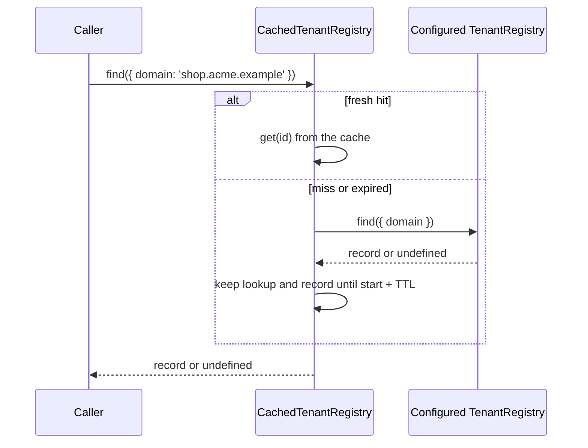

# Tenant registries

A tenant registry answers which tenants exist: it looks a tenant up by id, slug or domain and lists them. `tenancy.registry` names the registry; `tenantRegistry()` returns it behind a cache.

## The tenant record

`TenantRecord` is what a registry returns.

| Field | Type | Meaning |
| --- | --- | --- |
| `id` | `string` | Tenant id, matching `TENANT_ID_PATTERN` |
| `slug` | `string` | Short name used in URLs and subdomains |
| `name` | `string` | Display name |
| `state` | `TenantState` | `'provisioning'`, `'active'`, `'suspended'`, `'deleting'` or `'deleted'` (`TENANT_STATES`) |
| `domains` | `readonly string[]` | The tenant's own host names, lower case |
| `placement` | `TenantPlacement`, optional | `{ kind: 'schema', schema }`: where the tenant's data lives; this package stores it and does not read it |
| `settings` | `Readonly<Record<string, unknown>>` | Free-form settings; this package stores them and does not read them |

`tenantRecord(input)` builds a complete, frozen record from `{ id, ... }`:

- `slug` and `name` default to the id; `state` defaults to `'active'`.
- `domains` are lower-cased; `domains` and `settings` default to empty.
- A bad id throws `InvalidArgument`.

## How it works

1. `tenantRegistry(container = DI.RootContainer)` resolves `TenancyServices` in the container.
2. On its first resolve, `TenancyServices.resolve()` reads `tenancy.registry` (default `'ConfigTenantRegistry'`) and resolves the `TenantRegistry` registered under that name (`resolveNamedService`, nearest container first).
3. It wraps that registry in a `CachedTenantRegistry` with the TTL `tenancy.registryCacheMs` (default `5000`).
4. `tenantRegistry()` returns the `CachedTenantRegistry`; `.inner` is the configured registry.
5. A name that no class is registered under throws `InvalidOption` ("no TenantRegistry is registered under that name (registered: ...)"), and a non-string value throws `InvalidOption` too.

### Lookups through the cache

`CachedTenantRegistry` caches `get` and `find`, misses included. It never caches `list`.

1. The TTL is read on every call. It is `0`, and nothing is cached, when the inner registry's `cacheable` is `false` or `tenancy.registryCacheMs` is `0`, negative or not finite.
2. `get(id)`: a hit younger than the TTL answers. Otherwise the inner registry answers, and the result (a record or `undefined`) is kept until the lookup start plus the TTL.
3. `find({ slug, domain })`: the key is the slug and the lower-cased domain. A hit holds the tenant id and answers through `get(id)`; a remembered miss answers `undefined`. Otherwise the inner registry answers, and both the lookup and the record are kept.
4. `invalidate(id)` forgets that tenant, every slug or domain lookup that found it, and every remembered slug or domain miss. `invalidate()` forgets everything.
5. A lookup still running when `invalidate` is called returns what it read but stores nothing.
6. Each of the two maps holds at most 10,000 entries; a full map is cleared before the next entry.



## Shipped registries

| Registry | `cacheable` | Answers from |
| --- | --- | --- |
| `ConfigTenantRegistry` (default) | `false` | The list under `tenancy.tenants`, parsed with `tenantRecord`. It parses again whenever the configured list is replaced by another array. |
| `MemoryTenantRegistry` | `false` | Records added in the process with `add(record)` and changed with `set(id, patch)`. For tests and single-process setups. |
| `ListedTenantRegistry` (abstract) | `false` | Whatever its subclass returns from `records()`. Base of the two above. |

`ListedTenantRegistry` behaviour, shared by both shipped registries:

- `find` with both `slug` and `domain` needs both to match; with neither it returns `undefined`.
- Domain matching ignores case.
- `list({ states })` returns the records in those states; `list()` returns all, in list order.

`MemoryTenantRegistry`:

- `add(record)` builds the record with `tenantRecord` and replaces any tenant with the same id.
- `set(id, patch)` merges `patch` into the record and keeps the id, even when `patch` has another one. An unknown id throws `InvalidArgument`.

`ConfigTenantRegistry` refuses an entry with no string `id` (`tenancy.tenants[0] needs an id`), or with a `state` outside `TENANT_STATES` (`tenancy.tenants[0].state "disabled" is not a tenant state`), with `InvalidOption`; an id outside `TENANT_ID_PATTERN` throws `InvalidArgument`. Both happen on the lookup that parses the list.

## Configuration

| Key | Type | Default | Allowed values | Meaning |
| --- | --- | --- | --- | --- |
| `tenancy.registry` | string | `'ConfigTenantRegistry'` | a class registered under `TenantRegistry` | The registry `tenantRegistry()` wraps |
| `tenancy.registryCacheMs` | integer | `5000` | `0` or more | TTL of the registry cache; `0` turns it off |
| `tenancy.tenants` | object[] | `[]` | see [Configuration](06-configuration.md#tenant-entries) | The tenants of `ConfigTenantRegistry` |

```ts
tenancy: {
  registry: 'ConfigTenantRegistry',
  registryCacheMs: 5000,
  tenants: [
    { id: 'acme', slug: 'acme-inc', name: 'Acme Inc', domains: ['shop.acme.example'] },
    { id: 'globex', name: 'Globex', state: 'suspended', placement: { kind: 'schema', schema: 't_globex' } },
  ],
},
```

## Services and extension points

| Service | DI token and lifetime | Default implementation | Alternatives | How to replace or extend |
| --- | --- | --- | --- | --- |
| `TenantRegistry` | `TenantRegistry`, named registrations (`@Injectable(TenantRegistry)` registers the class under its name); resolved by name from `tenancy.registry` once per `TenancyServices` | `ConfigTenantRegistry` | `MemoryTenantRegistry` | Register your class under `TenantRegistry` and set `tenancy.registry` to its name. Subclass `ListedTenantRegistry` (implement `records()`) for a registry held in memory, or `TenantRegistry` for one that queries a store. |
| `CachedTenantRegistry` | none: `TenancyServices` builds it around the configured registry | `CachedTenantRegistry` | none | Not replaceable. Return `false` from `cacheable` to bypass it; call `invalidate()` after a change. |
| `TenancyServices` | `TenancyServices` (`AsyncService`), resolved with `container.resolve`; one instance per container | `TenancyServices` | none | Not meant to be replaced. Holds `registry` and `access`. |

The named registry and access check are resolved once per `TenancyServices`, on the first `tenantRegistry()`, `tenantAccess()`, `admitTenant()` or `forEachTenant()` call in a container. Import the module that registers your class before that call, and set `tenancy.registry` before it; a later change of the key is not picked up.

### `TenantRegistry`: custom implementation

Replace the registry when tenants live outside the configuration: a database, a control-plane service. Implement `get`, `find` and `list`; leave `cacheable` `true` so the cache sits in front of a remote store.

- `get(id)` returns the record or `undefined`.
- `find({ slug, domain })` returns the first record matching every field given, or `undefined` when none is given. Compare domains without case.
- `list({ states })` returns the records in those states. `forEachTenant` filters again, but a registry that filters saves the transfer.
- Return records built with `tenantRecord`, so they are complete and frozen.

```ts sample
import { DI, Injectable } from '@spinajs/di';
import { Configuration, FrameworkConfiguration } from '@spinajs/configuration';
import { TenantRegistry, tenantRecord, tenantRegistry } from '@spinajs/tenancy';
import type { TenantRecord, TenantState } from '@spinajs/tenancy';

interface ControlPlaneTenant {
  id: string;
  slug: string;
  name: string;
  state: TenantState;
  domains: string[];
}

const TENANTS_API = 'https://control-plane.internal/api/tenants';

@Injectable(TenantRegistry)
export class ControlPlaneTenantRegistry extends TenantRegistry {
  public async get(id: string): Promise<TenantRecord | undefined> {
    return this.fetchOne(`${TENANTS_API}/${encodeURIComponent(id)}`);
  }

  public async find(by: { slug?: string; domain?: string }): Promise<TenantRecord | undefined> {
    if (by.slug === undefined && by.domain === undefined) return undefined;
    const query = new URLSearchParams();
    if (by.slug !== undefined) query.set('slug', by.slug);
    if (by.domain !== undefined) query.set('domain', by.domain.toLowerCase());
    return this.fetchOne(`${TENANTS_API}?${query.toString()}`);
  }

  public async *list(filter?: { states?: TenantState[] }): AsyncIterable<TenantRecord> {
    const response = await fetch(TENANTS_API);
    const tenants = (await response.json()) as ControlPlaneTenant[];
    for (const tenant of tenants) {
      if (filter?.states === undefined || filter.states.includes(tenant.state)) yield tenantRecord(tenant);
    }
  }

  private async fetchOne(url: string): Promise<TenantRecord | undefined> {
    const response = await fetch(url);
    if (response.status === 404) return undefined;
    if (!response.ok) throw new Error(`control plane answered ${response.status}`);
    return tenantRecord((await response.json()) as ControlPlaneTenant);
  }
}

export class ControlPlaneConfiguration extends FrameworkConfiguration {
  protected onLoad(): unknown {
    return { tenancy: { registry: 'ControlPlaneTenantRegistry', registryCacheMs: 30_000 } };
  }
}

DI.register(ControlPlaneConfiguration).as(Configuration);

// Called by the control-plane webhook after a tenant is suspended or renamed.
export async function onTenantChanged(tenantId: string): Promise<void> {
  (await tenantRegistry()).invalidate(tenantId);
}
```

### `ListedTenantRegistry`: tenants held in memory

Extend `ListedTenantRegistry` when the whole list is at hand. Implement `records()`; `get`, `find` and `list` come with it, and `cacheable` is `false`.

```ts sample
import { Injectable } from '@spinajs/di';
import { ListedTenantRegistry, TenantRegistry, tenantRecord } from '@spinajs/tenancy';
import type { TenantRecord } from '@spinajs/tenancy';

/** The tenants of a single-customer install, from TENANTS=acme,globex. */
@Injectable(TenantRegistry)
export class EnvTenantRegistry extends ListedTenantRegistry {
  private readonly listed: readonly TenantRecord[] = (process.env.TENANTS ?? '')
    .split(',')
    .map((id) => id.trim())
    .filter((id) => id !== '')
    .map((id) => tenantRecord({ id }));

  protected records(): readonly TenantRecord[] {
    return this.listed;
  }
}
```

## Important behaviour

- With the default `ConfigTenantRegistry` or `MemoryTenantRegistry`, `tenancy.registryCacheMs` has no effect: both answer from memory and are not cacheable.
- Behind a cacheable registry, a tenant suspended in the store stays admitted for up to `tenancy.registryCacheMs` unless you call `invalidate(id)`.
- Misses are cached too: a tenant created in the store is unknown for up to the TTL unless you call `invalidate(id)` or `invalidate()`.
- The TTL counts from the start of the lookup, not from its answer.
- `tenantRegistry()` defaults to `DI.RootContainer`; pass a container to read another one. `forEachTenant()` always reads the registry of `DI.RootContainer`.

## Best practices

- Call `invalidate(id)` from the code that changes a tenant (state, domains, slug). `invalidate(id)` also drops every remembered slug and domain miss, and the remembered miss of that id, so it covers a new tenant.
- Use `MemoryTenantRegistry` in tests: set `tenancy.registry: 'MemoryTenantRegistry'` and add tenants through `(await tenantRegistry()).inner`.
- Keep `cacheable` `true` for a registry that does I/O; return `false` only for one that answers from memory.

## Patterns and antipatterns

```ts
// Don't: changes the store and leaves the cache answering "active" for up to registryCacheMs
await tenants.update('acme', { state: 'suspended' });

// Do: invalidate the tenant after the change
await tenants.update('acme', { state: 'suspended' });
(await tenantRegistry()).invalidate('acme');
```

## Examples

### Seed tenants in a test

```ts sample
import { MemoryTenantRegistry, admitTenant, tenantRegistry } from '@spinajs/tenancy';

// The test configuration sets tenancy.registry to 'MemoryTenantRegistry'.
export async function seedTenants(): Promise<void> {
  const registry = (await tenantRegistry()).inner;
  if (!(registry instanceof MemoryTenantRegistry)) throw new Error('set tenancy.registry to MemoryTenantRegistry');

  registry.add({ id: 'acme', slug: 'acme-inc', domains: ['shop.acme.example'] });
  registry.add({ id: 'globex', state: 'suspended' });
  registry.set('globex', { state: 'active' });

  const acme = await admitTenant({ domain: 'Shop.Acme.Example' });
  console.log(acme.slug); // 'acme-inc'
}
```

## Related

- [Tenant admission and access](04-admission-and-access.md): `admitTenant` looks tenants up through this registry.
- [Running across tenants](05-running-across-tenants.md): `forEachTenant` lists tenants through it.
- [Configuration](06-configuration.md): every `tenancy.*` key.
- [`@spinajs/configuration`](../configuration/README.md): named services resolved from a configuration key.
