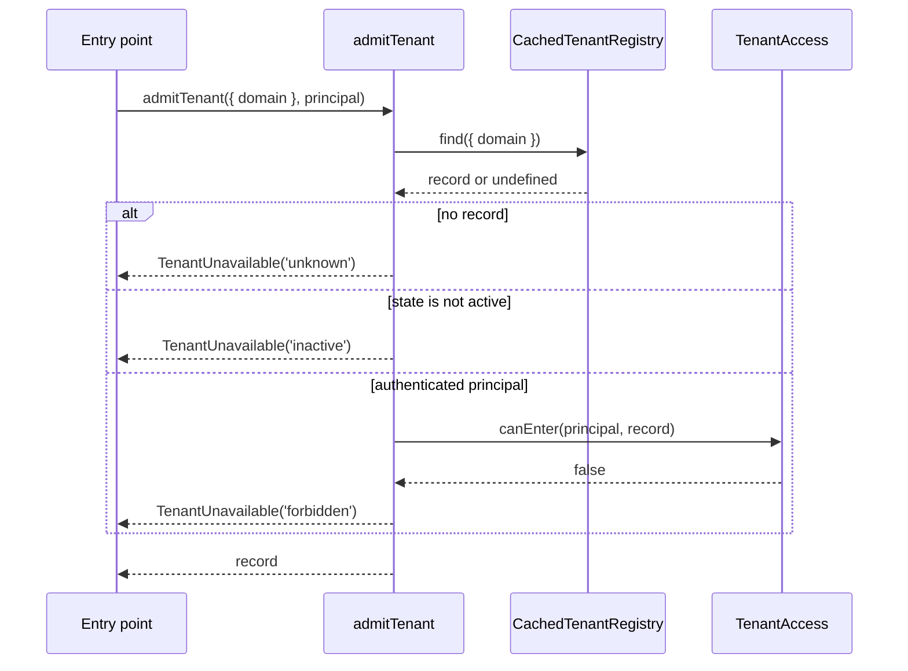

# Tenant admission and access

`admitTenant` turns a proposed tenant (an id, a slug or a domain) into its record, once the registry knows it, it is active, and the principal may enter it. Use it at every entry point before you enter a tenant whose name came from outside. `TenantAccess` decides who may enter; `TenantResolver` is the port that proposes a tenant from a request or message.

## How it works

`admitTenant(proposal, principal?, container = DI.RootContainer)`:

1. `container.resolve(TenancyServices)` gives the cached registry and the configured `TenantAccess`.
2. The proposal is looked up through the cached registry:
   - a string that is a tenant id: `registry.get(id)`; a string that is not (`'Not An Id'`) finds nothing;
   - `{ slug }`: `registry.find({ slug })`;
   - `{ domain }`: `registry.find({ domain })`.
3. No record: throws `TenantUnavailable` with `reason: 'unknown'` ("no such tenant").
4. A state other than `'active'`: throws `TenantUnavailable` with `reason: 'inactive'` (`tenant "acme" is suspended`).
5. An authenticated principal (`principal.authenticated === true`) for whom `TenantAccess.canEnter(principal, record)` is `false`: throws `TenantUnavailable` with `reason: 'forbidden'` (`user:bob may not enter tenant "acme"`).
6. Returns the record. `admitTenant` does **not** enter the tenant: pass `record.id` to `runInTenant` or `tenantScopeOf`.



### The default access check

`PrincipalAttributeTenantAccess.canEnter` is `true` when `principal.attributes.tenants` is an array that holds the tenant id. Any other value (missing, a string) refuses.

### Proposals and resolvers

`TenantProposal` is what a resolver proposes: `string` (a tenant id), `{ slug }` or `{ domain }`.

`TenantResolver` is an abstract class with two members:

| Member | Meaning |
| --- | --- |
| `trusted: boolean` | `false` for a source the client sets on its own (a header). The caller honours it only for an authenticated principal. |
| `resolve(source: unknown): TenantProposal \| undefined` | The proposal read from `source`, or `undefined` when the source names no tenant |

This package ships no resolver and does not call one. [`@spinajs/tenancy-http`](../tenancy-http/README.md) ships the HTTP and socket resolvers, asks them in the order of `tenancy.http.resolvers`, skips an untrusted resolver for a principal that is not authenticated, and passes the first proposal to `admitTenant`.

## Errors

`TenantUnavailable` extends `Exception` and carries `reason: TenantUnavailableReason`:

| `reason` | Meaning |
| --- | --- |
| `'unknown'` | The registry does not know the proposal, or the string is not a tenant id |
| `'inactive'` | The tenant is `provisioning`, `suspended`, `deleting` or `deleted` |
| `'forbidden'` | `TenantAccess.canEnter` refused an authenticated principal |

## Configuration

| Key | Type | Default | Allowed values | Meaning |
| --- | --- | --- | --- | --- |
| `tenancy.access` | string | `'PrincipalAttributeTenantAccess'` | a class registered under `TenantAccess` | The access check `admitTenant` asks |
| `tenancy.registry` | string | `'ConfigTenantRegistry'` | a class registered under `TenantRegistry` | The registry `admitTenant` looks tenants up in; see [Tenant registries](03-tenant-registries.md) |

```ts
tenancy: {
  access: 'PrincipalAttributeTenantAccess',
},
```

## Services and extension points

| Service | DI token and lifetime | Default implementation | Alternatives | How to replace or extend |
| --- | --- | --- | --- | --- |
| `TenantAccess` | `TenantAccess`, named registrations (`@Injectable(TenantAccess)`); resolved by name from `tenancy.access` once per `TenancyServices` | `PrincipalAttributeTenantAccess` | none shipped | Register your class under `TenantAccess` and set `tenancy.access` to its name. Extend `PrincipalAttributeTenantAccess` and call `super.canEnter` to keep the attribute rule. |
| `TenantResolver` | `TenantResolver`; this package registers none and resolves none | none in this package | the resolvers of `@spinajs/tenancy-http` | Extend `TenantResolver`. For HTTP, register a class named `<Name>TenantResolver` under `TenantResolver` and list `<name>` in `tenancy.http.resolvers` (see [`@spinajs/tenancy-http`](../tenancy-http/README.md)); elsewhere, call it yourself. |

`tenantAccess(container = DI.RootContainer)` returns the configured `TenantAccess`. Register a replacement before the first `tenantRegistry()`, `tenantAccess()`, `admitTenant()` or `forEachTenant()` call in the container: `TenancyServices` resolves both names once.

### `TenantAccess`: custom implementation

Replace the access check when membership is not on the principal: support staff who enter every tenant, a membership table. `canEnter` is asked for authenticated principals only.

```ts sample
import { DI, Injectable } from '@spinajs/di';
import { Configuration, FrameworkConfiguration } from '@spinajs/configuration';
import type { Principal } from '@spinajs/principal';
import { PrincipalAttributeTenantAccess, TenantAccess, admitTenant } from '@spinajs/tenancy';
import type { TenantRecord } from '@spinajs/tenancy';

/** Support staff enter every tenant; everyone else the tenants listed in `attributes.tenants`. */
@Injectable(TenantAccess)
export class SupportStaffTenantAccess extends PrincipalAttributeTenantAccess {
  public override async canEnter(principal: Principal, tenant: TenantRecord): Promise<boolean> {
    const roles = principal.attributes.roles;
    if (Array.isArray(roles) && roles.includes('support')) return true;
    return super.canEnter(principal, tenant);
  }
}

export class SupportConfiguration extends FrameworkConfiguration {
  protected onLoad(): unknown {
    return { tenancy: { access: 'SupportStaffTenantAccess' } };
  }
}

DI.register(SupportConfiguration).as(Configuration);

export async function openTicketView(principal: Principal, tenantSlug: string): Promise<TenantRecord> {
  return admitTenant({ slug: tenantSlug }, principal);
}
```

### `TenantResolver`: custom implementation

Write a resolver when a source outside HTTP names the tenant: a queue message, a CLI argument. Return `undefined` for a source that names none, and admit the proposal before you enter it.

```ts sample
import type { Principal } from '@spinajs/principal';
import { TenantResolver, admitTenant, runInTenant } from '@spinajs/tenancy';
import type { TenantProposal } from '@spinajs/tenancy';

interface InvoiceJob {
  invoiceId: string;
  tenant?: string;
}

const isInvoiceJob = (value: unknown): value is InvoiceJob =>
  value !== null && typeof value === 'object' && typeof (value as { invoiceId?: unknown }).invoiceId === 'string';

/** The tenant id a producer wrote into the job; the queue is internal, so the source is trusted. */
export class InvoiceJobTenantResolver extends TenantResolver {
  public readonly trusted: boolean = true;

  public resolve(source: unknown): TenantProposal | undefined {
    return isInvoiceJob(source) && typeof source.tenant === 'string' ? source.tenant : undefined;
  }
}

const resolver = new InvoiceJobTenantResolver();

export async function handleInvoiceJob(job: InvoiceJob, sender: Principal): Promise<void> {
  const proposal = resolver.resolve(job);
  if (proposal === undefined) throw new Error(`invoice job ${job.invoiceId} names no tenant`);

  const tenant = await admitTenant(proposal, sender);
  await runInTenant(tenant.id, async () => {
    console.log(`issuing invoice ${job.invoiceId} for ${tenant.name}`);
  });
}
```

## Important behaviour

- `TenantAccess` is asked for an authenticated principal only. With no principal, an anonymous or an unattended one, `admitTenant` admits every active tenant. Decide at the entry point whether that is allowed.
- `SYSTEM` from `@spinajs/principal` is authenticated and has no `attributes.tenants`, so the default access check refuses it. Code running as `SYSTEM` calls `admitTenant` without a principal, or the access check must allow it.
- `admitTenant` reads through the registry cache: behind a cacheable registry, a tenant suspended in the store is admitted until the TTL passes or `invalidate(id)` runs.
- `admitTenant` checks `state === 'active'` only; `forEachTenant` with other states does not go through it.

## Best practices

- Admit every tenant name that came from outside the process (a host, a header, a message) before you enter it.
- Map `TenantUnavailable` to your transport's answer; `@spinajs/tenancy-http` answers all three reasons with the one status in `tenancy.http.unknownTenant` (404 or 403).
- Set `trusted` to `false` when the client sets the source freely, and in your own entry points ask such a resolver only for an authenticated principal, as `@spinajs/tenancy-http` does.

## Patterns and antipatterns

```ts
// Don't: enters whatever tenant the header names; no registry, state or access check
await runInTenant(String(req.headers['x-tenant']), handler);

// Do: admit first, then enter the record's id
const tenant = await admitTenant(String(req.headers['x-tenant']), principal);
await runInTenant(tenant.id, handler);
```

## Related

- [Tenant registries](03-tenant-registries.md): where `admitTenant` looks the tenant up, and its cache.
- [Tenant scope](01-tenant-scope.md): enter the admitted tenant with `runInTenant`.
- [`@spinajs/tenancy-http`](../tenancy-http/README.md): the HTTP and socket resolvers and the refusal status.
- [`@spinajs/authz`](../authz/README.md): principals and `runWithPrincipal`.
