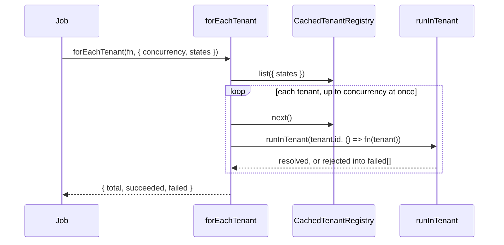

# Running across tenants

`forEachTenant(fn, options)` runs `fn` once per tenant of the registry, each inside `runInTenant`, and returns a report instead of stopping at the first failure. Use it for scheduled jobs that touch every tenant: billing, cleanup, reports.

## How it works

1. `options.concurrency` (default `1`) must be a positive integer; otherwise the call rejects with `InvalidArgument`.
2. `tenantScope()` is read. Inside a single-tenant scope the call rejects with `TenantSwitchDenied` ("forEachTenant cannot run inside tenant "a"; leave the scope with runAcrossTenants(reason) first"). No scope and the cross-tenant scope are both allowed.
3. `tenantRegistry()` gives the registry of `DI.RootContainer`, and `registry.list({ states })` is called once, with `options.states` (default `['active']`). The cache never caches `list`, so each run reads the current list.
4. `concurrency` workers pull tenants from the list, one `next()` at a time, so the registry's iterator never sees overlapping calls.
5. A tenant whose `state` is not in `states` is skipped, even when the registry ignored the filter. Skipped tenants are not counted.
6. Each counted tenant runs as `runInTenant(tenant.id, () => fn(tenant))`: its own scope, its own store copy, an empty authz cache, and the scope guards asked.
7. A rejection of `fn`, or of `runInTenant` (a guard refusal, a bad id), is recorded as `{ tenant, error }`; the other tenants go on.
8. When every worker has finished, the call returns the `TenantRunReport`.



## Options and report

`ForEachTenantOptions`:

| Option | Type | Default | Meaning |
| --- | --- | --- | --- |
| `concurrency` | `number` | `1` | Tenants handled at once; a positive integer |
| `states` | `TenantState[]` | `['active']` | States of the tenants visited |

`TenantRunReport`:

| Field | Type | Meaning |
| --- | --- | --- |
| `total` | `number` | Tenants `fn` was started for |
| `succeeded` | `number` | `total` minus the failures |
| `failed` | `readonly TenantRunFailure[]` | `{ tenant: string; error: unknown }` per failed tenant |

## Important behaviour

- `forEachTenant` reads the registry of `DI.RootContainer`; it takes no container argument.
- It does not go through `admitTenant`: tenants in the given states are visited without an access check, as whatever principal is ambient.
- An error thrown by the registry's iterator (`next()` rejects) rejects the whole call, and the report is lost. Workers still running are not stopped.
- With `concurrency: 1` the tenants run in list order. With more, they start in list order and finish in any order; `failed` is in finish order.
- `fn` gets the record as `list` yielded it. The shipped registries take their snapshot when `list` is called, so a tenant suspended during the run is still visited.

## Best practices

- Call it from `runAcrossTenants(reason, ...)` in a scheduled job: the reason reaches the guards, and code outside `fn` sees the cross-tenant scope rather than no scope.
- Read `report.failed` and log or retry each entry; `forEachTenant` resolves even when every tenant failed.
- Raise `concurrency` only as far as the shared resources `fn` uses (the database pool, an API quota) allow.
- Pass `states: ['suspended']` or another state list only for jobs meant for those tenants, such as purging `deleting` tenants.

## Patterns and antipatterns

```ts
// Don't: one failing tenant stops the loop, and runInTenant from inside a tenant throws
for (const id of tenantIds) await runInTenant(id, () => closeBillingPeriod(id));

// Do: every active tenant runs, failures are reported
const report = await runAcrossTenants('nightly billing', () => forEachTenant((tenant) => closeBillingPeriod(tenant.id)));
```

## Examples

### Close the billing period of every tenant every night

```ts sample
import { forEachTenant, requireTenant, runAcrossTenants } from '@spinajs/tenancy';
import type { TenantRecord, TenantRunReport } from '@spinajs/tenancy';

async function closeBillingPeriod(tenant: TenantRecord): Promise<void> {
  const inScope = requireTenant();
  console.log(`closing the billing period of ${tenant.name} (${inScope.id})`);
}

export async function nightlyBilling(): Promise<TenantRunReport> {
  const report = await runAcrossTenants('nightly billing', () => forEachTenant(closeBillingPeriod, { concurrency: 4 }));

  for (const failure of report.failed) {
    console.error(`billing failed for ${failure.tenant}`, failure.error);
  }
  console.log(`billing closed for ${report.succeeded} of ${report.total} tenants`);
  return report;
}
```

### Purge tenants marked for deletion

```ts sample
import { forEachTenant, runAcrossTenants } from '@spinajs/tenancy';

export async function purgeDeletedTenants(): Promise<string[]> {
  const purged: string[] = [];
  const report = await runAcrossTenants('tenant purge', () =>
    forEachTenant(
      async (tenant) => {
        purged.push(tenant.id);
      },
      { states: ['deleting'] },
    ),
  );
  if (report.failed.length > 0) throw new Error(`purge failed for ${report.failed.map((f) => f.tenant).join(', ')}`);
  return purged;
}
```

## Related

- [Tenant scope](01-tenant-scope.md): `runInTenant` and `runAcrossTenants`, which this builds on.
- [Tenant registries](03-tenant-registries.md): the `list` it reads.
- [Scope guards and entry-point glue](02-scope-guards-and-entry-points.md): guards run once per tenant.
