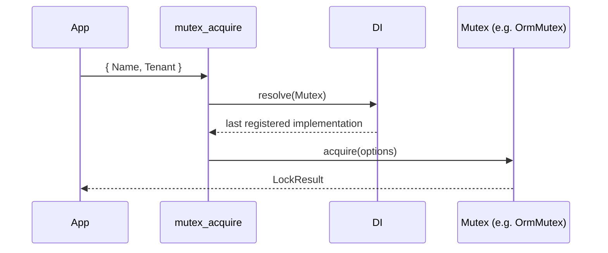

# Named mutex

Lock a named resource so only one owner works on it at a time, across processes that share a backend. Use it for scheduled jobs, imports and migrations that must not run twice in parallel.

The helpers are thin wrappers: each one resolves the registered `Mutex` and calls the method of the same name. Where the lock lives, and how strong it is, depends on that backend; see [Mutex backends](02-mutex-backends.md).

## How it works

1. You register a backend once at startup: `DI.register(OrmMutex).as(Mutex)`.
2. A helper, for example `mutex_acquire(options)`, calls `DI.resolve(Mutex)` on the root container.
3. DI returns the singleton of the last class registered as `Mutex`.
4. The helper returns the promise of the matching method: `acquire`, `release`, `create`, `delete`, `get` or `wait`.
5. Without a registration, DI builds the abstract `Mutex` itself and the call throws `TypeError: DI.resolve(...).acquire is not a function`.

| Helper | Calls | Returns |
| --- | --- | --- |
| `mutex_acquire(options: MutexLockOptions)` | `Mutex.acquire` | `Promise<LockResult>`: `Locked: true` when `options.Tenant` holds the lock. Creates the lock when missing. Does **not** wait. |
| `mutex_release(options: MutexLockOptions, deleteOnClose?: boolean)` | `Mutex.release` | `Promise<boolean>`: `true` when the lock was released, or deleted with `deleteOnClose`. |
| `mutex_wait(name: string, timeout?: number)` | `Mutex.wait` | `Promise<boolean>`: `true` once the lock is free, `false` after `timeout` ms. `0` or no timeout waits forever. |
| `mutex_create(options: MutexLockOptions)` | `Mutex.create` | `Promise<MutexLock>`: the lock, created unlocked when missing. |
| `mutex_delete(options: MutexLockOptions)` | `Mutex.delete` | `Promise<boolean>`: `true` when the lock was deleted. |
| `mutex_get(name: string)` | `Mutex.get` | `Promise<MutexLock \| null>`: the lock data, or `null` when missing. |

### Types

| Type | Fields |
| --- | --- |
| `MutexLockOptions` | `Name: string`; `Tenant?: string`, who locks. The backend picks a default when it is missing: `OrmMutex` uses `app.name`. |
| `MutexLock` | `Name: string`, `Tenant: string` (current or last owner), `Locked: boolean`, `Created_at: DateTime`, `Updated_at: DateTime` (Luxon). |
| `LockResult` | `Locked: boolean`, `true` when the lock is granted; `Mutex: MutexLock`, the lock data. |



## Services and extension points

| Service | DI token and lifetime | Default implementation | Alternatives | How to replace or extend |
| --- | --- | --- | --- | --- |
| `Mutex` | `Mutex` abstract class; singleton per implementation class; resolved by type on every helper call | none | `OrmMutex` from `@spinajs/orm-threading`; your own subclass | `DI.register(MyMutex).as(Mutex)`, or subclass `OrmMutex`. See [Mutex backends](02-mutex-backends.md). |

The helpers are plain functions, not services: replace the backend, not the helpers.

## Important behaviour

- `mutex_acquire()` never blocks. A held lock returns `Locked: false` at once; poll with `mutex_wait()` and acquire again.
- `mutex_wait()` and `mutex_acquire()` are separate calls. Another owner can take the lock between them, so always check `Locked`.
- The tenant is the identity of the owner. Two calls with the same `Tenant` both get `Locked: true`, so give each process or worker its own tenant, such as `` `worker-${process.pid}` ``.
- With `OrmMutex`, a missing `Tenant` falls back to `app.name`. Every instance of the same app then shares one tenant and none of them is blocked. See [Database mutex](../orm-threading/01-database-mutex.md#important-behaviour).
- Release passes the same `Name` and `Tenant` you acquired with. `OrmMutex` matches both, so a release with another tenant returns `false` and leaves the lock held.
- `OrmMutex` locks have no expiry. A process that dies while holding one leaves it locked until someone releases or deletes it.
- Each helper resolves `Mutex` again, so a backend registered later replaces the earlier one for every following call.

## Best practices

- Release in `finally`, with the same options object you acquired with.
- Build the tenant from something unique per process: host name and `process.pid`.
- Pass a `timeout` to `mutex_wait()` in request handlers; without one it waits forever.
- Inject the backend with `@Autoinject(Mutex)` in services you unit test; the test registers a fake `Mutex` (see [Mutex backends](02-mutex-backends.md#replace-the-backend-in-tests)).

## Patterns and antipatterns

```ts
// Don't: no tenant, so every instance of the app is the same owner and all of them get Locked: true
const lock = await mutex_acquire({ Name: 'invoice-export' });
await exportInvoices();

// Do: one tenant per process, check the result, release in finally
const options = { Name: 'invoice-export', Tenant: `${hostname()}-${process.pid}` };
const lock = await mutex_acquire(options);
if (lock.Locked) {
  try {
    await exportInvoices();
  } finally {
    await mutex_release(options);
  }
}
```

```ts
// Don't: wait() only reports that the lock was free at one moment
await mutex_wait('price-import');
await importPrices();

// Do: wait, then acquire and check
if (await mutex_wait('price-import', 30_000)) {
  const lock = await mutex_acquire(options);
  // ...
}
```

## Examples

### Run the nightly invoice export on one instance only

```ts sample
import { hostname } from 'node:os';
import { DI } from '@spinajs/di';
import { Mutex, MutexLockOptions, mutex_acquire, mutex_release } from '@spinajs/threading';
import { OrmMutex } from '@spinajs/orm-threading';

DI.register(OrmMutex).as(Mutex);

const exportLock: MutexLockOptions = {
  Name: 'nightly-invoice-export',
  Tenant: `${hostname()}-${process.pid}`,
};

export async function runNightlyExport(exportInvoices: () => Promise<number>): Promise<number | null> {
  const result = await mutex_acquire(exportLock);
  if (!result.Locked) {
    return null;
  }

  try {
    return await exportInvoices();
  } finally {
    await mutex_release(exportLock);
  }
}
```

### Wait for a running import, then take the lock

```ts sample
import { mutex_acquire, mutex_release, mutex_wait } from '@spinajs/threading';

export async function rebuildCatalog(rebuild: () => Promise<void>): Promise<'done' | 'busy'> {
  const options = { Name: 'catalog', Tenant: `catalog-rebuild-${process.pid}` };

  for (let attempt = 0; attempt < 3; attempt++) {
    const free = await mutex_wait(options.Name, 60_000);
    if (!free) {
      return 'busy';
    }

    const lock = await mutex_acquire(options);
    if (lock.Locked) {
      try {
        await rebuild();
        return 'done';
      } finally {
        await mutex_release(options);
      }
    }
  }

  return 'busy';
}
```

### Show who holds a lock

```ts sample
import { mutex_get } from '@spinajs/threading';

export async function describeLock(name: string): Promise<string> {
  const lock = await mutex_get(name);
  if (!lock) {
    return `${name}: never created`;
  }

  return lock.Locked ? `${name}: held by ${lock.Tenant} since ${lock.Updated_at.toISO()}` : `${name}: free`;
}
```

### Inject the backend into a service

```ts sample
import { AsyncService, Autoinject, Injectable } from '@spinajs/di';
import { Mutex } from '@spinajs/threading';

@Injectable()
export class StockSync extends AsyncService {
  @Autoinject(Mutex)
  protected mutex: Mutex;

  public async sync(warehouse: string, pull: () => Promise<void>): Promise<boolean> {
    const options = { Name: `stock-sync-${warehouse}`, Tenant: `stock-sync-${process.pid}` };

    const lock = await this.mutex.acquire(options);
    if (!lock.Locked) {
      return false;
    }

    try {
      await pull();
      return true;
    } finally {
      await this.mutex.release(options, true);
    }
  }
}
```

`release(options, true)` deletes the lock row instead of unlocking it; use it for locks with a one-off name.

## Related

- [Mutex backends](02-mutex-backends.md): the `Mutex` contract, registration and custom backends.
- [Database mutex](../orm-threading/01-database-mutex.md): how `OrmMutex` implements each method, and its limits.
- [Task locking](../tasks/02-task-locking.md): `@Task()` uses `mutex_acquire()` and `mutex_release()`.
- [Critical section and rate limit](03-critical-section-and-rate-limit.md): in-process queuing that needs no backend.
