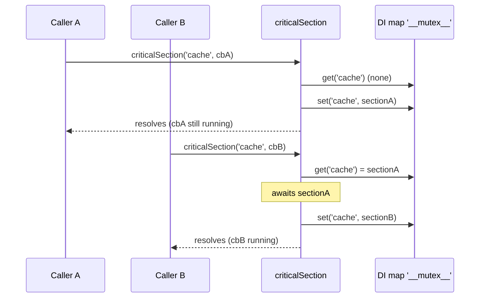

# Critical section and rate limit

`criticalSection(name, callback)` queues a callback behind the section running under the same name, inside the current Node.js process. `rateLimit(name, callback, ms)` does the same and runs the callback `ms` milliseconds after its turn comes.

Both are promise-based and keep no state outside the process. They do **not** coordinate processes or servers; use the [named mutex](01-named-mutex.md) for that. Read [Important behaviour](#important-behaviour) before you rely on them: the guarantees are weaker than the names suggest.

## How it works

`criticalSection(name, callback)`:

1. Resolves the logger with `DI.resolve('__log__', ['THREADING'])`.
2. Reads the section registry: the `Map<string, Promise<void>>` stored in the DI cache under `'__mutex__'` (`DI.get('__mutex__')`).
3. Takes the promise stored under `name`, or a resolved promise when there is none, and awaits it.
4. Starts the section: logs `Entering critical section <name>` at `trace`, calls `callback()`, logs `Leaving critical section <name>` in `finally`.
5. Stores the section's promise under `name` with `DI.register(promise).asMapValue('__mutex__', name)`.
6. Resolves its own promise with `undefined` right after step 5. It does **not** wait for `callback` to finish.

On a callback error, the section stores a resolved promise under `name` (so the next call is not blocked) and rethrows. The rethrow rejects the stored section promise, not the promise returned to the caller; see [Important behaviour](#important-behaviour).

`rateLimit(name, callback, ms)` calls `criticalSection(name, () => delay(ms, callback))`. The callback runs `ms` ms after the previous section under `name` ends.



## Services and extension points

| Service | DI token and lifetime | Default implementation | Alternatives | How to replace or extend |
| --- | --- | --- | --- | --- |
| Logger | `'__log__'` string token; a factory, called on every `criticalSection` call with `['THREADING']` | `logFactoryFunction`, registered when `@spinajs/log` is imported; returns the `THREADING` logger | any factory registered as `'__log__'` | `DI.register((container, name) => logger).as('__log__')`. The last registration wins for every package that resolves `'__log__'`. |
| Section registry | `'__mutex__'` value map in the root DI cache, created on first use | `Map<string, Promise<void>>` | none | Not an extension point. Read it with `DI.get('__mutex__')`; `DI.clearCache()` drops it with every running section. |

### Logger: run without `@spinajs/log`

`criticalSection` needs a `'__log__'` factory. Without one, `DI.resolve('__log__', ...)` returns `null`, the section throws inside, the callback never runs, and Node.js reports an unhandled rejection. Import `@spinajs/log`, or register a small factory in scripts and tests.

The factory receives the container and the logger name. The section only calls `trace(...)` on the result.

```ts sample
import { DI, IContainer } from '@spinajs/di';
import { criticalSection } from '@spinajs/threading';

const traces: string[] = [];

DI.register((_container: IContainer, name: string) => ({
  trace: (vars: { section: string }, message: string) => traces.push(`${name}: ${message.replace('${section}', vars.section)}`),
})).as('__log__');

export async function warmCache(load: () => Promise<void>): Promise<string[]> {
  await criticalSection('cache-warmup', load);
  return traces;
}
```

The factory replaces the logger for every package that resolves `'__log__'`, so keep it to scripts and tests.

## Important behaviour

- **The returned promise does not track the callback.** It resolves with `undefined` once the section is registered. Awaiting `criticalSection()` does not mean the callback ran or finished, and its return value is discarded.
- **Callback errors do not reach the caller.** They reject the stored section promise. The next `criticalSection()` call on the same name, if it started while the section ran, rejects with that error and does not run its callback. With no later call, Node.js reports an unhandled rejection; with default settings (Node 15+) that ends the process.
- **Exclusion holds between one running section and one waiter.** Calls made in the same tick all see an empty slot and run together. Several calls that arrive while a section runs all await the same promise and then run together.
- **Sequenced calls queue.** When each call starts after the previous call's promise resolved, each one waits for the previous callback to finish.
- `rateLimit()` has the same limits. Its promise resolves before the callback runs, the callback's result is discarded, and an error in it surfaces as above.
- The registry lives in the root DI cache under `'__mutex__'`. `DI.clearCache()`, often called between tests, forgets every running section.
- The name `'__mutex__'` is unrelated to the `__mutex__` table of `@spinajs/orm-threading`.

## Best practices

- Wrap the callback to get its result and its error back, as in the examples below. This also keeps errors out of the unhandled-rejection path.
- Start each call after the previous `criticalSection()` promise resolved when you need strict ordering, for example from one queue consumer.
- Use one name per resource (`cache-warmup`, `token-refresh`), not per caller.
- Use the [named mutex](01-named-mutex.md) when more than one process or server touches the resource.

## Patterns and antipatterns

```ts
// Don't: the value is undefined and a failed refresh goes unhandled
const token = await criticalSection('token-refresh', () => refreshToken());

// Do: carry the result and the error out of the section
const token = await new Promise<string>((resolve, reject) => {
  void criticalSection('token-refresh', async () => {
    try {
      resolve(await refreshToken());
    } catch (err) {
      reject(err);
    }
  });
});
```

```ts
// Don't: fire both calls in the same tick; they run at the same time
await Promise.all([criticalSection('ledger', writeA), criticalSection('ledger', writeB)]);

// Do: let the first section register before the second call
await criticalSection('ledger', writeA);
await criticalSection('ledger', writeB);
```

## Examples

### Refresh an access token once for queued callers

`inSection()` returns the callback's result and rethrows its error, so the caller sees what happened.

```ts sample
import { criticalSection } from '@spinajs/threading';

export function inSection<T>(name: string, callback: () => Promise<T>): Promise<T> {
  return new Promise<T>((resolve, reject) => {
    void criticalSection(name, async () => {
      try {
        resolve(await callback());
      } catch (err) {
        reject(err);
      }
    });
  });
}

let cached: { token: string; expiresAt: number } | null = null;

export function accessToken(fetchToken: () => Promise<{ token: string; ttlMs: number }>): Promise<string> {
  return inSection('oauth-token', async () => {
    if (cached && cached.expiresAt > Date.now()) {
      return cached.token;
    }

    const fresh = await fetchToken();
    cached = { token: fresh.token, expiresAt: Date.now() + fresh.ttlMs };
    return fresh.token;
  });
}
```

### Space calls to a rate-limited API

Each awaited `rateLimit()` call returns once its section is queued; the request goes out `ms` after the previous one finished.

```ts sample
import { rateLimit } from '@spinajs/threading';

export async function pushOrders(orderIds: number[], push: (id: number) => Promise<void>, failed: number[]): Promise<void> {
  for (const id of orderIds) {
    await rateLimit('erp-api', () => push(id).catch(() => void failed.push(id)), 250);
  }
}
```

The `.catch()` inside the callback keeps a failed request from rejecting the shared section and stopping the next one.

## Related

- [Named mutex](01-named-mutex.md): locks across processes through the registered `Mutex`.
- [Delay and sleep](04-delay-and-sleep.md): `delay()` is what `rateLimit()` uses to wait.
- [Values and value maps](../di/09-values-and-value-maps.md): how `asMapValue()` stores the section registry.
- [Factories](../di/08-factories.md): how the `'__log__'` factory is registered and called.
