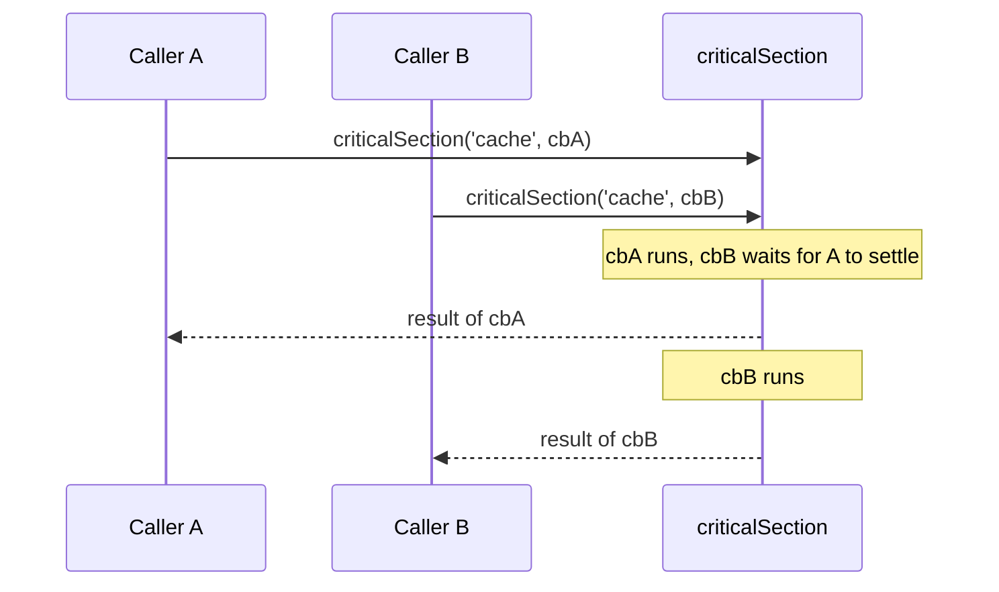

# Critical section and rate limit

`criticalSection(name, callback)` queues a callback behind the section running under the same name, inside the current Node.js process, and returns the callback's result. `rateLimit(name, callback, ms)` does the same and runs the callback `ms` milliseconds after its turn comes.

Both are promise-based and keep no state outside the process. They do **not** coordinate processes or servers; use the [named mutex](01-named-mutex.md) for that. See [Important behaviour](#important-behaviour).

## How it works

`criticalSection(name, callback)`:

1. Chains the call behind the previous section stored under `name` in a module-level map (or starts at once when there is none).
2. When its turn comes, resolves the logger with `DI.resolve('__log__', ['THREADING'])`, logs `Entering critical section <name>` at `trace`, calls `callback()` and logs `Leaving critical section <name>` in `finally`. A missing logger is skipped.
3. Returns a promise that settles with the callback's result or error.

A failed callback does not block the queue: the next call under `name` still runs.

`rateLimit(name, callback, ms)` calls `criticalSection(name, () => delay(ms, callback))`. The callback runs `ms` ms after the previous section under `name` ends.



## Services and extension points

| Service | DI token and lifetime | Default implementation | Alternatives | How to replace or extend |
| --- | --- | --- | --- | --- |
| Logger | `'__log__'` string token; a factory, called on every section run with `['THREADING']` | `logFactoryFunction`, registered when `@spinajs/log` is imported; returns the `THREADING` logger | any factory registered as `'__log__'` | `DI.register((container, name) => logger).as('__log__')`. The last registration wins for every package that resolves `'__log__'`. |
| Section queue | module-level `Map<string, Promise<void>>` in `@spinajs/threading` | none | none | Not an extension point. An entry exists only while sections are queued under that name. |

### Logger: optional

The logger is optional. Without a `'__log__'` factory (no `@spinajs/log` import) the section runs silently. Register a factory to see the trace lines.

The factory receives the container and the logger name. The section only calls `trace(...)` on the result.

```ts sample
import { DI, IContainer } from '@spinajs/di';
import { criticalSection } from '@spinajs/threading';

const traces: string[] = [];

DI.register((_container: IContainer, name: string) => ({
  trace: (vars: { section: string }, message: string) => traces.push(`${name}: ${message.replace('${section}', vars.section)}`),
})).as('__log__');

export async function warmCache(load: () => Promise<void>): Promise<string[]> {
  await criticalSection('cache-warmup', load);
  return traces;
}
```

The factory replaces the logger for every package that resolves `'__log__'`, so keep it to scripts and tests.

## Important behaviour

- **The returned promise tracks the callback.** It resolves with the callback's result and rejects with its error.
- **Exclusion is per name.** Calls under one name run one at a time in call order, also when made in the same tick or while another section runs.
- **A failed callback does not stop the queue.** The next waiter still runs; only the caller of the failed section sees the error.
- `rateLimit()` has the same semantics. It resolves with the callback's result, after the delay.
- The queue is in-process only and independent of the DI cache, so `DI.clearCache()` does not affect it.
- The `__mutex__` table of `@spinajs/orm-threading` is unrelated.

## Best practices

- Use one name per resource (`cache-warmup`, `token-refresh`), not per caller.
- Use the [named mutex](01-named-mutex.md) when more than one process or server touches the resource.

## Patterns and antipatterns

```ts
const token = await criticalSection('token-refresh', () => refreshToken());

// concurrent calls are serialized
await Promise.all([criticalSection('ledger', writeA), criticalSection('ledger', writeB)]);
```

## Examples

### Refresh an access token once for queued callers

Concurrent callers queue; the first fetches, the rest reuse the cached token.

```ts sample
import { criticalSection } from '@spinajs/threading';

let cached: { token: string; expiresAt: number } | null = null;

export function accessToken(fetchToken: () => Promise<{ token: string; ttlMs: number }>): Promise<string> {
  return criticalSection('oauth-token', async () => {
    if (cached && cached.expiresAt > Date.now()) {
      return cached.token;
    }

    const fresh = await fetchToken();
    cached = { token: fresh.token, expiresAt: Date.now() + fresh.ttlMs };
    return fresh.token;
  });
}
```

### Space calls to a rate-limited API

Each awaited `rateLimit()` call returns once its request ran; the request goes out `ms` after the previous one finished.

```ts sample
import { rateLimit } from '@spinajs/threading';

export async function pushOrders(orderIds: number[], push: (id: number) => Promise<void>, failed: number[]): Promise<void> {
  for (const id of orderIds) {
    await rateLimit('erp-api', () => push(id).catch(() => void failed.push(id)), 250);
  }
}
```

## Related

- [Named mutex](01-named-mutex.md): locks across processes through the registered `Mutex`.
- [Delay and sleep](04-delay-and-sleep.md): `delay()` is what `rateLimit()` uses to wait.
- [Factories](../di/08-factories.md): how the `'__log__'` factory is registered and called.
