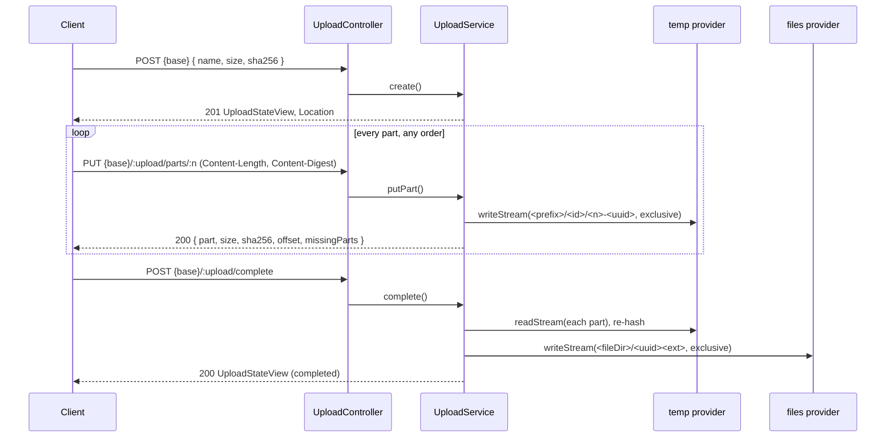

# Wire protocol

The HTTP routes of an `UploadController` subclass. A client creates a session, sends the file as numbered raw parts, each with its SHA-256, and completes the session. It can ask for the stored parts at any time and resume from there.

`{base}` below is the subclass's `@BasePath`, after `http.controllers.route.prefix` when the app sets one. Every answer is JSON, except `HEAD` and the `204` of `DELETE`.

## How it works

1. `POST {base}` creates a session. The service fixes the part size, the part count, the declared MIME type (from the file name), the two storage providers and `expiresAt`, and answers `201`.
2. The client sends every part with `PUT {base}/:upload/parts/:part`, in any order and in parallel if it wants. Each part is checked for its length and SHA-256 and stored under a new key. Part 1 also has its content type checked.
3. After a failure the client reads `GET {base}/:upload` (or `HEAD`) and sends only the parts in `missingParts`.
4. `POST {base}/:upload/complete` takes an assembly claim, re-reads every part, hashes each one and the whole file again, writes the merged file and answers the completed view.
5. `DELETE {base}/:upload` aborts an open session. The [sweeper](11-sweeper.md) expires sessions nobody completes.



## Routes

| Route | Request | Success answer | Controller method |
| --- | --- | --- | --- |
| `POST {base}` | JSON body `{ name, size, sha256?, partSize?, metadata? }` | `201`, `UploadStateView`, `Location: <request path>/<id>` | `create` |
| `HEAD {base}/:upload` | none | `200`, no body; headers `Upload-Offset`, `Upload-Length`, `Upload-Part-Size` | `offset` |
| `GET {base}/:upload` | none | `200`, `UploadStateView` | `state` |
| `PUT {base}/:upload/parts/:part` | raw bytes; `Content-Length` and `Content-Digest` required | `200`, `PartStoredView` | `putPart` |
| `POST {base}/:upload/complete` | JSON body `{ sha256? }`, or no body | `200`, `UploadStateView` with `status: 'completed'` | `complete` |
| `DELETE {base}/:upload` | none | `204`, no body | `abort` |

### Create body

| Field | Type | Rule |
| --- | --- | --- |
| `name` | `string` | 1 to 255 characters. Its extension gives the declared MIME type (`mime-types` `lookup`); the client's `Content-Type` is never used. |
| `size` | `integer` | Bytes, at least 1, at most `upload.limits.maxFileSize`. |
| `sha256` | `string` | Optional. 64 hex characters, any case, stored lower case: the SHA-256 of the whole file. Required here or at complete while `upload.integrity.fileDigest` is `required`. |
| `partSize` | `integer` | Optional. Bytes per part, within `minPartSize`..`maxPartSize` (at most 5 GiB), giving at most `maxParts` parts. Default: `upload.limits.partSize`, clamped into that range. |
| `metadata` | `object` | Optional. What the default `metadataFor()` stores with the session. It reaches every event, so never put secrets in it. It has no limit of its own: the `http.bodyLimits` cap on the request body bounds it. |

Other fields are refused (`additionalProperties: false`).

### Part request

- `Content-Length` must equal the part's size: `partSize` for parts `1` to `partCount - 1`, and `size - partSize * (partCount - 1)` for the last one. A missing length, or a chunked body, answers `411` `upload.length_required`.
- `Content-Digest: sha-256=:<base64 of the 32-byte SHA-256>:` ([RFC 9530](https://www.rfc-editor.org/rfc/rfc9530)). Other algorithms in the header are ignored. Without `sha-256` the part answers `400` `upload.digest_required`, unless `upload.integrity.partDigest` is `optional`.
- Send the body as `application/octet-stream`. A JSON, urlencoded or XML body is taken by a body parser before the route runs, and answers `415`.
- A part sent again replaces the stored copy. Two concurrent writes of one part never mix: each goes to its own key, and the last commit wins.

### Complete body

`{ "sha256": "<64 hex>" }` when the hash was not given at create. When both are given, they must be equal (`400` `upload.file_digest_mismatch`). A request without a body is the same as `{}`.

## Resume state

`GET` answers `UploadStateView`:

| Field | Type | Meaning |
| --- | --- | --- |
| `id` | `string` | Session id, a UUID. |
| `status` | `'open' \| 'assembling' \| 'completed' \| 'failed' \| 'aborted' \| 'expired'` | See [Statuses](#statuses). |
| `name`, `size` | `string`, `number` | As created. |
| `partSize`, `partCount` | `number` | As fixed at create. |
| `receivedParts` | `{ number, size, sha256 }[]` | Stored parts in part order; `sha256` is hex. Empty once the sweeper purged the parts of a finished session. |
| `missingParts` | `number[]` | Parts not stored yet. Always empty for a `completed` session. |
| `offset` | `number` | Bytes in the run of stored parts that starts at part 1. Equals `size` for a `completed` session. |
| `expiresAt` | `string` | ISO time; parts are refused after it. |
| `sha256` | `string` | Hex SHA-256 of the merged file; only once `completed`. |
| `mime` | `string` | The detected MIME type; once part 1 is stored. |
| `failure` | `{ code, message }` | Only for a `failed` session. |

`PUT` answers `PartStoredView`: `{ part, size, sha256, offset, missingParts }`, with the same meanings.

`HEAD` sends `Upload-Offset` (`offset`), `Upload-Length` (`size`) and `Upload-Part-Size` (`partSize`), and no body.

- A sequential client resumes with part `offset / partSize + 1`.
- A parallel client sends every part in `missingParts`.

## Statuses

```text
open ──complete (claim)──▶ assembling ──verified──▶ completed
  │                          │  └─stored part changed──▶ open
  │                          └─file hash or size mismatch──▶ failed
  ├─DELETE──▶ aborted
  └─sweeper, past expiresAt──▶ expired
```

| Status | `PUT` part | `POST complete` | `DELETE` |
| --- | --- | --- | --- |
| `open` | stores it; `410` `upload.expired` past `expiresAt` | assembles; `410` `upload.expired` past `expiresAt` | `204`, aborted |
| `assembling` | `409` `upload.not_open` | `409` `upload.assembling` while the claim is fresh; takes it over once older than `upload.assembly.staleAfter` | `409` `upload.assembling` |
| `completed` | `409` `upload.not_open` | `200`, the view again; runs `onCompleted` while it has not succeeded | `409` `upload.not_open` |
| `aborted` | `409` `upload.not_open` | `409` `upload.not_open` | `204` again; `onAborted` does not run again |
| `failed`, `expired` | `409` `upload.not_open` | `409` `upload.not_open` | `409` `upload.not_open` |

An `open` session past `expiresAt` can still be aborted until the sweeper expires it.

## Errors

Every upload refusal answers `{ code, message, details? }` with the status below. `details.parts` lists the part numbers to send again; it comes with `upload.parts_missing` and `upload.part_corrupted`.

| Code | Status | Route | When |
| --- | --- | --- | --- |
| `upload.invalid` | 400 | create, complete | `name`, `size`, `sha256` or `metadata` is malformed; an `upload.create` hook replaced `metadata` with a non-object |
| `upload.not_found` | 404 | every `:upload` route | No such session, or a session of another owner |
| `upload.too_large` | 400 | create | `size` is over `maxFileSize` |
| `upload.part_size` | 400 | create, part | `partSize` is outside `minPartSize`..`maxPartSize` or gives more than `maxParts` parts; a part's `Content-Length` is not its size; a part body ended early |
| `upload.part_number` | 400 | part | `:part` is not an integer in `1`..`partCount` |
| `upload.too_many_sessions` | 429 | create | The owner already has `maxOpenSessionsPerOwner` open sessions |
| `upload.unsupported_type` | 400 | create | The name's extension maps to no MIME type and `allowUnknownType()` is `false` |
| `upload.unsupported_type` | 415 | create, part 1 | The declared type (create) or the detected type (part 1) is not in `allowedTypes()` |
| `upload.length_required` | 411 | part | No `Content-Length`, or a chunked body |
| `upload.digest_required` | 400 | part | No `sha-256` digest while `upload.integrity.partDigest` is `required` |
| `upload.part_too_large` | 413 | part | The body is longer than the part |
| `upload.part_digest_mismatch` | 400 | part | The `sha-256` value is not 32 bytes, or the body does not hash to it |
| `upload.content_mismatch` | 415 | part 1 | The detected type differs from the declared one, or nothing was detected and the declared type is not in `upload.detect.allowUndetected` |
| `upload.not_open` | 409 | part, complete, abort | The session is not `open` (see [Statuses](#statuses)) |
| `upload.expired` | 410 | part, complete | `expiresAt` has passed, also while the body was streaming |
| `upload.assembling` | 409 | complete, abort | Another request holds a fresh assembly claim; or it held the claim and released it while this request tried to take it, so a retry can succeed |
| `upload.parts_missing` | 409 | complete | Parts are missing; `details.parts` lists them |
| `upload.part_corrupted` | 409 | complete | Stored parts no longer hash to their SHA-256; they were dropped and the session is `open` again. `details.parts` lists them |
| `upload.part_lost` | 409 | part | The sweeper reclaimed the part's object before it was committed: the write took longer than `upload.assembly.staleAfter`. Send the part again |
| `upload.file_lost` | 409 | complete | The sweeper reclaimed the merged file before it was committed. The claim is released, the parts stay; call complete again |
| `upload.file_digest_required` | 400 | complete | No file SHA-256 at create or complete while `upload.integrity.fileDigest` is `required` |
| `upload.file_digest_mismatch` | 400 | complete | The `sha256` differs from the one given at create; or the merged file does not hash to the declared value, and the session is now `failed` |
| `upload.size_mismatch` | 400 | complete | The merged file is not `size` bytes; the session is now `failed` |
| `upload.internal` | 500 | every route | An error the framework would answer as a generic 500: the body is `{ code: 'upload.internal', message: 'Internal error' }`, with no path or stack. See below |

`upload.internal` replaces the framework's 500 body on the upload routes. The controller logs the original error with the session id.

- Server-side misconfiguration answers it: a `fileDir()` with a `..` segment, or a zero `sessionTtl` from `limitsFor()` (both throw `InvalidOption`), and a missing provider.
- A failing `onCompleted` answers it, and runs again on the next complete.
- An error that has its own mapped status keeps the framework body. A `ResourceDuplicated` stays a `409`, for example.
- The app's `http.errors.handlers` do not see these 500s. A class-level `@OnError` of a subclass runs first.

Other answers come from the framework, in its own body shape:

| Status | When |
| --- | --- |
| 400 | The create or complete body fails its schema (`ValidationFailed`). This runs before the action, so before `authorize`: see [Extending the controller](04-extending-the-controller.md#important-behaviour). |
| 400 | A malformed `Content-Digest` header. |
| 401, 403 | A policy refuses, or `authorize` throws `Forbidden` or `AuthenticationFailed`. |
| 403 `{ code, message }` | An `upload.create` or `upload.complete` hook refused; `code` is the hook's code. |
| 403 `{ error: { code: 'E_CSRF_ORIGIN', message } }` | `create` or `DELETE` came from a foreign `Origin`. The CSRF guard answers before `authorize`, in its own body shape. |
| 415 | The part body was JSON, urlencoded or XML. |

## Client flow

Upload a file from a Node script, part by part, then resume from the server's state if a part failed:

```ts sample
import { createHash } from 'node:crypto';

interface UploadState {
  id: string;
  partSize: number;
  partCount: number;
  missingParts: number[];
  status: string;
}

const sha256 = (data: Uint8Array) => createHash('sha256').update(data).digest();

/** `base` is the controller's URL, e.g. https://api.example.com/documents/uploads */
export async function uploadDocument(base: string, name: string, file: Buffer, headers: Record<string, string>): Promise<UploadState> {
  const created = await fetch(base, {
    method: 'POST',
    headers: { ...headers, 'content-type': 'application/json' },
    body: JSON.stringify({ name, size: file.length, sha256: sha256(file).toString('hex') }),
  });
  if (created.status !== 201) throw new Error(`create failed: ${created.status} ${await created.text()}`);
  let state = (await created.json()) as UploadState;

  for (let attempt = 0; state.missingParts.length > 0 && attempt < 3; attempt++) {
    for (const part of state.missingParts) {
      // a copy: fetch takes a Uint8Array over its own ArrayBuffer, and sets Content-Length for it
      const bytes = new Uint8Array(file.subarray((part - 1) * state.partSize, part * state.partSize));
      await fetch(`${base}/${state.id}/parts/${part}`, {
        method: 'PUT',
        headers: { ...headers, 'content-type': 'application/octet-stream', 'content-digest': `sha-256=:${sha256(bytes).toString('base64')}:` },
        body: bytes,
      });
    }
    state = (await (await fetch(`${base}/${state.id}`, { headers })).json()) as UploadState;
  }

  const completed = await fetch(`${base}/${state.id}/complete`, { method: 'POST', headers });
  if (completed.status !== 200) throw new Error(`complete failed: ${completed.status} ${await completed.text()}`);
  return (await completed.json()) as UploadState;
}
```

A browser client hashes each part with `crypto.subtle.digest('SHA-256', part)`. WebCrypto has no incremental hash, so hash the whole file with an incremental library while reading the parts, and send it in the complete body.

## Important behaviour

- **Lookups are owner-scoped.** Every `:upload` route loads the session with the owner from `ownerOf()`. A missing session and another owner's session both answer `404`.
- **`HEAD` is its own route.** It is declared before `GET`; in the other order Express answers `HEAD` with the `GET` route and the `Upload-*` headers never go out.
- **`Location` is built from the request path**, `req.originalUrl` without the query, plus `/<id>`. Behind a proxy that rewrites paths it holds the path the app saw.
- **Browser apps must expose the headers.** Add `Upload-Offset`, `Upload-Length`, `Upload-Part-Size` and `Location` to `http.cors.exposedHeaders`, and allow `content-digest` in `http.cors.allowedHeaders` when you set that list. See [CORS](../http/16-cors.md).
- **CSRF applies.** The controller sets no `@CsrfExempt()`. A `create` or `DELETE` from a foreign `Origin` answers `403` `E_CSRF_ORIGIN`; a browser on another origin needs that origin in `http.csrf.allowedOrigins`. See [CSRF guard](../http/23-csrf-guard.md).
- **A refused part may cost the connection.** A refusal before the body was read is drained first when its `Content-Length` is at most the part's size; otherwise the answer carries `Connection: close`. See [Limits](06-limits.md#refused-parts).
- **Repeated `complete` is safe.** A completed session answers its view again and runs `onCompleted` only while it has not succeeded.

## Related

- [Integrity](03-integrity.md): what the server checks on each part and at assembly.
- [Extending the controller](04-extending-the-controller.md): where `{base}`, the owner and the allowed types come from.
- [Raw request bodies and digests](../http/24-raw-body-and-digests.md): `@RequestStream()` and `@ContentDigest()` under the part route.
