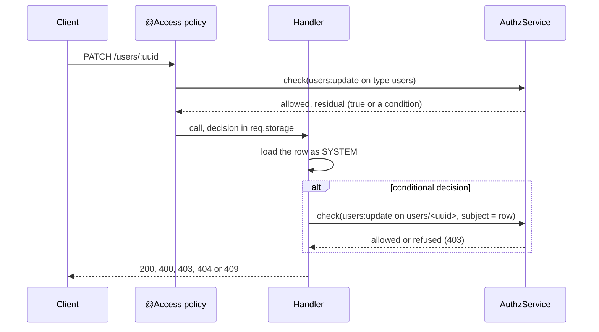

# Setup and access

The package ships a config fragment that mounts its controllers and declares the `users:*` permissions. Every route then asks `@Access(...)` from `@spinajs/authz-http`, and the handler decides a conditional grant again on the addressed row. Read this page first: the other pages assume these rules.

## How it works

1. `@spinajs/configuration` loads `lib/<mjs|cjs>/config/users-http.js` from every installed `@spinajs/*` package; see [Config files](../configuration/03-config-files.md).
2. The fragment adds `controllers` and `admin/controllers` of the package's `lib/` to `system.dirs.controllers`.
3. The controller scan of `@spinajs/http` imports those files and mounts `UserController`, `UserMetadataController`, `Users`, `Security` and `Profile`; see [Controller discovery](../http/03-controller-discovery.md).
4. Importing the files runs their decorators: `DefaultAccountGuard` registers as `AccountGuard`, `UserMetadataService` and `CurrentUserArg` register as themselves, and the `IUserMetadataEntry` response schema joins the `__schemas__` value map.
5. Per request, `@Access(permission)` decides the permission on the type (`users`, `user`, `user.metadata`). A refusal answers `401` (no principal) or `403`.
6. The handler reads the decision the policy left in `req.storage.AuthzDecision`:
   - **unconditional** (residual `true`): it holds for every row;
   - **conditional** (a grant with a relation, for example `self` or `owner`): the handler loads the row as `SYSTEM` and decides the permission again on that row, as the caller.
7. Routes that cannot be decided on one existing row (lists, create, restore, the lifecycle routes) need an unconditional grant: `requireEveryUser()` answers `403` otherwise.



## Configuration

Keys this package ships:

| Key | Type | Default | Allowed values | Meaning |
| --- | --- | --- | --- | --- |
| `system.dirs.controllers` | `string[]` | adds `<pkg>/lib/<mjs\|cjs>/controllers` and `<pkg>/lib/<mjs\|cjs>/admin/controllers` | directories | Where the controller scan finds this package's controllers. The path starts at `WORKSPACE_ROOT_PATH`, or the working directory. |
| `system.dirs.locales` | `string[]` | adds `<pkg>/lib/<mjs\|cjs>/locales` | directories | Declared; the package ships no locale files. |
| `system.dirs.views` | `string[]` | adds `<pkg>/lib/<mjs\|cjs>/views` | directories | Declared; the package ships no views. |
| `authz.permissions['users:read']` | object | `{ fields: true }` | permission definition | Read accounts on the admin routes. Grants may carry a field set; responses are cut to it. |
| `authz.permissions['users:create']` | object | `{}` | permission definition | Create accounts. |
| `authz.permissions['users:update']` | object | `{ fields: true }` | permission definition | Update login, email and roles; activate, unban; end one session. |
| `authz.permissions['users:delete']` | object | `{}` | permission definition | Delete, restore, deactivate and ban. |

Keys of other packages this one reads:

| Key | Type | Default | Allowed values | Meaning |
| --- | --- | --- | --- | --- |
| `authz.admin.guard.preventSelfLockout` | `boolean` | `true` (absent is on) | `true`, `false` | `AccountGuard`: the caller may not disable its own account or remove its own privilege. See [Account guard](08-account-guard.md). |
| `authz.admin.guard.preventLastPrivilegedRemoval` | `boolean` | `true` (absent is on) | `true`, `false` | `AccountGuard`: never take the last account in service holding `privilegedPermission` out of service. |
| `authz.admin.guard.privilegedPermission` | `string` | `'users:update'` (authz-rbac fragment) | a permission | The permission that makes an account privileged. Required while either switch above is on. |
| `authz.http.access.domain` | `string` | `'root'` (authz-http fragment) | a live authz domain name, or `'root'` | The domain whose `authz.token` rules `GET /user/tokens/roles` applies. |
| `authz.token.excludedRoles`, `authz.token.rolePolicy` | see `@spinajs/authz-rbac` | | | Roles a token loses at check time; read from the access domain's `Configuration`. |
| `authz.credentials.permission` | `string` | `'users:credentials'` | a permission | Read by users' `AuthzCredentialAdminGuard`, which the session, lifecycle and identity-change routes ask. |
| `authn.freshAuth.maxAgeSeconds` | `number` | `300` (authn fragment) | seconds | How recent a login counts as fresh authentication. |
| `users.user.profile` | `string` | `'BasicProfileProvider'` | a registered `UserProfileProvider` name | The provider `GET /users/profile/:login` asks. See [Admin profile route](09-admin-profile.md). |

```js
module.exports = {
  authz: {
    rbac: {
      roles: {
        // users:credentials is what the credential admin guard asks on delete, deactivate, ban and the session routes.
        'user-admin': { grants: ['users:read', 'users:create', 'users:update', 'users:delete', 'users:credentials'] },
        'support': { grants: ['users:read'] },
      },
    },
    admin: {
      guard: {
        preventSelfLockout: true,
        preventLastPrivilegedRemoval: true,
        privilegedPermission: 'users:update',
      },
    },
  },
};
```

## Permissions per route family

| Routes | Permission | Resource type | Conditional grant reaches |
| --- | --- | --- | --- |
| `GET /user`, `GET /user/tokens/*` | `user:read` | `user`, the caller's own row | its own row only |
| `/user/metadata...`, `/user/:uuid/metadata...` | `user.metadata:<read\|create\|update\|delete>` | `user.metadata`, decided per entry | its own entries only (users' `user` role: relation `owner`) |
| `GET /users/:uuid`, `GET /users/byLogin/:login`, `GET /users/profile/:login`, `PATCH /users/:uuid`, `DELETE /users/:uuid`, the session routes | `users:<action>` | `users`, decided again on the row | the rows its condition holds on (for example `self`) |
| `GET /users`, `POST /users`, `PATCH /users/:uuid/restore`, activate, deactivate, ban, unban | `users:<action>` | `users` | nothing: `403` |
| `GET /users/roles` | `users:read` | `users` | any `users:read` grant; the answer is about the caller |

`@spinajs/users` ships the roles that hold them: `user` holds `user:read` (fields `Email`, `Login`) and the `user.metadata` permissions with relation `owner`; `admin.users` holds `users:*`, which covers `users:credentials`, and the metadata permissions unconditionally.

## Important behaviour

- A conditional grant never reaches another user's record. For a caller with only a conditional grant, a missing row answers `403` like a refused one, so it cannot probe which accounts exist.
- An unconditional grant answers `404` for a missing row.
- Every row lookup runs as `SYSTEM` (`AuthzService.runAs`): the application's user model may be an `@AccessResource`, and the decision is made by the handler, not by a model scope.
- The routes that act through `AuthzAdmin` or the account guard (create, update, delete, deactivate, ban, `GET /users/roles`) need a signed-in **user** principal (`userActor()`); a service or an agent principal gets `403`. They never run as `SYSTEM`.
- `fields: true` on `users:read` and `users:update` lets a grant carry a field set. The read routes use `@Access(..., { fields: 'filter' })`, so the response holds only the fields the grant reads.

## Best practices

- Grant `users:credentials` together with `users:delete`: delete, deactivate and ban also ask the credential admin guard, which wants it.
- Give support staff `users:read` only. They can look accounts up, list a user's sessions only with `users:credentials` as well, and change nothing.
- Prefer conditional grants (`{ permission: 'users:update', relation: 'self' }`) over writing your own "own account" routes: the single-row routes decide them on the row.

## Patterns and antipatterns

```js
// Don't: users:delete alone. DELETE /users/:uuid, deactivate and ban then answer 403 forbidden:
// the credential admin guard wants users:credentials.
'account-closer': { grants: ['users:read', 'users:delete'] },

// Do
'account-closer': { grants: ['users:read', 'users:delete', 'users:credentials'] },
```

```js
// Don't: a conditional users:read for a team lead expecting GET /users to list the team. It answers 403.
'team-lead': { grants: [{ permission: 'users:read', relation: 'self' }] },

// Do: keep the conditional grant for the single-row routes, and list the team through a route of your own
// that queries exactly the rows the lead may see.
```

## Related

- [Controller discovery](../http/03-controller-discovery.md): how `system.dirs.controllers` becomes mounted routes.
- [Config files](../configuration/03-config-files.md): how package fragments are found and merged.
- [Host services](11-host-services.md): what each route resolves besides `AuthzService`.
- [`@spinajs/authz`](../authz/README.md): decisions, residuals and `runAs`.
