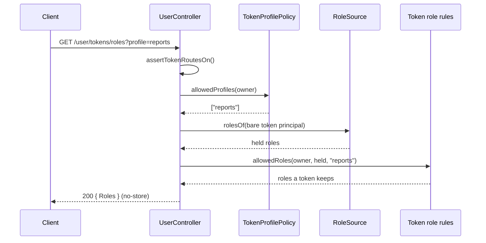

# Own account routes

`UserController` serves the signed-in user's own record and tells a token picker which roles and profiles a new API token may carry. It mounts at `/user`. Metadata routes under `/user/metadata` are a separate controller; see [User metadata routes](04-user-metadata-routes.md).

## Routes

| Method | Path | Permission | Callers | Answer |
| --- | --- | --- | --- | --- |
| `GET` | `/user` | `user:read` on the caller's own row | any signed-in user principal | The caller's `User` with its metadata, cut to the fields its grant reads |
| `GET` | `/user/tokens/roles` | `user:read` on the caller's own row | a session that is not impersonating | `{ Roles: string[] }` |
| `GET` | `/user/tokens/profiles` | `user:read` on the caller's own row | a session that is not impersonating | `{ Profiles: string[] }` |

Query parameter of `GET /user/tokens/roles`: `profile` (optional), one role name of 1 to 128 characters; anything else answers `400`.

## How it works

### `GET /user`

1. `@Access('user:read', { resource: ownUser, subject: 'load', fields: 'filter' })` builds the resource `{ type: 'user', id: <principal id> }` from the principal. A principal that is not a user is refused with `403` before any check.
2. The policy loads the row as the check's subject and decides `user:read` on it. With users' shipped `user` role the grant holds through the `self` relation.
3. `@CurrentUser()` reads the row with its metadata; see [Current user argument](02-current-user.md).
4. `refresh()` answers `user.dehydrateWithRelations({ dateTimeFormat: 'iso' })`. `fields: 'filter'` cuts it to the fields the grant reads: `Email` and `Login` with the `user` role.

### `GET /user/tokens/roles` and `GET /user/tokens/profiles`

1. `@Access('user:read', { ..., also: SESSION_CALLER })` adds `Authenticated`, `NoTokenAuthPolicy` and `NoImpersonationPolicy` of `@spinajs/authn-http` (AND): a token, key or signature caller gets `403 session_required`, an impersonating session `403 impersonating`.
2. `assertTokenRoutesOn()` answers `404` (`error: 'not_found'`) while no `TokenService` implementation is registered.
3. Profiles: `offeredTokenProfiles()` resolves the service registered under the name `TokenProfilePolicy` and calls `allowedProfiles({ type, id })`. No such registration: `[]`.
4. Roles: `offeredTokenRoles()`:
   1. with `profile`, answers `[]` unless the profile is one `offeredTokenProfiles()` returns;
   2. answers `[]` while no `RoleSource` is registered;
   3. asks `RoleSource.rolesOf()` for the roles the caller holds at any scope, as a bare token principal;
   4. loads the token role rules of the access domain (`authz.http.access.domain`) with `loadTokenRoleRules()` of `@spinajs/authz-rbac`, and returns `allowedRoles(owner, held, profile)`: the held roles less `authz.token.excludedRoles` and those the `TokenRolePolicy` drops.
5. Both answers carry `Cache-Control: no-store`.



## Configuration

| Key | Type | Default | Allowed values | Meaning |
| --- | --- | --- | --- | --- |
| `authz.http.access.domain` | `string` | `'root'` | a live authz domain, or `'root'` | Whose `authz.token` rules cut the offered roles. A name that is not a live domain answers `500` (`AuthzConfigError`). |
| `authz.token.excludedRoles` | see `@spinajs/authz-rbac` | | | Roles a token never keeps. |
| `authz.token.rolePolicy` | see `@spinajs/authz-rbac` | | | The policy that drops further roles, per profile. |

## Services and extension points

| Service | DI token and lifetime | Default implementation | Alternatives | How to replace or extend |
| --- | --- | --- | --- | --- |
| `UserController` | Class key `UserController`; singleton; mounted by the controller scan | `UserController` | none | Subclass and `DI.register(Mine).as(UserController)`; see [Controller overrides](10-controller-overrides.md). |
| `TokenService` | `TokenService` of `@spinajs/authn/contracts`; checked with `getRegisteredTypes()`, never resolved here | authn-token's implementation | none | Register one to turn the token routes on; none answers `404`. |
| `TokenProfilePolicy` | The **string** name `'TokenProfilePolicy'` (authn-token's abstract class); resolved per request | authn-token's `NoTokenProfilesPolicy` (offers none) | yours | `@Injectable(TokenProfilePolicy)` on a subclass of authn-token's `TokenProfilePolicy`. A class that is itself named `TokenProfilePolicy` counts as the bare abstract and is ignored. |
| `RoleSource` | `RoleSource` of `@spinajs/authn/contracts`; resolved per request | users' `RbacRoleSource` | yours | `DI.register(Mine).as(RoleSource)`; none offers `[]`. |
| Token role rules | `loadTokenRoleRules()` of `@spinajs/authz-rbac`, from the access domain's container | authz-rbac's | | Configure `authz.token` in that domain. |

`TokenProfilePolicy` is found by name so that users-http does not import authn-token: importing it would register its `TokenService` and strategies in every app that loads users-http.

### `TokenProfilePolicy`: offer report-only tokens

A profile pins a token to one role. Register your policy under authn-token's abstract `TokenProfilePolicy`: its create route and this offer then read the same answer. The route looks the policy up by the name `'TokenProfilePolicy'`, which is the abstract class's name, and resolves the last registration under it.

```ts sample
import { Injectable } from '@spinajs/di';
import type { IdentityRef } from '@spinajs/authn/contracts';
import { TokenProfilePolicy } from '@spinajs/authn-token';

/** Every user may pin a token to the `reports` role; other principals get no profile. */
@Injectable(TokenProfilePolicy)
export class ReportsTokenProfilePolicy extends TokenProfilePolicy {
  public async allowedProfiles(owner: IdentityRef): Promise<readonly string[]> {
    return owner.type === 'user' ? ['reports'] : [];
  }
}
```

## Important behaviour

- `GET /user` and the token routes answer `403` to a service, an agent or any other non-user principal, whatever unconditional `user:read` it holds: `ownUser` refuses before the check.
- The offered roles never exceed what `POST /user/tokens` of `@spinajs/authn-http` accepts; a picker built on them offers nothing the create route refuses.
- A `TokenProfilePolicy` that answers anything but a list of non-empty role names, a policy without `allowedProfiles()`, or a `RoleSource` without `rolesOf()` answers `500`. Nothing is offered. Entries of `rolesOf()` without a string `role` are skipped.
- authz-rbac's `TokenRolePolicy.allowedProfiles` is **not** read: no create or check path reads it.
- A bare abstract class recorded by an earlier resolve of an unregistered token does not count as an implementation.

## Best practices

- Build the token form from `GET /user/tokens/profiles` first, then `GET /user/tokens/roles?profile=<choice>`: the roles differ per profile.
- Keep `authz.http.access.domain` equal to the domain your API checks tokens in, or the offered roles will not match what a token keeps.

## Examples

### Read the own record and the token offer from a client

```ts sample
interface TokenOffer {
  Roles: string[];
}

interface ProfileOffer {
  Profiles: string[];
}

/** Fills a "new API token" form. `api` is a fetch wrapper that sends the session cookie. */
export async function loadTokenForm(api: (path: string) => Promise<Response>) {
  const me = await (await api('/user')).json();
  const { Profiles } = (await (await api('/user/tokens/profiles')).json()) as ProfileOffer;
  const profile = Profiles[0];
  const { Roles } = (await (await api(`/user/tokens/roles${profile ? `?profile=${encodeURIComponent(profile)}` : ''}`)).json()) as TokenOffer;

  return { login: me.Login as string, profiles: Profiles, roles: Roles };
}
```

## Related

- [Current user argument](02-current-user.md): the `@CurrentUser()` behind `GET /user`.
- [Host services](11-host-services.md): every service these routes resolve, and what happens without it.
- [`@spinajs/authn`](../authn/README.md): `TokenService` and `RoleSource` contracts.
