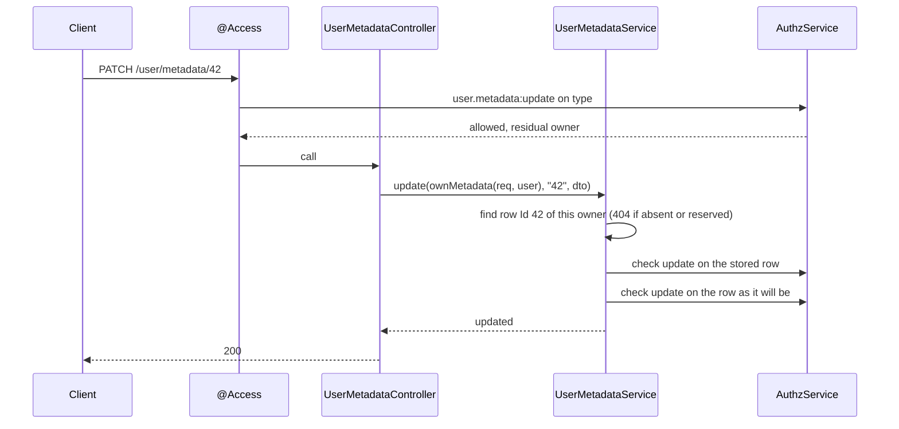

# User metadata routes

`UserMetadataController` serves CRUD of a user's key-value metadata (`users_metadata`): the caller's own under `/user/metadata`, another user's under `/user/:uuid/metadata`. Every route sits on `@Access('user.metadata:<action>')`, every row is decided again for the caller, and reserved security keys do not exist for this API.

## Routes

| Method | Path | Permission | Body | Answer |
| --- | --- | --- | --- | --- |
| `GET` | `/user/metadata` | `user.metadata:read` | | Page of the caller's entries |
| `GET` | `/user/metadata/:key` | `user.metadata:read` | | One entry, by key |
| `POST` | `/user/metadata` | `user.metadata:create` (+ `update` on an existing key) | `UserMetadataDto` | `200`, insert or update |
| `PATCH` | `/user/metadata/:meta` | `user.metadata:update` | `UserMetadataDto` | `200`; `:meta` is an `Id` (digits) or a `Key` |
| `DELETE` | `/user/metadata/:meta` | `user.metadata:delete` | | `200`; `:meta` is an `Id` |
| `GET`, `POST`, `PATCH`, `DELETE` | `/user/:uuid/metadata`, `/user/:uuid/metadata/:key`, `/user/:uuid/metadata/:meta` | the same | the same | The same, for the user `:uuid` |

List query arguments, each one JSON-encoded object: `pagination` (`page`, zero-based; `limit`, default `10`), `order` (`column`: `Id`, `Key` or `Type`, default `Id`; `order`: `ASC` or `DESC`, default `DESC`), and `filter` on `Key` (`eq`, `like`, `b-like`, `e-like`) and `Type` (`eq`). Example: `?pagination={"page":0,"limit":20}&order={"column":"Key","order":"ASC"}`. See [Filtering](../orm-http/03-filtering.md).

An entry in an answer (`IUserMetadataEntry`):

| Field | Type | Meaning |
| --- | --- | --- |
| `Id` | `integer` | Row id |
| `Key` | `string` | Metadata key, eg. `user:niceName` |
| `Type` | `'number' \| 'float' \| 'string' \| 'json' \| 'boolean' \| 'datetime'` | How to read `Value` |
| `Value` | `string \| null` | Stored as text whatever `Type` says; the client decodes it |

## How it works

1. `@Access('user.metadata:<action>')` decides the permission on the type `user.metadata` and leaves the decision in `req.storage.AuthzDecision`.
2. The handler builds a `MetadataScope`:
   - `/user/metadata...`: `ownMetadata(req, user)`; the owner is the `@CurrentUser()` row, never a request value.
   - `/user/:uuid/metadata...`: `addressedMetadata(req, uuid)`. A conditional decision (users' `user` role: `owner`) on another user's uuid is refused with `403` **before** the lookup. Then it reads the user as `SYSTEM`; missing or deleted: `404`.
3. `UserMetadataService` runs the operation inside the scope; see [Metadata service](05-metadata-service.md):
   - every query is limited to `user_id = <owner>`;
   - every row read or written is admitted by `scope.admits(permission, row)`: free for an unconditional decision on the same permission, otherwise `AuthzService.check()` on the row as the caller.
4. Reserved keys are filtered out of lists, answer `404` on read, update and delete, and `400` on write.



## Request body

`UserMetadataDto`, validated by `MetadataDtoSchema`:

| Field | Type | Required | Rule |
| --- | --- | --- | --- |
| `Key` | `string` | yes | 6 to 255 characters; not a reserved key |
| `Value` | `string` | no | Stored as text |
| `Type` | `string` | yes | One of `number`, `float`, `string`, `json`, `boolean`, `datetime` |

The body carries no `user_id`: ownership comes from the addressed user only.

## Schema

### `users_metadata`

Owned by `@spinajs/users`; this package reads and writes it through `UserMetadataBase` and `FilterableUserMetadata` (connection `default`).

| Column | Type | Meaning |
| --- | --- | --- |
| `Id` | integer | Row id |
| `user_id` | integer | `users.Id` of the owner |
| `Key` | varchar | Metadata key |
| `Value` | text | Value as text |
| `Type` | varchar | Declared type of `Value` |

Reserved key prefixes (`USER_RESERVED_METADATA_PREFIXES` of `@spinajs/users`): `2fa:`, `user:2fa:`, `user:pwd_reset:`, `user:pwd:`, `user:login:`, `user:ban:`, `user:invite:`. The check folds case, width, accents and invisible characters first.

## Services and extension points

| Service | DI token and lifetime | Default implementation | Alternatives | How to replace or extend |
| --- | --- | --- | --- | --- |
| `UserMetadataController` | Class key; singleton; mounted by the controller scan | `UserMetadataController` | none | Subclass and `DI.register(Mine).as(UserMetadataController)`; see [Controller overrides](10-controller-overrides.md). |
| `UserMetadataService` | Class key `UserMetadataService`, `@Injectable()`; singleton; `@Autoinject` into the controller | `UserMetadataService` | none | See [Metadata service](05-metadata-service.md). |
| `IUserMetadataEntry` response schema | Value map `'__schemas__'`, key `'IUserMetadataEntry'`, registered on import | `UserMetadataEntrySchema` | yours | `DI.register(mySchema).asMapValue('__schemas__', 'IUserMetadataEntry')` after the package import; `@spinajs/http-swagger` reads it. See [Named schemas](../http-swagger/04-named-schemas-and-schema-providers.md). |
| `UserMetadataDto` body schema | `@Schema(MetadataDtoSchema)` of `@spinajs/validation` | `MetadataDtoSchema` | | Read `MetadataDtoSchema` to build client forms; change the rules by overriding the route with your own DTO. |

### `IUserMetadataEntry`: document a decoded value in the API spec

When a gateway in front of the API decodes `Value` by `Type`, publish the schema it answers with. Register it after `@spinajs/users-http` is imported, so it replaces the shipped entry in the `__schemas__` map.

```ts sample
import { DI } from '@spinajs/di';
import '@spinajs/users-http';

export const DecodedMetadataEntrySchema = {
  $schema: 'http://json-schema.org/draft-07/schema#',
  title: 'User metadata entry',
  type: 'object',
  properties: {
    Id: { type: 'integer' },
    Key: { type: 'string' },
    Type: { type: 'string', enum: ['number', 'float', 'string', 'json', 'boolean', 'datetime'] },
    Value: { description: 'Decoded by Type: a number, boolean, object or ISO date string', nullable: true },
  },
};

DI.register(DecodedMetadataEntrySchema).asMapValue('__schemas__', 'IUserMetadataEntry');
```

## Important behaviour

- A conditional grant reaches the caller's own entries in **both** families (`/user/metadata` and `/user/<own uuid>/metadata`) and no other user's. Another user's metadata needs an unconditional grant (users' `admin.users`).
- `POST` is an upsert: `create` is checked on the new entry, and `update` on every stored row the key overwrites.
- `PATCH` checks `update` twice: on the entry as stored and on the entry as the update leaves it, so a grant that holds on some keys cannot move an entry to another key.
- `:meta` of `PATCH` is an `Id` when it is all digits, else a `Key`. One column is compared, never both.
- A reserved key answers `404` on read, update and delete, the same as a missing entry. A write of one answers `400`.
- The database's collation may match another spelling to a reserved row (`2fá:enabled` and `2fa:enabled`); the service checks the stored key too and refuses the write.
- An `order.column` other than `Id`, `Key`, `Type` answers `400`.
- The routes need the `@Access` decision in the request. A route reached without its policy answers `403`.

## Best practices

- Prefix your application's keys with a namespace (`app:`, `ui:`), so they never meet a reserved prefix of `@spinajs/users`.
- Send `Type` with every write and decode `Value` by it on the client: the column is text.
- Use the `Id` form of `PATCH` and `DELETE` from list screens; the `Key` form of `PATCH` from settings screens that know the key.

## Patterns and antipatterns

```ts
// Don't: write security state through the generic API. It answers 400, and the ban would not lock anything.
await api.post('/user/' + uuid + '/metadata', { Key: 'user:ban:is_banned', Value: 'true', Type: 'boolean' });

// Do: use the dedicated route; it records the ban and ends the sessions.
await api.post('/users/security/ban/' + uuid, { reason: 'chargeback', duration: 86400 });
```

## Examples

### Store and read a display name from a client

```ts sample
interface MetadataEntry {
  Id: number;
  Key: string;
  Type: 'number' | 'float' | 'string' | 'json' | 'boolean' | 'datetime';
  Value: string | null;
}

/** `api` sends the session cookie and JSON bodies. */
export async function renameMe(api: (path: string, init?: RequestInit) => Promise<Response>, niceName: string): Promise<MetadataEntry> {
  await api('/user/metadata', {
    method: 'POST',
    headers: { 'content-type': 'application/json' },
    body: JSON.stringify({ Key: 'user:niceName', Value: niceName, Type: 'string' }),
  });

  return (await (await api('/user/metadata/user:niceName')).json()) as MetadataEntry;
}
```

## Related

- [Metadata service](05-metadata-service.md): the service and scopes behind these routes.
- [Current user argument](02-current-user.md): the owner of `/user/metadata`.
- [Filtering](../orm-http/03-filtering.md) and [Pagination and ordering](../orm-http/05-pagination-and-order.md): the list query parameters.
- [`@spinajs/users`](../users/README.md): the metadata model, the reserved prefixes and the `owner` relation.
