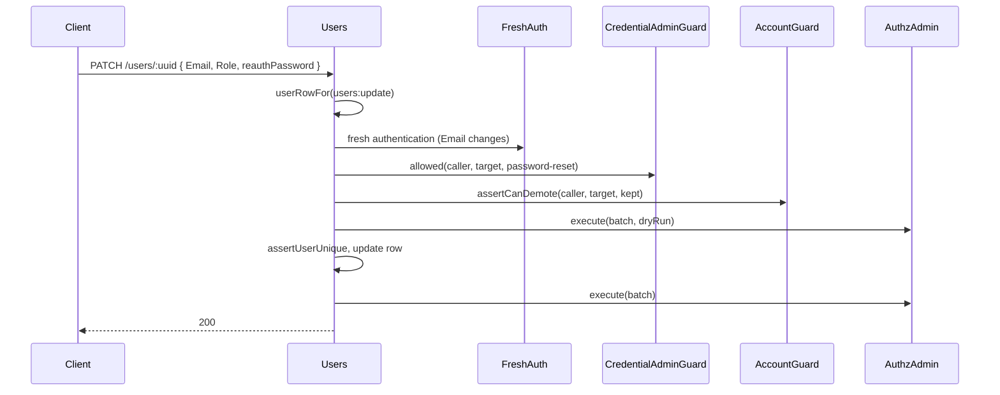

# User administration

The `Users` controller is the administrative API for accounts at `/users`: list with filters and sorting, read one, create an account and invite its owner, change its login, email and roles, soft delete and restore it. Role changes go through `AuthzAdmin` with the caller as actor, so authz-rbac's admin guard decides escalation and lockout.

## Routes

| Method | Path | Permission | Extra checks | Answer |
| --- | --- | --- | --- | --- |
| `GET` | `/users` | `users:read` on every user | | `User[]`, header `X-Total-Count` |
| `GET` | `/users/roles` | `users:read` (any grant) | a signed-in user caller | `string[]`: roles the caller may grant |
| `GET` | `/users/:uuid` | `users:read` on that row | | `User` |
| `GET` | `/users/byLogin/:login` | `users:read` on that row | | `User` |
| `POST` | `/users` | `users:create` on every user | a signed-in user caller; `AuthzAdmin` per role | `User` (inactive, invite sent), maybe `Incomplete` |
| `PATCH` | `/users/:uuid` | `users:update` on that row | a signed-in user caller; fresh auth and credential admin guard when `Email` or `Login` changes; `AccountGuard.assertCanDemote` when a role is removed; `AuthzAdmin` | `200` |
| `DELETE` | `/users/:uuid` | `users:delete` on that row | fresh auth; credential admin guard (`sessions`); `AccountGuard.assertCanDisable` | `200` |
| `PATCH` | `/users/:uuid/restore` | `users:delete` on every user | | `200` |

`GET /users`, `GET /users/:uuid` and `GET /users/byLogin/:login` take the `include` query argument (an array; only `Metadata`) to populate the metadata relation, and answer only the fields the `users:read` grant reads.

## List: filtering, sorting, paging

Each of `pagination`, `order` and `filter` is one JSON-encoded query argument: `?pagination={"page":0,"limit":50}&order={"column":"Login","order":"ASC"}`. See [Pagination and ordering](../orm-http/05-pagination-and-order.md).

| Field | Default | Rule |
| --- | --- | --- |
| `pagination.page` | `0` | zero-based |
| `pagination.limit` | `10` | capped at `100` |
| `order.column` | `CreatedAt` | `Uuid`, `Login`, `Email`, `IsActive`, `CreatedAt`, `LastLoginAt`, `DeletedAt`; anything else `400` |
| `order.order` | `DESC` | `ASC`, `DESC` |
| `include` | none | `Metadata` |
| `filter` | none | the columns below; see [Filtering](../orm-http/03-filtering.md) |

| Filter column | Operators | Meaning |
| --- | --- | --- |
| `Uuid` | `eq` | |
| `Email`, `Login` | `eq`, `like` | |
| `CreatedAt` | `eq`, `gte`, `lte`, `lt`, `gt` | |
| `LastLoginAt`, `DeletedAt` | `eq`, `gte`, `lte`, `lt`, `gt`, `isnull`, `notnull` | A `DeletedAt` condition anywhere in the filter also lists soft-deleted accounts |
| `IsActive` | `eq` | |
| `Role` | `eq`, `in-set` (holds any), `neq`, `nin-set` (holds none) | Live GLOBAL assignments of the named roles in `authz_assignment` |
| `user:niceName` | `eq`, `neq`, `like`, `b-like`, `e-like` | The `user:niceName` metadata value |

## How it works

### Create: `POST /users`

1. `userActor(caller)` refuses anything but a signed-in user principal (`403`); `requireEveryUser(users:create)` refuses a conditional grant (`403`).
2. `roleList()` (from `@spinajs/users`) normalises `Role` (one name or a list) to unique, trimmed names.
3. `create()` of `@spinajs/users` creates the account **inactive** and without a password, grants the roles at GLOBAL through `AuthzAdmin` as the caller, and sends the owner an invite through authn's `PasswordService`. One refused role refuses the request; nothing is created.
4. `UserAlreadyExists` becomes `409` with `parameter: [{ instancePath: '/Email', keyword: 'duplicate', ... }]` naming the clashing fields.
5. `UserCreatedIncomplete` (a step after the role grants failed): the account exists, so the answer is still `200` with the account and `Incomplete: { resendInvite }`.

### Update: `PATCH /users/:uuid`

1. `userActor()`, then `userRowFor(users:update)`: the row is loaded as `SYSTEM` with its metadata and a conditional grant is decided on it.
2. A new `Login` must not be reserved (`assertLoginNotReserved`, `400`). A `Role` that normalises to `[]` answers `400`.
3. When `Email` or `Login` actually changes:
   1. fresh authentication (`freshAuthRefusal()`): a login within `authn.freshAuth.maxAgeSeconds`, or `reauthPassword` in the body; `403 fresh_auth_required`, `session_required`, `impersonating`, or the login failure `401`;
   2. on another account, `assertCredentialAdmin(caller, uuid, 'password-reset')`: `403 forbidden`, `protected_role`, `escalation`.
4. `reauthPassword` is dropped from the DTO.
5. With `Role`: `globalRolesOf()` reads the current GLOBAL roles, `replacementCommands()` builds a grant per added role and a `revokeWhere` per removed one. A removal first asks `AccountGuard.assertCanDemote(caller, target, kept)`.
6. The `AuthzAdmin` batch runs as a **dry run**: a refusal answers `403` (`escalation`, `protected_role`, `forbidden`, `self_lockout`, `last_holder`) or `400` (`unknown_role`, `not_assignable`, `wrong_scope_type`) before anything is written.
7. `assertUserUnique()` checks a changed login or email (`409`).
8. The row is updated, then the batch runs for real.



### Delete and restore

1. `DELETE /users/:uuid`: `userActor()`, fresh authentication, `userRowFor(users:delete)`, `assertCredentialAdmin(..., 'sessions')`, `AccountGuard.assertCanDisable(..., 'delete')`, then `deleteUser()` of `@spinajs/users`: `DeletedAt` is stamped and every session of the account ends.
2. `PATCH /users/:uuid/restore`: `everyUserRow(users:delete)` reads the row including deleted ones; not deleted answers `400`; else `DeletedAt` is cleared. `IsActive` is not changed: restoring is not activating.

### Assignable roles: `GET /users/roles`

For every role of authz-rbac's `RoleStore` whose `assignable` is not `false`, it runs a dry-run `assignment.grant` at GLOBAL as the caller, and lists the roles `AuthzAdmin` accepts. A UI built on it offers no role the update would refuse.

## Request bodies

`CreateUserDto` (`$id: 'arrow.common.createUserDto'`):

| Field | Type | Required | Rule |
| --- | --- | --- | --- |
| `Login` | `string` | yes | 3 to 32 characters; not a reserved `__name__` login |
| `Email` | `string` | yes | `format: email` |
| `Role` | `string \| string[]` | yes | Role name (`ROLE_NAME_PATTERN`, no edge whitespace), or 1 to 16 unique names |
| `Metadata` | object | no | Extra metadata; protected keys are refused |

`UpdateUserDto` (`$id: 'arrow.common.updateUserDto'`, `additionalProperties: false`):

| Field | Type | Required | Rule |
| --- | --- | --- | --- |
| `Login` | `string` | no | 3 to 32 characters |
| `Email` | `string` | no | `format: email` |
| `Role` | `string \| string[]` | no | Replaces the account's GLOBAL roles; `[]` is refused |
| `reauthPassword` | `string` | no | The caller's password, for fresh authentication when `Email` or `Login` changes |

`DELETE /users/:uuid` takes `reauthPassword` in its body for the same reason.

## Services and extension points

| Service | DI token and lifetime | Default implementation | Alternatives | How to replace or extend |
| --- | --- | --- | --- | --- |
| `Users` controller | Class key `Users`; singleton; mounted by the controller scan | `Users` | none | Subclass and `DI.register(Mine).as(Users)`. Protected hooks: `sortColumn(order)` and `asDuplicateResponse(work)`. See [Controller overrides](10-controller-overrides.md). |
| `AccountGuard` | Abstract class key `AccountGuard`; `@Autoinject` into `Users` | `DefaultAccountGuard` | yours | See [Account guard](08-account-guard.md). |
| `CredentialAdminGuard` | authn contract, resolved per call from the root container | users' `AuthzCredentialAdminGuard` | yours | See [Host services](11-host-services.md#credentialadminguard-protect-a-break-glass-account). Without one, identity changes of another account and deletes answer `403 forbidden`. |
| `FreshAuth` | authn-http policy, resolved per call | `FreshAuth` | | Configure `authn.freshAuth.maxAgeSeconds`. |
| `AuthzAdmin` | `AuthzService.admin()` of the root container | authz-rbac's | | Configure `authz.admin.guard`; see `@spinajs/authz-rbac`. |
| `RoleStore`, `AssignmentStore` | authz-rbac stores, resolved per call | authz-rbac's | | Without a `RoleStore`, `GET /users/roles` answers `500` (`AuthzConfigError`). |

## Important behaviour

- A conditional `users:<action>` grant (for example `self`) works on `GET /users/:uuid`, `GET /users/byLogin/:login`, `PATCH /users/:uuid` and `DELETE /users/:uuid`, decided on the row. The list, create and restore refuse it.
- Every row is read as `SYSTEM`; the list runs its query and count as `SYSTEM` after `requireEveryUser()`.
- `Role` **replaces** the GLOBAL roles. Roles at other scopes are not touched. A list with the current roles plus one adds that one.
- The update is not one transaction: the row is written first, then the role batch. The dry run before them catches every refusal `AuthzAdmin` can give in advance.
- A role-only change, and an `Email` or `Login` sent unchanged, need only `users:update`.
- An `Email` or `Login` change of the caller's own account needs fresh authentication but not the credential admin guard (users' guard refuses one's own account).
- `Metadata` is not accepted on `PATCH`; use the [metadata routes](04-user-metadata-routes.md).
- The `Role` filter reads `authz_assignment` on the users model's connection; assignments kept on another connection are missed. `Role` is not sortable.
- The list always joins the `user:niceName` metadata value.

## Best practices

- Build role pickers from `GET /users/roles`, not from the configured role list.
- Send `reauthPassword` with every `PATCH` that may change `Email` or `Login`, and with `DELETE`, when the admin UI cannot tell how old the session is.
- On `200` with `Incomplete.resendInvite: true`, offer "resend invite" instead of retrying `POST /users`: a retry answers `409`.
- Filter soft-deleted accounts with `DeletedAt notnull` to build a recycle bin, then restore from it.

## Patterns and antipatterns

```ts
// Don't: send only the role to add. Role replaces the GLOBAL roles, so this removes every other one.
await api.patch(`/users/${uuid}`, { Role: 'reports' });

// Do: send the full list you want the account to hold.
await api.patch(`/users/${uuid}`, { Role: [...currentRoles, 'reports'] });
```

## Examples

### Create an account and handle an incomplete invite

```ts sample
interface CreatedUser {
  Uuid: string;
  Login: string;
  Email: string;
  IsActive: boolean;
  Incomplete?: { resendInvite: boolean };
}

type Api = (path: string, init?: RequestInit) => Promise<Response>;

/** Creates an invited account; returns what the admin UI should tell its operator. */
export async function inviteUser(api: Api, login: string, email: string, roles: string[]): Promise<string> {
  const res = await api('/users', {
    method: 'POST',
    headers: { 'content-type': 'application/json' },
    body: JSON.stringify({ Login: login, Email: email, Role: roles }),
  });

  if (res.status === 409) {
    const body = (await res.json()) as { parameter?: Array<{ params: { field: string } }> };
    return `already in use: ${(body.parameter ?? []).map((p) => p.params.field).join(', ')}`;
  }
  if (!res.ok) {
    return `refused (${res.status})`;
  }

  const user = (await res.json()) as CreatedUser;
  return user.Incomplete?.resendInvite ? `created ${user.Login}; the invite was not sent, resend it` : `invited ${user.Login}`;
}
```

### List administrators who never signed in

```ts sample
type Api = (path: string) => Promise<Response>;

export async function idleAdmins(api: Api): Promise<{ total: number; logins: string[] }> {
  const filter = {
    op: 'and',
    filters: [
      { Column: 'Role', Operator: 'in-set', Value: ['admin', 'admin.users'] },
      { Column: 'LastLoginAt', Operator: 'isnull', Value: null },
    ],
  };
  const query = new URLSearchParams({
    filter: JSON.stringify(filter),
    order: JSON.stringify({ column: 'CreatedAt', order: 'ASC' }),
    pagination: JSON.stringify({ page: 0, limit: 100 }),
  });

  const res = await api(`/users?${query.toString()}`);
  const rows = (await res.json()) as Array<{ Login: string }>;
  return { total: Number(res.headers.get('X-Total-Count')), logins: rows.map((r) => r.Login) };
}
```

## Related

- [Account lifecycle and sessions](07-lifecycle-and-sessions.md): activate, deactivate, ban and sessions of the same accounts.
- [Account guard](08-account-guard.md): the self lockout and last privileged account rules.
- [Setup and access](01-setup-and-access.md): how a conditional grant is decided on the row.
- [`@spinajs/users`](../users/README.md): `create()`, `deleteUser()`, `assertUserUnique()` and the invite flow.
