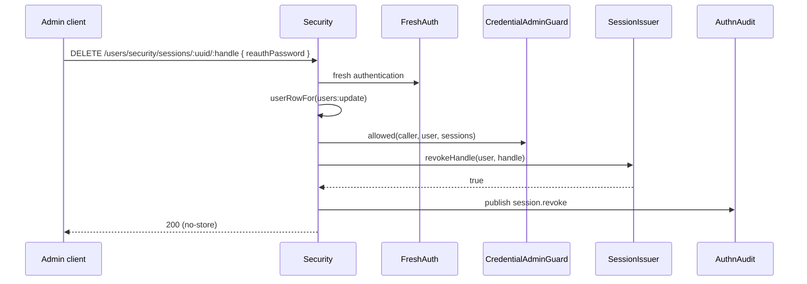

# Account lifecycle and sessions

The `Security` controller at `/users/security` takes accounts out of service and back (deactivate, activate, ban, unban) and lets an administrator list and end one user's sessions. Routes that take access away ask for fresh authentication and authn's credential admin guard, then the [account guard](08-account-guard.md); routes that give access back ask neither.

## Routes

| Method | Path | Permission | Fresh auth | Credential admin guard | Account guard | Effect |
| --- | --- | --- | --- | --- | --- | --- |
| `POST` | `/users/security/deactivate/:uuid` | `users:delete` on every user | yes | `sessions` | `assertCanDisable(..., 'deactivate')` | `deactivate()`: inactive, sessions ended |
| `POST` | `/users/security/activate/:uuid` | `users:update` on every user | no | no | no | `activate()` |
| `POST` | `/users/security/ban/:uuid` | `users:delete` on every user | yes | `sessions` | `assertCanDisable(..., 'ban')` | `ban(reason, duration)`: banned, sessions ended |
| `POST` | `/users/security/unban/:uuid` | `users:update` on every user | no | no | no | `unban()` |
| `GET` | `/users/security/sessions/:uuid` | `users:read` on that row, session caller | no | `sessions` | no | `IAdminSessionEntry[]`, newest first |
| `DELETE` | `/users/security/sessions/:uuid/:handle` | `users:update` on that row, session caller | yes | `sessions` | no | Ends one session; audited |

Body of `ban` (`BanUserDto`, `$id: 'arrow.common.banUserDTO'`):

| Field | Type | Rule |
| --- | --- | --- |
| `reason` | `string` | up to 255 characters; stored in the user's metadata |
| `duration` | `number` | seconds, at least `1`; 24 hours when omitted |
| `reauthPassword` | `string` | the caller's password, for fresh authentication |

`deactivate` and the session revoke take `reauthPassword` in their body too.

A session list entry (`IAdminSessionEntry`):

| Field | Type | Meaning |
| --- | --- | --- |
| `Handle` | `string` | The issuer's one-way handle; never the session id, which is a working credential |
| `Created` | `string` | ISO instant the session opened |
| `LastSeen` | `string` | ISO instant of its last use |
| `Ip` | `string?` | Stored client ip (the impersonator's, for an impersonation session) |
| `UserAgent` | `string?` | Stored client user agent |

## How it works

### Deactivate and ban

1. `userActor(caller)`: a signed-in user principal, else `403`.
2. `freshAuthRefusal(req, this)` runs authn-http's `FreshAuth` policy in the handler: a login within `authn.freshAuth.maxAgeSeconds`, or `reauthPassword`. A wrong password answers authn's login failure `401`; `403 fresh_auth_required`, `session_required` (token, key or signature caller) or `impersonating` are thrown.
3. `everyUserRow(users:delete)`: an unconditional grant, then the row with its metadata as `SYSTEM`; `404` when absent.
4. `assertCredentialAdmin(caller, uuid, 'sessions')`: authn's `CredentialAdminGuard` must answer `{ ok: true }`. Otherwise `403` with `error` `forbidden`, `protected_role` or `escalation`, or `404 not_found`. No guard registered: `403 forbidden`.
5. `AccountGuard.assertCanDisable(caller, target, action)`: self lockout and last privileged account.
6. `deactivate(target)` or `ban(target, reason, duration)` of `@spinajs/users`.

Fresh authentication runs inside the handler, not as a route policy: `@spinajs/http` runs a route's policies together, so as a policy it would verify and count a password even when `@Access` refuses.

### List and end sessions

1. `@Access(..., { also: SESSION_CALLER })`: `Authenticated`, `NoTokenAuthPolicy`, `NoImpersonationPolicy` of `@spinajs/authn-http`, AND-ed with the permission.
2. `sessionIssuer()`: no `SessionIssuer` registered answers `404` (`error: 'not_found'`).
3. For a revoke, fresh authentication as above.
4. `userRowFor(users:read | users:update)`, then `assertCredentialAdmin(..., 'sessions')`.
5. List: `SessionIssuer.list({ type: 'user', id })`, sorted by `createdAt` descending, mapped to `IAdminSessionEntry`.
6. Revoke: `SessionIssuer.revokeHandle(subject, handle)`. It is owner-bound: a handle of another user's session ends nothing and answers `404 session_not_found`.
7. A revoke publishes `session.revoke` to `AuthnAudit` with reason `admin`, the caller as actor, the handle, and the caller's ip and user agent.
8. Answers carry `Cache-Control: no-store`.



## Services and extension points

| Service | DI token and lifetime | Default implementation | Alternatives | How to replace or extend |
| --- | --- | --- | --- | --- |
| `Security` controller | Class key `Security`; singleton; mounted by the controller scan | `Security` | none | Subclass and `DI.register(Mine).as(Security)`; see [Controller overrides](10-controller-overrides.md). |
| `AccountGuard` | Abstract class key; `@Autoinject` into `Security` | `DefaultAccountGuard` | yours | See [Account guard](08-account-guard.md). |
| `CredentialAdminGuard` | authn contract; checked with `hasImplementation()`, resolved per call | users' `AuthzCredentialAdminGuard` | yours | `DI.register(Mine).as(CredentialAdminGuard)`; see [Host services](11-host-services.md). |
| `SessionIssuer` | authn contract; checked with `hasImplementation()`, resolved per call | authn-session's issuer | yours | Without one the session routes answer `404`. |
| `AuthnAudit` | authn class; resolved per revoke | authn's | | Subscribe to its events to forward `session.revoke`. |
| `FreshAuth` | authn-http policy; resolved per call | `FreshAuth` | | Configure `authn.freshAuth.maxAgeSeconds`. |

## Important behaviour

- The order is fixed: fresh authentication, then the row and permission, then the credential admin guard, then the account guard, then the write. A stale session gets `403 fresh_auth_required` even where a later check would refuse.
- users' `AuthzCredentialAdminGuard` refuses the caller's own account (`403 forbidden`), so nobody deactivates, bans, deletes or manages the sessions of their own account through these routes, whatever `preventSelfLockout` says. The owner manages its own sessions through `GET /user/sessions` and `DELETE /user/sessions/:handle` of `@spinajs/authn-http`.
- Activate, unban and restore give access back and ask neither fresh authentication nor the guard.
- Ban of an already banned account answers `400`; unban of an account that is not banned answers `400`.
- The forced logout of **every** session is `DELETE /authn/admin/users/:uuid/sessions` of `@spinajs/authn-http`; this controller ends one session by handle.
- The list includes impersonation sessions of the user.

## Best practices

- Show `Ip`, `UserAgent` and `LastSeen` before an administrator ends a session, so the right device is chosen.
- Prefer `ban` with a `duration` over `deactivate` for temporary measures: the ban lifts itself.
- Ask for `reauthPassword` in the admin UI's confirm dialog of every route marked "fresh auth" above.

## Patterns and antipatterns

```ts
// Don't: end a session by the id from your session store. The route takes the handle; an id is a credential.
await api.delete(`/users/security/sessions/${uuid}/${sessionId}`);

// Do: take the handle from the list.
const [newest] = await (await api.get(`/users/security/sessions/${uuid}`)).json();
await api.delete(`/users/security/sessions/${uuid}/${newest.Handle}`, { reauthPassword });
```

## Examples

### Ban for a week and end the oldest remaining session

```ts sample
type Api = (path: string, init?: RequestInit) => Promise<Response>;

interface AdminSession {
  Handle: string;
  Created: string;
  LastSeen: string;
  Ip?: string;
  UserAgent?: string;
}

const json = (body: unknown): RequestInit => ({ headers: { 'content-type': 'application/json' }, body: JSON.stringify(body) });

/** Bans for 7 days; the ban already ends every session. */
export async function banForAWeek(api: Api, uuid: string, reason: string, reauthPassword: string): Promise<number> {
  const res = await api(`/users/security/ban/${uuid}`, { method: 'POST', ...json({ reason, duration: 7 * 24 * 3600, reauthPassword }) });
  return res.status;
}

/** Ends the oldest session of a user, eg. a forgotten kiosk login. */
export async function endOldestSession(api: Api, uuid: string, reauthPassword: string): Promise<boolean> {
  const sessions = (await (await api(`/users/security/sessions/${uuid}`)).json()) as AdminSession[];
  const oldest = sessions[sessions.length - 1];
  if (!oldest) {
    return false;
  }

  const res = await api(`/users/security/sessions/${uuid}/${encodeURIComponent(oldest.Handle)}`, { method: 'DELETE', ...json({ reauthPassword }) });
  return res.ok;
}
```

## Related

- [Account guard](08-account-guard.md): the rules `deactivate`, `ban` and `delete` pass through.
- [User administration](06-user-administration.md): delete and restore, which follow the same order.
- [Host services](11-host-services.md): the credential admin guard and session issuer.
- [`@spinajs/authn`](../authn/README.md): `SessionIssuer`, `CredentialAdminGuard`, `AuthnAudit`.
