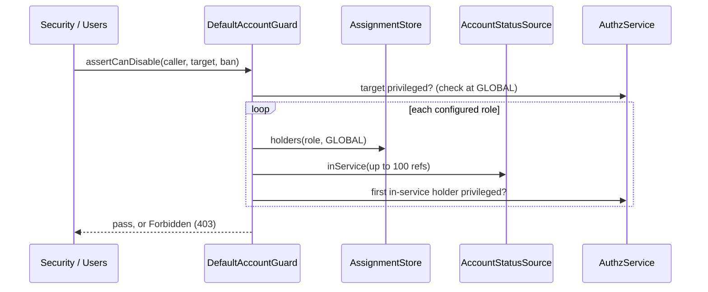

# Account guard

`AccountGuard` decides whether a caller may take an account out of service (delete, deactivate, ban) or remove roles from it. The default, `DefaultAccountGuard`, applies the self lockout and last privileged account rules of `authz.admin.guard`. Extend it to add your own rules, or replace it.

The lifecycle routes are not `AuthzAdmin` commands, so authz-rbac's admin guard never sees them; this service applies the same switches to them.

## How it works

`Users` and `Security` call it after fresh authentication and the credential admin guard, before any write:

| Route | Call |
| --- | --- |
| `DELETE /users/:uuid` | `assertCanDisable(caller, target, 'delete')` |
| `POST /users/security/deactivate/:uuid` | `assertCanDisable(caller, target, 'deactivate')` |
| `POST /users/security/ban/:uuid` | `assertCanDisable(caller, target, 'ban')` |
| `PATCH /users/:uuid` with a `Role` that removes a role | `assertCanDemote(caller, target, kept)`; `kept` are the current GLOBAL roles the new list keeps |

A refusal throws `Forbidden` (`403`); anything else passes.

### `DefaultAccountGuard.assertCanDisable`

1. `guardSwitches(authz.admin.guard)` of `@spinajs/authz-rbac` reads the switches on every call. A check that is on without `privilegedPermission` throws `AuthzConfigError`.
2. `preventSelfLockout` and the caller is the target (`actor.type === 'user' && actor.id === target.Uuid`): `Forbidden('Cannot <action> your own account')`.
3. `preventLastPrivilegedRemoval` off: pass.
4. `reload()` re-reads the target with its metadata as `SYSTEM` (the ban lives there), unless the metadata is already populated.
5. `privilegedNow()`: the target is active, unbanned and undeleted **and** holds `privilegedPermission` at GLOBAL unconditionally. Not privileged: pass.
6. `hasWitness()` looks for another account in service holding the permission. None: `Forbidden('Cannot <action> this account: it would leave no account in service holding ...')`.

### `DefaultAccountGuard.assertCanDemote`

1. Both switches off, or no `privilegedPermission`: pass.
2. The target is not privileged now: pass.
3. A role in `kept` still gives the permission (checked with a principal whose ceiling is `kept`): pass. Roles the batch adds are not counted.
4. `preventSelfLockout` and the caller is the target: `Forbidden('Cannot remove ... from your own account')`.
5. `preventLastPrivilegedRemoval` and no witness: `Forbidden`.

### Finding a witness

1. For each role of authz-rbac's `RoleStore`, `AssignmentStore.holders(role, GLOBAL, now)` lists its GLOBAL holders. Subject sets and non-user holders are skipped, so is the target and anyone already asked.
2. `firstInService()` asks the `AccountStatusSource` about up to 100 holders per call (`inService()`), then reads the rows it answers `true` for, as `SYSTEM`, and takes the first active, unbanned, undeleted one.
3. `privileged()` checks that holder: `AuthzService.check({ principal, permission, resource: GLOBAL })`, allowed with residual `true`.
4. The first privileged holder is the witness. Only the first in-service holder of each role is tried.
5. No `AccountStatusSource` registered, one that throws, or one that answers anything but a `Map`: the search ends with no witness, and a warning is logged under `users-http`.



## Configuration

| Key | Type | Default | Allowed values | Meaning |
| --- | --- | --- | --- | --- |
| `authz.admin.guard.preventSelfLockout` | `boolean` | `true` (absent is on; any value but `false` is on) | `true`, `false` | No self-deactivation, self-deletion, self-ban, or removing one's own privilege |
| `authz.admin.guard.preventLastPrivilegedRemoval` | `boolean` | `true` (absent is on) | `true`, `false` | Never take the last account in service holding `privilegedPermission` out of service |
| `authz.admin.guard.privilegedPermission` | `string` | `'users:update'` | a permission | What makes an account privileged; required while a switch is on (the authz schema refuses to boot without it) |

```js
authz: {
  admin: {
    guard: {
      preventSelfLockout: true,
      preventLastPrivilegedRemoval: true,
      privilegedPermission: 'users:update',
    },
  },
}
```

## Services and extension points

| Service | DI token and lifetime | Default implementation | Alternatives | How to replace or extend |
| --- | --- | --- | --- | --- |
| `AccountGuard` | Abstract class key `AccountGuard`; `DefaultAccountGuard` registers with `@Injectable(AccountGuard)`; singleton; `@Autoinject(AccountGuard)` into `Users` and `Security` when they are built | `DefaultAccountGuard` | none shipped | Subclass `DefaultAccountGuard` and override a hook, or extend `AccountGuard` and implement both methods. Register with `@Injectable(AccountGuard)` (or `DI.register(Mine).as(AccountGuard)`) before the HTTP server starts; the last registration wins. |
| `AccountStatusSource` | authz-rbac abstract; looked up with `DI.getRegisteredTypes()`, resolved per call | users' `UserAccountStatusSource` | yours | See [Host services](11-host-services.md#accountstatussource-keep-service-accounts-out-of-the-witness-search). |
| `UserPrincipalFactory` | `@spinajs/users`; `@Autoinject` | users' | | Builds the principals the guard checks. |
| `AssignmentStore`, `RoleStore` | authz-rbac stores; resolved per call | authz-rbac's | | Where holders and role names come from. |

Hooks of `DefaultAccountGuard` (all `protected`):

| Method | Default | Override to |
| --- | --- | --- |
| `privilegedNow(user, permission)` | active, unbanned, undeleted row **and** `privileged()` | change what "privileged and in service" means for the target |
| `hasWitness(target, permission)` | the role-by-role search above | search witnesses another way (a fixed list, a directory) |
| `firstInService(uuids, answered)` | slices of 100, first usable row | change batching or the "usable" test |
| `inService(uuids)` | asks the `AccountStatusSource`; `undefined` when missing or failing | answer from your own source |
| `reload(record)` | re-read with metadata as `SYSTEM` unless populated | add relations your rules need |
| `privileged(principal, permission)` | `AuthzService.check` at GLOBAL, residual `true` | count conditional grants, or another resource |
| `principalOf(user, roles?)` | `UserPrincipalFactory.principalOf(user, { ceiling })` | build principals differently |
| `asSystem(work)` | `AuthzService.runAs(SYSTEM, ...)` | run reads under another identity |

Fields: `Guard` (`@Config('authz.admin.guard')`), `Log` (`@Logger('users-http')`), `Users` (`UserPrincipalFactory`).

### `DefaultAccountGuard`: protect named accounts

Keep the default rules and add one: accounts listed in `app.users.protectedLogins` (the owner account, the break-glass account) are never disabled or demoted through the API. Overriding the two public methods and calling `super` keeps every default check.

```ts sample
import type { Principal } from '@spinajs/authz';
import { Config } from '@spinajs/configuration';
import { Injectable } from '@spinajs/di';
import { Forbidden } from '@spinajs/exceptions';
import type { User } from '@spinajs/users';
import { AccountDisableAction, AccountGuard, DefaultAccountGuard } from '@spinajs/users-http';

@Injectable(AccountGuard)
export class ProtectedLoginsAccountGuard extends DefaultAccountGuard {
  @Config('app.users.protectedLogins', { defaultValue: [] })
  protected ProtectedLogins: string[];

  public async assertCanDisable(actor: Principal, target: User, action: AccountDisableAction): Promise<void> {
    this.assertNotProtected(target, action);
    await super.assertCanDisable(actor, target, action);
  }

  public async assertCanDemote(actor: Principal, target: User, kept: readonly string[]): Promise<void> {
    this.assertNotProtected(target, 'demote');
    await super.assertCanDemote(actor, target, kept);
  }

  protected assertNotProtected(target: User, action: string): void {
    if (this.ProtectedLogins.includes(target.Login)) {
      throw new Forbidden(`Cannot ${action} ${target.Login}: the account is protected`);
    }
  }
}
```

```js
// config
app: { users: { protectedLogins: ['owner', 'break-glass'] } },
```

### `AccountGuard`: replace the policy

An installation whose service accounts are managed by infrastructure code: nobody disables or demotes a `svc-` account through the API, and nobody acts on their own account. No last-holder search runs. Implement both abstract methods.

```ts sample
import type { Principal } from '@spinajs/authz';
import { DI } from '@spinajs/di';
import { Forbidden } from '@spinajs/exceptions';
import type { User } from '@spinajs/users';
import { AccountDisableAction, AccountGuard } from '@spinajs/users-http';

export class ServiceAccountGuard extends AccountGuard {
  public async assertCanDisable(actor: Principal, target: User, action: AccountDisableAction): Promise<void> {
    this.assertAllowed(actor, target, action);
  }

  public async assertCanDemote(actor: Principal, target: User, _kept: readonly string[]): Promise<void> {
    this.assertAllowed(actor, target, 'demote');
  }

  protected assertAllowed(actor: Principal, target: User, action: string): void {
    if (actor.type === 'user' && actor.id === target.Uuid) {
      throw new Forbidden(`Cannot ${action} your own account`);
    }
    if (target.Login.startsWith('svc-')) {
      throw new Forbidden(`Cannot ${action} ${target.Login}: service accounts are managed by infrastructure code`);
    }
  }
}

DI.register(ServiceAccountGuard).as(AccountGuard);
```

## Important behaviour

- The guard fails closed. A missing or failing `AccountStatusSource` counts no witness, so the last privileged account stays. An account with an expired password or a pending invite is no witness under users' source.
- The target counts as privileged from its **row** (active, unbanned, undeleted), never from the status source: a password reset or an accepted invite can bring it back, and a failing source must not make the last administrator look out of service.
- A conditional grant of `privilegedPermission` does not make an account privileged.
- A holder reachable only through a subject set, or one that is not the first in-service holder of any role, is not found. The check can refuse although a witness exists; it never allows wrongly.
- users' credential admin guard already refuses the caller's own account on delete, deactivate and ban, so `preventSelfLockout` matters there only behind an application guard that admits it. It still applies to `assertCanDemote`.
- `DefaultAccountGuard` is a singleton: it warns about a missing status source once.

## Best practices

- Call `super` in an override of `DefaultAccountGuard` unless you mean to drop the last-holder rule.
- Keep `privilegedPermission` the permission your administrators actually need to repair accounts (`users:update` by default), so the guard protects the accounts that matter.
- Register the guard in a module that imports `@spinajs/users-http`; the import runs the package's own registration first, so yours is the last.

## Patterns and antipatterns

```ts
// Don't: register a guard as itself. Users and Security inject AccountGuard and keep getting the default.
@Injectable()
export class MyGuard extends DefaultAccountGuard {}

// Do
@Injectable(AccountGuard)
export class MyGuard extends DefaultAccountGuard {}
```

## Related

- [Account lifecycle and sessions](07-lifecycle-and-sessions.md) and [User administration](06-user-administration.md): the routes that call the guard.
- [Host services](11-host-services.md): `AccountStatusSource` and the stores the guard reads.
- [Multiple implementations](../di/06-multiple-implementations.md): why the last registration under `AccountGuard` wins.
