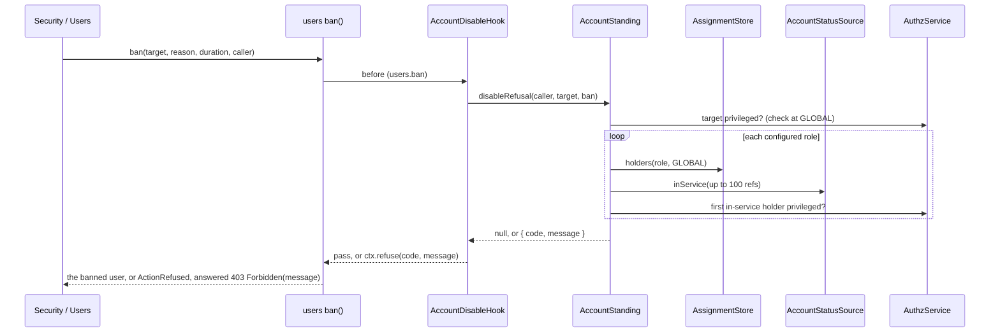

# Account guard

The account guard stops an administrator from locking themselves, or the installation, out through the API. It applies the self lockout and last privileged account rules of `authz.admin.guard` in two places:

- **Taking an account out of service.** `AccountDisableHook` is a before hook on the users actions `users.deactivate`, `users.ban` and `users.delete`.
- **Removing roles.** `AccountGuard.assertCanDemote` covers the role replacement of `PATCH /users/:uuid`, which is no users action.

Both ask `AccountStanding`, which holds the rules. The lifecycle routes are not `AuthzAdmin` commands, so authz-rbac's admin guard never sees them; the account guard applies the same switches to them.

## How it works

| Route | Check |
| --- | --- |
| `DELETE /users/:uuid` | `deleteUser(target, caller)`: `AccountDisableHook` on `users.delete` |
| `POST /users/security/deactivate/:uuid` | `deactivate(target, caller)`: `AccountDisableHook` on `users.deactivate` |
| `POST /users/security/ban/:uuid` | `ban(target, reason, duration, caller)`: `AccountDisableHook` on `users.ban` |
| `PATCH /users/:uuid` with a `Role` that removes a role | `AccountGuard.assertCanDemote(caller, target, kept)`; `kept` are the current GLOBAL roles the new list keeps |

The routes run these after fresh authentication and the `authn.admin.credentials` action, before any write.

### `AccountDisableHook`

1. It runs first among the before hooks of `users.deactivate`, `users.ban` and `users.delete`: its order is `ACCOUNT_DISABLE_HOOK_ORDER` (`-1000`).
2. It does not judge an action run as SYSTEM (`actor.type === 'system'`). SYSTEM is the default actor of users' functions and of the CLI, and AuthzAdmin's guard does not judge SYSTEM either.
3. Otherwise it asks `AccountStanding.disableRefusal(actor, user, action)`. On a refusal it calls `ctx.refuse(code, message)`, where `code` is `self_lockout` or `last_holder`.
4. The users action then throws `ActionRefused` and writes nothing. users-http's routes answer such a refusal of their own action with `403 Forbidden`, the reason as the message, as the account guard answered before 3.x. Any other hook's refusal of the action answers `403 { error: 'action_refused', code }`.

It applies to every caller that hands the action an actor, not only to the routes.

### `AccountStanding.disableRefusal(actor, target, action)`

1. `guardSwitches(authz.admin.guard)` of `@spinajs/authz-rbac` reads the switches on every call. A check that is on without `privilegedPermission` throws `AuthzConfigError`; in the hook that fails the action closed (403 `hook_error`).
2. With `preventSelfLockout` on and the actor being the target (`actor.type === 'user' && actor.id === target.Uuid`), it answers `{ code: 'self_lockout', message: 'Cannot <action> your own account' }`.
3. With `preventLastPrivilegedRemoval` off, it answers `null`.
4. `reload()` re-reads the target with its metadata as `SYSTEM`, because the ban lives in the metadata. It skips the read for a `User` whose metadata is already populated.
5. `privilegedNow()` holds when the target is active, unbanned and undeleted **and** holds `privilegedPermission` at GLOBAL unconditionally. A target that is not privileged gets `null`.
6. `hasWitness()` looks for another account in service holding the permission. With none, it answers `{ code: 'last_holder', message: 'Cannot <action> this account: it would leave no account in service holding ...' }`.

### `AccountStanding.demoteRefusal(actor, target, kept)`

`DefaultAccountGuard.assertCanDemote` throws `Forbidden(message)` for its answer.

1. Both switches off, or no `privilegedPermission`: `null`.
2. The target is not privileged now: `null`.
3. A role in `kept` still gives the permission, checked with a principal whose ceiling is `kept`: `null`. Roles the batch adds are not counted.
4. `preventSelfLockout` and the actor is the target: `self_lockout`, `Cannot remove ... from your own account`.
5. `preventLastPrivilegedRemoval` and no witness: `last_holder`.

### Finding a witness

1. For each role of authz-rbac's `RoleStore`, `AssignmentStore.holders(role, GLOBAL, now)` lists its GLOBAL holders. The search skips subject sets, non-user holders, the target and anyone already asked.
2. `firstInService()` asks the `AccountStatusSource` about up to 100 holders per call (`inService()`). It then reads, as `SYSTEM`, the rows the source answers `true` for, and takes the first active, unbanned, undeleted one.
3. `privileged()` checks that holder: `AuthzService.check({ principal, permission, resource: GLOBAL })`, allowed with residual `true`.
4. The first privileged holder is the witness. Only the first in-service holder of each role is tried.
5. No `AccountStatusSource` registered, one that throws, or one that answers anything but a `Map`: the search ends with no witness, and a warning is logged under `users-http`.



## Configuration

| Key | Type | Default | Allowed values | Meaning |
| --- | --- | --- | --- | --- |
| `authz.admin.guard.preventSelfLockout` | `boolean` | `true` (absent is on; any value but `false` is on) | `true`, `false` | No self-deactivation, self-deletion, self-ban, or removing one's own privilege |
| `authz.admin.guard.preventLastPrivilegedRemoval` | `boolean` | `true` (absent is on) | `true`, `false` | Never take the last account in service holding `privilegedPermission` out of service |
| `authz.admin.guard.privilegedPermission` | `string` | `'users:update'` | a permission | What makes an account privileged; required while a switch is on (the authz schema refuses to boot without it) |

```js
authz: {
  admin: {
    guard: {
      preventSelfLockout: true,
      preventLastPrivilegedRemoval: true,
      privilegedPermission: 'users:update',
    },
  },
}
```

## Services and extension points

| Service | DI token and lifetime | Default implementation | Alternatives | How to replace or extend |
| --- | --- | --- | --- | --- |
| `AccountDisableHook` | `ActionHook` (`@Injectable(ActionHook)`), registered by users-http; singleton | `AccountDisableHook` | your own before hook | Narrow it with a before hook of your own on the same actions: every before hook must allow. To replace it, `DI.unregister(AccountDisableHook)` and register yours, before anything resolves `Hooks`. |
| `AccountStanding` | Class key `AccountStanding` (`@Injectable()`); singleton; `@Autoinject` into `AccountDisableHook` and `DefaultAccountGuard` | `AccountStanding` | your subclass | Subclass and override a method, then `DI.register(Mine).as(AccountStanding)` before the first resolve. One subclass changes both the disable rule and the demotion rule. |
| `AccountGuard` | Abstract class key `AccountGuard`; `DefaultAccountGuard` registers with `@Injectable(AccountGuard)`; singleton; `@Autoinject(AccountGuard)` into `Users` | `DefaultAccountGuard` | none shipped | Extend `AccountGuard` and implement `assertCanDemote`; register with `@Injectable(AccountGuard)`. The last registration wins. |
| `AccountStatusSource` | authz-rbac abstract; looked up with `DI.getRegisteredTypes()`, resolved per call | users' `UserAccountStatusSource` | yours | See [Host services](11-host-services.md#accountstatussource-keep-service-accounts-out-of-the-witness-search). |
| `UserPrincipalFactory` | `@spinajs/users`; `@Autoinject` into `AccountStanding` | users' | | Builds the principals the rules check. |
| `AssignmentStore`, `RoleStore` | authz-rbac stores; resolved per call | authz-rbac's | | Where holders and role names come from. |

`AccountGuard.assertCanDisable` is gone (D17): `AccountDisableHook` decides deactivate, ban and delete. `AccountGuard` declares `assertCanDisable?: never`, so a TypeScript subclass that still overrides it fails to compile instead of never being called.

Methods of `AccountStanding`:

| Method | Default | Override to |
| --- | --- | --- |
| `disableRefusal(actor, target, action)` (public) | the steps above | add a rule for taking an account out of service |
| `demoteRefusal(actor, target, kept)` (public) | the steps above | add a rule for removing roles |
| `privilegedNow(user, permission)` | active, unbanned, undeleted row **and** `privileged()` | change what "privileged and in service" means for the target |
| `hasWitness(target, permission)` | the role-by-role search above | search witnesses another way (a fixed list, a directory) |
| `firstInService(uuids, answered)` | slices of 100, first usable row | change batching or the "usable" test |
| `inService(uuids)` | asks the `AccountStatusSource`; `undefined` when missing or failing | answer from your own source |
| `reload(record)` | re-read with metadata as `SYSTEM`, unless a `User` with populated metadata | add relations your rules need |
| `privileged(principal, permission)` | `AuthzService.check` at GLOBAL, residual `true` | count conditional grants, or another resource |
| `principalOf(user, roles?)` | `UserPrincipalFactory.principalOf(user, { ceiling })` | build principals differently |
| `asSystem(work)` | `AuthzService.runAs(SYSTEM, 'users-http-account-guard', ...)` | run reads under another identity |

Fields: `Guard` (`@Config('authz.admin.guard')`), `Log` (`@Logger('users-http')`), `Users` (`UserPrincipalFactory`).

### `AccountStanding`: protect named accounts

This example keeps the default rules and adds one: accounts listed in `app.users.protectedLogins`, such as the owner account or the break-glass account, are never disabled or demoted through the API. Overriding the two public methods and calling `super` keeps every default check.

```ts sample
import type { PrincipalRef } from '@spinajs/authz';
import { Config } from '@spinajs/configuration';
import { DI } from '@spinajs/di';
import { User, userModel } from '@spinajs/users';
import { AccountStanding } from '@spinajs/users-http';
import type { AccountDisableAction, AccountRefusal } from '@spinajs/users-http';

export class ProtectedLoginsStanding extends AccountStanding {
  @Config('app.users.protectedLogins', { defaultValue: [] })
  protected ProtectedLogins: string[];

  public async disableRefusal(actor: PrincipalRef, target: User | { readonly Uuid: string }, action: AccountDisableAction): Promise<AccountRefusal | null> {
    return (await this.protectedRefusal(target, action)) ?? super.disableRefusal(actor, target, action);
  }

  public async demoteRefusal(actor: PrincipalRef, target: User, kept: readonly string[]): Promise<AccountRefusal | null> {
    return (await this.protectedRefusal(target, 'demote')) ?? super.demoteRefusal(actor, target, kept);
  }

  protected async protectedRefusal(target: User | { readonly Uuid: string }, action: string): Promise<AccountRefusal | null> {
    // The hook hands over the user's uuid only.
    const login = target instanceof User ? target.Login : (await this.asSystem(() => userModel().query().withDeleted().where('Uuid', target.Uuid).first()))?.Login;
    // Either code makes the routes answer 403 with the message.
    return login && this.ProtectedLogins.includes(login) ? { code: 'last_holder', message: `Cannot ${action} ${login}: the account is protected` } : null;
  }
}

DI.register(ProtectedLoginsStanding).as(AccountStanding);
```

```js
// config
app: { users: { protectedLogins: ['owner', 'break-glass'] } },
```

### A rule of your own beside the hook

Take an installation whose service accounts are managed by infrastructure code: nobody disables a `svc-` account through the API. Add a before hook on the same actions. `AccountDisableHook` still applies the default rules, and both hooks must allow.

```ts sample
import { Injectable } from '@spinajs/di';
import { ActionHook } from '@spinajs/hooks';
import type { ActionPattern, BeforeContext } from '@spinajs/hooks';
import '@spinajs/users';

type Disabling = 'users.deactivate' | 'users.ban' | 'users.delete';

@Injectable(ActionHook)
export class ServiceAccountsHook extends ActionHook<Disabling> {
  readonly actions: readonly ActionPattern[] = ['users.deactivate', 'users.ban', 'users.delete'];

  public before(ctx: BeforeContext<Disabling>): void {
    if (ctx.input.actor.type !== 'system' && ctx.input.user.Login.startsWith('svc-')) {
      ctx.refuse('service_account', 'service accounts are managed by infrastructure code');
    }
  }
}
```

The routes answer this refusal with `403 { error: 'action_refused', code: 'service_account' }`.

## Important behaviour

- The rules fail closed. A missing or failing `AccountStatusSource` counts no witness, so the last privileged account stays. An account with an expired password or a pending invite is no witness under users' source.
- The target counts as privileged from its **row** (active, unbanned, undeleted), never from the status source: a password reset or an accepted invite can bring it back, and a failing source must not make the last administrator look out of service.
- A conditional grant of `privilegedPermission` does not make an account privileged.
- A holder reachable only through a subject set, or one that is not the first in-service holder of any role, is not found. The check can refuse although a witness exists; it never allows wrongly.
- users' credential admin rule already refuses the caller's own account on delete, deactivate and ban, so `preventSelfLockout` matters there only behind an application rule that admits it. It still applies to `assertCanDemote`, and to any code that calls `deactivate`, `ban` or `deleteUser` with the user's own principal.
- An action run as SYSTEM, such as the CLI's `rbac:user-delete`, is not judged: the last privileged account can still be taken out of service from the server.
- `AccountStanding` is a singleton: it warns about a missing status source once.

## Best practices

- Call `super` in an override of `AccountStanding` unless you mean to drop the last-holder rule.
- Narrow with a hook of your own beside `AccountDisableHook` rather than replacing it.
- Keep `privilegedPermission` the permission your administrators actually need to repair accounts (`users:update` by default), so the guard protects the accounts that matter.
- Register the guard in a module that imports `@spinajs/users-http`; the import runs the package's own registration first, so yours is the last.

## Patterns and antipatterns

```ts
// Don't: override assertCanDisable. It is gone; AccountDisableHook decides deactivate, ban and delete.
@Injectable(AccountGuard)
export class MyGuard extends DefaultAccountGuard {
  // A compile error: AccountGuard declares assertCanDisable?: never
  async assertCanDisable() {}
}

// Do: change the rule in AccountStanding, which the hook and the demotion both ask
DI.register(MyStanding).as(AccountStanding);
```

## Related

- [Account lifecycle and sessions](07-lifecycle-and-sessions.md) and [User administration](06-user-administration.md): the routes whose actions the guard judges.
- [`@spinajs/users` action hooks](../users/04-action-hooks.md): `users.deactivate`, `users.ban`, `users.delete` and their `actor`.
- [Host services](11-host-services.md): `AccountStatusSource` and the stores the guard reads.
- [Multiple implementations](../di/06-multiple-implementations.md): why the last registration under `AccountGuard` wins.
