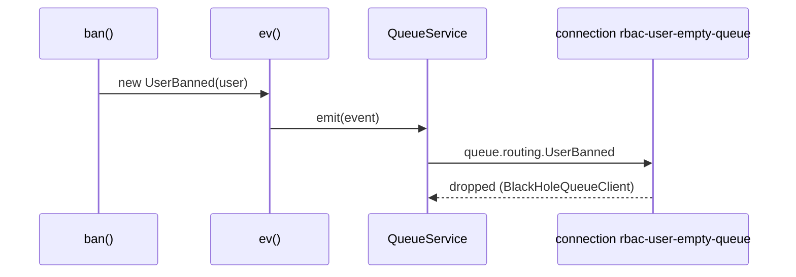

# User events

Queue events (`@spinajs/queue`) that tell other services what happened to an account: created, activated, banned, logged in, password changed, impersonated. The [user actions](03-user-actions.md) emit the lifecycle ones; [`QueueAuthnEventSink`](08-authn-event-sinks.md) re-emits authn's login, password and impersonation outcomes as user events.

## How it works

1. An action, or a sink, builds the event with the `User` row: `new UserBanned(user)`.
2. `UserEvent`'s constructor copies `user.Uuid` into `UserUUID`; subclasses copy more fields.
3. `ev(event)` resolves `QueueService` and emits it to the connection `queue.routing.<EventName>` names, or to `queue.default` when there is no route.
4. The connection's transport delivers it to subscribers. The shipped routes point the events at `rbac-user-empty-queue`, a `BlackHoleQueueClient` connection that drops every message.



## Events

All are `@Event()` classes extending `UserEvent` (itself a `QueueEvent`) and carry `UserUUID`.

| Event | Extra fields | Emitted by | Shipped route |
| --- | --- | --- | --- |
| `UserCreated` | `Uuid`, `Email`, `Login`, `Role` (roles granted at GLOBAL), `RegisteredAt`, `IsBanned`, `IsActive`, `Metadata` (always `{}`) | `create()` | none: `queue.default` |
| `UserChanged` | | `updateUser()`, `activate()`, `deactivate()`, invite redeem | none: `queue.default` |
| `UserActivated` | | `activate()`, invite redeem (`UserAccountSink`) | `rbac-user-empty-queue` |
| `UserDeactivated` | | `deactivate()` | `rbac-user-empty-queue` |
| `UserBanned` | | `ban()` | `rbac-user-empty-queue` |
| `UserUnbanned` | | `unban()` | `rbac-user-empty-queue` |
| `UserDeleted` | | `deleteUser()` | `rbac-user-empty-queue` |
| `UserMetadataChange` | `user`, `meta` (`{ key, value }[]`) | `setUserMeta()`, `ban()` | none: `queue.default` |
| `UserLogged` | | authn `login` success | `rbac-user-empty-queue` |
| `UserLoginFailed` | `Error` (`UserIsBanned`, `UserNotActive` or `InvalidCredentials`, message `Login failed: <reason>`) | authn `login` failure | none: `queue.default` |
| `UserPasswordChanged` | | authn `password.change` (not an expiry) and `password.reset` | `rbac-user-empty-queue` |
| `UserPasswordExpired` | | authn `password.change` with `data.expired` (from `expirePassword()` and authn-local's expiration job) | none: `queue.default` |
| `UserPasswordChangeRequest` | | authn `password.reset.request` success | `rbac-user-empty-queue` |
| `UserImpersonationStarted` | `TargetUUID`; `UserUUID` is the impersonator | authn `impersonation.start` | `rbac-user-empty-queue` |
| `UserImpersonationEnded` | `TargetUUID`; `UserUUID` is the impersonator | authn `impersonation.end` and `impersonation.expire` | `rbac-user-empty-queue` |

## Configuration

| Key | Type | Default | Allowed values | Meaning |
| --- | --- | --- | --- | --- |
| `queue.routing.<Event>.connection` | `string` | `'rbac-user-empty-queue'` for the routed events above | a `queue.connections` name | Where the event goes. |
| `queue.connections[name='rbac-user-empty-queue']` | connection | `BlackHoleQueueClient`, channels `rbac-jobs` / `rbac-events` | | The sink the shipped routes use. |
| `queue.default` | `string` | from `@spinajs/queue` | a connection name | Where unrouted events go. |

Route the events you need to a real connection:

```ts
// config/queue.ts in your app
export default {
  queue: {
    routing: {
      UserBanned: { connection: 'events', channel: '/topic/accounts' },
      UserDeleted: { connection: 'events', channel: '/topic/accounts' },
      UserCreated: { connection: 'events', channel: '/topic/accounts' },
    },
  },
};
```

## Services and extension points

| Service | DI token and lifetime | Default implementation | Alternatives | How to replace or extend |
| --- | --- | --- | --- | --- |
| Event delivery | `queue.routing.<Event>` config → `QueueClient` of that connection | `BlackHoleQueueClient` for routed events | any queue transport | Route the event to another connection. |
| Event base class | `UserEvent` (`QueueEvent`) | | your subclass | Extend `UserEvent` for your own user events emitted with `ev()` or `_user_ev()`. |
| Authn re-emission | `AuthnEventSink` list, `QueueAuthnEventSink` | `QueueAuthnEventSink` | your sink | See [Authn event sinks](08-authn-event-sinks.md). |

### Your own user event

Emit an application event about a user from an action pipeline. `_user_ev(EventClass, ...args)` builds `new EventClass(user, ...args)`, emits it and forwards the user.

```ts sample
import { Event } from '@spinajs/queue';
import { UserEvent, _user_ev, getUser } from '@spinajs/users';
import type { User } from '@spinajs/users';

@Event()
export class UserPlanUpgraded extends UserEvent {
  public Plan: string;

  constructor(user: User, plan: string) {
    super(user);
    this.Plan = plan;
  }
}

export async function upgradePlan(uuid: string, plan: string): Promise<User> {
  const user = await getUser(uuid);
  // ... charge and store the plan, then announce it
  return _user_ev(UserPlanUpgraded, plan)(user);
}
```

## Important behaviour

- By default nothing leaves the process for the routed events: their connection is a black hole. The unrouted ones go to `queue.default`.
- `QueueService.consume(UserBanned, ...)` builds each delivered message with `DI.resolve(UserBanned)` and no arguments, then hydrates it from the payload. No shipped event constructor dereferences a missing argument (`UserEvent`, `UserCreated` and the impersonation events take theirs as optional), and `UserEvent` is `@NewInstance()`, so each delivery gets its own instance. Your own subclass must accept a missing constructor argument too.
- `UserCreated.Metadata` is always empty: metadata may hold credentials that must not ride a queue payload.
- `UserLoginFailed` never carries the credentials that failed, only the error class and the audit reason.
- `create()` with a password also produces `UserPasswordChanged`: authn's `set` event does not tell a create from an admin set.
- Events about an identity that is not a stored user (for example an agent) are not re-emitted.

## Best practices

- Route only the events a consumer needs; leave the rest on the black hole.
- Key consumers on `UserUUID`, never on a numeric id.
- Treat `UserLogged` as a notification, not an audit log; authn's audit sinks are the record.

## Patterns and antipatterns

```ts
// Don't: a subclass whose constructor dereferences its argument throws on every delivery
@Event()
export class UserPlanUpgraded extends UserEvent {
  public Plan: string;
  constructor(user: User, plan: Plan) {
    super(user);
    this.Plan = plan.Name;
  }
}

// Do: the consumer builds the event with no arguments and hydrates it
@Event()
export class UserPlanUpgraded extends UserEvent {
  public Plan: string;
  constructor(user?: User, plan?: Plan) {
    super(user);
    if (plan) this.Plan = plan.Name;
  }
}
```

## Examples

### Close support tickets of deleted accounts

```ts sample
import { DI } from '@spinajs/di';
import { QueueService } from '@spinajs/queue';
import { UserDeleted } from '@spinajs/users';

interface Helpdesk {
  closeTicketsOf(userUuid: string): Promise<void>;
}

export async function startAccountCleanup(helpdesk: Helpdesk): Promise<void> {
  const queue = await DI.resolve(QueueService);
  await queue.consume<UserDeleted>(UserDeleted, async (event) => helpdesk.closeTicketsOf(event.UserUUID), 'helpdesk-cleanup');
}
```

Route `UserDeleted` to a real connection first (see [Configuration](#configuration)).

## Related

- [Events and jobs](../queue/01-events-and-jobs.md): `ev()`, `consume()` and message classes.
- [Connections and routing](../queue/02-connections-and-routing.md): `queue.routing` and `queue.default`.
- [Authn event sinks](08-authn-event-sinks.md): where the login, password and impersonation events come from.
- [User actions](03-user-actions.md): where the lifecycle events come from.
