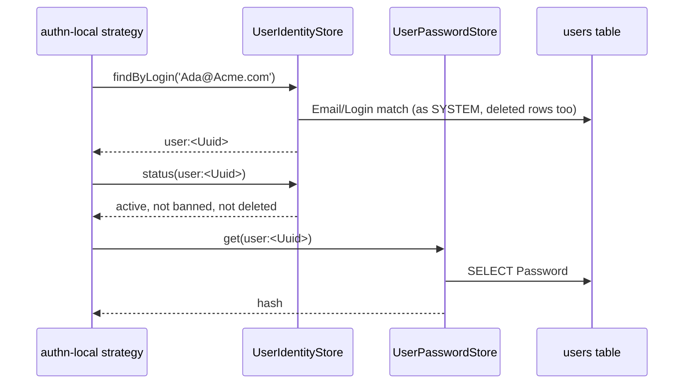

# Identity and password stores

The services through which `@spinajs/authn` and its packages see the `users` table: who a login names, whether that account may sign in, where its password hash lives, which passwords are old, and which accounts count as "in service" for `AuthzAdmin`. Importing `@spinajs/users` registers all four; replace or subclass one to change how logins resolve or where hashes are stored.

## How it works

### Login (`UserIdentityStore` and `UserPasswordStore`)

1. authn-local's strategy calls `IdentityStore.findByLogin(login)`.
2. `UserIdentityStore.findByLogin()` returns `null` for a blank value. Otherwise it boots the ORM if needed and, as `SYSTEM`, reads every user (soft-deleted ones included) whose `Email` or `Login` equals the trimmed input, or whose lower-cased `Email` or `Login` equals its lower-cased or NFKC-folded form.
3. It ranks the matches: exact `Email` first, exact `Login` second, any folded match third. Exactly one row at the best rank gives `{ type: 'user', id: <Uuid> }`; none or several give `null`.
4. authn calls `status(ref)`: `exists`, `active` (`IsActive`), `banned` (`IsBanned`, duration aware), `deleted` (`DeletedAt` set), `invitePending` (`user:invite:pending === true`), `addressVerified` (`EmailVerifiedAt` set). An unknown ref answers all `false`. `UserAddressVerifier` is the `IdentityAddressVerifier`: it sets `EmailVerifiedAt` once, as `SYSTEM`, when a verify secret of `@spinajs/authn-local` is redeemed ([Address verification](../authn-local/14-address-verification.md)).
5. The strategy calls `PasswordCredentialStore.get(ref)`. `UserPasswordStore.get()` reads `users.Password` as `SYSTEM`: `null`, `''` and `'!none'` answer `null`; any other value, authn-local's `'!expired'` included, comes back as stored.
6. A rehash, change, reset or expiry calls `set(ref, hash, expected?)`, one SQL statement:
   - `expected` undefined: unconditional update, answers `true`;
   - `expected` `null`: update only over a no-password state, answers whether one row changed;
   - `expected` a string: update only where `Password` equals it byte for byte, answers whether one row changed.
7. `display(ref)` gives `{ email, name: Login }` for mails, audit and inline re-authentication.

### Password age (`UserPasswordAgeSource`)

authn-local's expiration job (`authn.local.expiration.*`) calls `passwordsSetBefore(cutoff)`. It answers the users that are not deleted, hold a password (not `NULL`, not `''`, not starting with `!`) and have `PasswordSetAt` before `cutoff` or `NULL`. [`UserAccountSink`](08-authn-event-sinks.md) keeps `PasswordSetAt` current.

### In service (`UserAccountStatusSource`)

`AuthzAdmin`'s last-holder check (authz-rbac) calls `inService(refs)` before it removes the last holder of a role. A user ref is in service when its row exists, is not soft-deleted, is active, is not banned, has no pending invite, and its password is not `'!expired'`. Other principal types and unknown UUIDs answer `false`. Rows are read in chunks of 100 with their metadata.



## Services and extension points

| Service | DI token and lifetime | Default implementation | Alternatives | How to replace or extend |
| --- | --- | --- | --- | --- |
| Identity lookup | `IdentityStore` (`@spinajs/authn/contracts`), singleton, `@Injectable(IdentityStore)` on import; resolved by type (last registration wins) | `UserIdentityStore` | your store | `DI.register(MyStore).as(IdentityStore)` after importing users. Subclass to change `findByLogin`, `status`, `display`, or the protected `find(id, withMetadata)`. Add `provision()` for JIT accounts. |
| Password hashes | `PasswordCredentialStore`, singleton, by type | `UserPasswordStore` | your store; `new UserPasswordStore({ driver })` on another connection | `DI.register(...).as(PasswordCredentialStore)`. Subclass and override the protected `driver()`, `update()` or `write()`. |
| Password age | `PasswordAgeSource` (`@spinajs/authn-local`), singleton, optional | `UserPasswordAgeSource` | your source; none: the expiration job answers `idle: 'no_source'` | `DI.register(MySource).as(PasswordAgeSource)`, or subclass and filter `passwordsSetBefore()`. |
| In-service check | `AccountStatusSource` (`@spinajs/authz-rbac`), singleton, resolved in the root container when registered | `UserAccountStatusSource` | your source | `DI.register(MySource).as(AccountStatusSource)`, or subclass and narrow `inService()`. |

Register replacements **after** `@spinajs/users` is imported: its `@Injectable` registrations run at import, and the last registration wins.

### Identity store: sign in with the login name only

Some deployments share mailboxes between accounts; let only the login name sign in.

```ts sample
import { DI } from '@spinajs/di';
import { IdentityStore } from '@spinajs/authn/contracts';
import type { IdentityRef } from '@spinajs/authn/contracts';
import { UserIdentityStore } from '@spinajs/users';

export class LoginNameIdentityStore extends UserIdentityStore {
  public async findByLogin(login: string): Promise<IdentityRef | null> {
    if (typeof login !== 'string' || login.includes('@')) {
      return null;
    }
    return super.findByLogin(login);
  }
}

DI.register(LoginNameIdentityStore).as(IdentityStore);
```

### Password store: keep hashes on another connection

`UserPasswordStore` writes through the base `User` model's connection. Point it at a dedicated connection by overriding `driver()`; the compare-and-set logic stays.

```ts sample
import { DI } from '@spinajs/di';
import { PasswordCredentialStore } from '@spinajs/authn/contracts';
import { Orm, OrmDriver } from '@spinajs/orm';
import { UserPasswordStore } from '@spinajs/users';

export class CredentialsDbPasswordStore extends UserPasswordStore {
  protected driver(): OrmDriver {
    const driver = DI.get(Orm)?.Connections.get('credentials');
    if (!driver) {
      throw new Error('The credentials connection is not configured');
    }
    return driver;
  }
}

DI.register(CredentialsDbPasswordStore).as(PasswordCredentialStore);
```

The connection must hold a `users` table with `Uuid` and `Password` columns.

### Password age: never expire service accounts

```ts sample
import { DI } from '@spinajs/di';
import { PasswordAgeSource } from '@spinajs/authn-local';
import type { IdentityRef } from '@spinajs/authn/contracts';
import { UserPasswordAgeSource } from '@spinajs/users';

const SERVICE_ACCOUNTS = new Set(['2f4c7d9e-8a1b-4c3d-9e5f-6a7b8c9d0e1f']);

export class HumanPasswordAgeSource extends UserPasswordAgeSource {
  public async passwordsSetBefore(cutoff: Date): Promise<readonly IdentityRef[]> {
    return (await super.passwordsSetBefore(cutoff)).filter((ref) => !SERVICE_ACCOUNTS.has(ref.id));
  }
}

DI.register(HumanPasswordAgeSource).as(PasswordAgeSource);
```

### Account status: treat accounts on leave as out of service

`AuthzAdmin` then refuses to remove the last in-service holder of a role when the remaining holders are on leave.

```ts sample
import { DI } from '@spinajs/di';
import { principalKey } from '@spinajs/authz';
import type { PrincipalRef } from '@spinajs/authz';
import { AccountStatusSource } from '@spinajs/authz-rbac';
import { User, UserAccountStatusSource } from '@spinajs/users';

export class LeaveAwareStatusSource extends UserAccountStatusSource {
  public async inService(refs: readonly PrincipalRef[]): Promise<ReadonlyMap<string, boolean>> {
    const answers = new Map(await super.inService(refs));
    const uuids = refs.filter((r) => r.type === 'user' && answers.get(principalKey(r)) === true).map((r) => r.id);

    if (uuids.length > 0) {
      const users = (await User.query().whereIn('Uuid', uuids).populate('Metadata')) as User[];
      for (const u of users) {
        if (u.Metadata['hr:on_leave'] === true) {
          answers.set(principalKey({ type: 'user', id: u.Uuid }), false);
        }
      }
    }

    return answers;
  }
}

DI.register(LeaveAwareStatusSource).as(AccountStatusSource);
```

## Important behaviour

- Every lookup runs as `SYSTEM` and uses the base `User`, so an application's `@AccessResource` user model never hides a row from login, reset or status.
- `findByLogin()` scans `users` (`LOWER()` keeps the unique indexes out). On a large table, index the lower-cased columns in your own migration if your database supports expression indexes.
- An input that matches one account's email and another's login exactly resolves to the email owner. Two folded matches and no exact one resolve to `null`.
- `findByLogin()` never matches `Id` or `Uuid`.
- `UserIdentityStore` has no `provision()`: JIT provisioning (`authn.linking.jit`) has no store to create accounts.
- `set()` with `expected` compares byte for byte with the connection's `SqlExpressions.equalsExactly()`: `CAST(? AS BINARY)` on MySQL, `COLLATE Latin1_General_BIN2` plus a length check on SQL Server (their default collations ignore case, and SQL Server also trailing spaces), plain `=` on SQLite and PostgreSQL. A driver without `SqlExpressions` throws `NotSupported`. See [SQL helpers](../orm/17-sql-helpers.md#dialect-expressions).
- A driver error in `set()` becomes `UnexpectedServerError` naming only the error class: the driver message carries the hash.
- A password past `authn.local.expiration.maxAgeDays` still logs in until the expiration job writes `'!expired'`; `UserAccountStatusSource` counts it in service until then.
- The stores and `UserAddressVerifier` inject the `Orm` (`@Autoinject(Orm)`), so resolving one boots the ORM, also in a CLI process that resolves only its command. A migration's `data()` can seed users through them: `OrmMigrator` runs it after the `Orm` resolved. A store built with `new` and a `driver` needs no `Orm`.

## Best practices

- Subclass the shipped stores rather than reimplementing them; they carry the `SYSTEM` runs, the folding rules and the compare-and-set.
- Keep `IdentityRef` ids as UUIDs: authz, sessions and tokens key users by `user:<Uuid>`.
- Run authn-local's expiration job on a schedule; `UserPasswordAgeSource` only answers the question.

## Patterns and antipatterns

```ts
// Don't: a read followed by a write lets two concurrent resets both "win"
const current = await store.get(ref);
if (current === oldHash) await store.set(ref, newHash);

// Do: one compare-and-set statement
const changed = await store.set(ref, newHash, oldHash);
```

## Related

- [`@spinajs/authn`](../authn/README.md): the `IdentityStore` and `PasswordCredentialStore` contracts and the login flow.
- [Authn event sinks](08-authn-event-sinks.md): writes `PasswordSetAt` and activates invited accounts.
- [User model and metadata](01-user-model.md): the columns these stores read.
