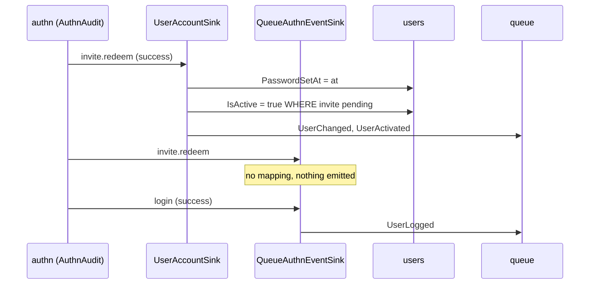

# Authn event sinks

Two `AuthnEventSink`s that users registers so the `users` row and the user events follow what `@spinajs/authn` decides. `UserAccountSink` writes `PasswordSetAt` and activates invited accounts; `QueueAuthnEventSink` re-emits logins, password changes and impersonations as [user events](06-user-events.md). Add your own sink next to them to react to the same authn events.

## How it works

1. authn's audit (`AuthnAudit`) resolves every `AuthnEventSink` with `Array.chainOf(AuthnEventSink)` and hands each one every `AuthnEvent`, concurrently. A sink error is logged by the publisher and never fails the login.
2. `UserAccountSink.publish(e)` ignores failures and non-user identities. For a successful event it:
   - writes `users.PasswordSetAt = e.at` for `password.change` (unless `data.expired`), `password.reset` and `invite.redeem`, only forward in time (`PasswordSetAt IS NULL OR PasswordSetAt < at`);
   - on `invite.redeem`, sets `IsActive = true` in one conditional statement that matches only while `user:invite:pending` is stored as `true`, then deletes the marker and emits `UserChanged` and `UserActivated` (no mail).
   Each step runs as `SYSTEM`; a failure is logged as a warning naming the event, user and error class, never thrown.
3. `QueueAuthnEventSink.publish(e)` loads the `User` row (as `SYSTEM`, deleted rows included) and emits:

| authn event | Outcome | Emitted |
| --- | --- | --- |
| `login` | success | `UserLogged` |
| `login` | failure | `UserLoginFailed` with `UserIsBanned` (`banned`), `UserNotActive` (`inactive`, `deleted`) or `InvalidCredentials` (any other reason) |
| `password.change` | success | `UserPasswordExpired` when `data.expired`, else `UserPasswordChanged` |
| `password.reset` | success | `UserPasswordChanged` |
| `password.reset.request` | success | `UserPasswordChangeRequest` |
| `impersonation.start` | success | `UserImpersonationStarted(actor, identity)` |
| `impersonation.end`, `impersonation.expire` | success | `UserImpersonationEnded(actor, identity)` |

   An event whose identity (or impersonator) is not a stored user emits nothing. Errors propagate to the publisher, which logs their class.



## Services and extension points

| Service | DI token and lifetime | Default implementation | Alternatives | How to replace or extend |
| --- | --- | --- | --- | --- |
| Account bookkeeping | `AuthnEventSink` list (`Array.chainOf`), singleton, `@Injectable(AuthnEventSink)` on import | `UserAccountSink` | | Keep it: `UserPasswordAgeSource` and invite activation depend on it. Subclass and override the protected `recordPasswordSet()` or `activateInvited()`, then `DI.unregister(UserAccountSink)` and register yours. |
| User events | `AuthnEventSink` list, singleton | `QueueAuthnEventSink` | none, if no consumer needs the events | `DI.unregister(QueueAuthnEventSink)` to stop the events; subclass `publish()` to emit more. |
| Your reaction to authn events | `AuthnEventSink` list | | any number of sinks | `@Injectable(AuthnEventSink)` on your class; it runs next to the shipped ones. |

### Custom sink: stamp the last login time

`users.LastLoginAt` is a column nobody writes. A sink keeps it current.

```ts sample
import { Injectable } from '@spinajs/di';
import { AuthnEventSink } from '@spinajs/authn/contracts';
import type { AuthnEvent } from '@spinajs/authn/contracts';
import { AuthzService, SYSTEM } from '@spinajs/authz';
import { DI } from '@spinajs/di';
import { User } from '@spinajs/users';
import { DateTime } from 'luxon';

@Injectable(AuthnEventSink)
export class LastLoginSink extends AuthnEventSink {
  public async publish(e: AuthnEvent): Promise<void> {
    if (e.type !== 'login' || e.outcome !== 'success' || e.identity?.type !== 'user') {
      return;
    }

    const authz = (await DI.resolve(AuthzService)) as AuthzService;
    // As SYSTEM: the caller at login is anonymous.
    await authz.runAs(SYSTEM, 'last-login', async () => {
      await User.update({ LastLoginAt: DateTime.fromJSDate(e.at) }).where('Uuid', e.identity!.id);
    });
  }
}
```

### Replace the queue sink: emit only security events

```ts sample
import { DI } from '@spinajs/di';
import { AuthnEventSink } from '@spinajs/authn/contracts';
import type { AuthnEvent } from '@spinajs/authn/contracts';
import { QueueAuthnEventSink } from '@spinajs/users';

const SECURITY_EVENTS = new Set(['password.change', 'password.reset', 'impersonation.start', 'impersonation.end', 'impersonation.expire']);

export class SecurityOnlyQueueSink extends QueueAuthnEventSink {
  public async publish(e: AuthnEvent): Promise<void> {
    if (SECURITY_EVENTS.has(e.type)) {
      await super.publish(e);
    }
  }
}

DI.unregister(QueueAuthnEventSink);
DI.register(SecurityOnlyQueueSink).as(AuthnEventSink);
```

Unregister before the first authn event resolves the sink list.

## Important behaviour

- `PasswordSetAt` is written from events, not from `PasswordCredentialStore.set()`: the store cannot tell a password change from a login rehash or the `'!expired'` marker.
- Invite activation is one conditional `UPDATE`. A `deactivate()` that dropped the marker first cannot be undone by a redeem that read the account a moment earlier.
- `UserAccountSink` never throws; a lost `PasswordSetAt` write shows only as a warning in the `rbac` log, and that password then counts as old.
- `QueueAuthnEventSink` maps `invite.redeem` to no event; `UserActivated` comes from `UserAccountSink`.
- MFA changes have no queue event; they reach sinks as `mfa.enrol` and `mfa.disable`.

## Best practices

- Write sinks as idempotent and fast: they run on the login path, concurrently with the others.
- Run database work in a sink as `SYSTEM` (`AuthzService.runAs`), like the shipped sinks: the caller may be anonymous.
- Log error classes, not messages: a driver error message can carry the statement and its bindings.

## Patterns and antipatterns

```ts
// Don't: subclass and register next to the original; both run and every event is emitted twice
DI.register(SecurityOnlyQueueSink).as(AuthnEventSink);

// Do: remove the shipped one first
DI.unregister(QueueAuthnEventSink);
DI.register(SecurityOnlyQueueSink).as(AuthnEventSink);
```

## Related

- [User events](06-user-events.md): the events `QueueAuthnEventSink` emits.
- [Identity and password stores](07-identity-and-password-stores.md): `UserPasswordAgeSource` reads `PasswordSetAt`.
- [`@spinajs/authn`](../authn/README.md): `AuthnEvent` types and the audit flow.
- [Multiple implementations](../di/06-multiple-implementations.md): lists of services and `DI.unregister`.
