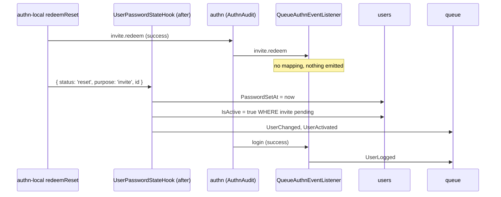

# Authentication event listeners

`QueueAuthnEventListener` is the `AuthnEventListener` users registers so the user events follow what `@spinajs/authn` decides: it re-emits logins, password changes and impersonations as [user events](06-user-events.md). Add your own listener next to it to react to the same authn events.

`PasswordSetAt` and the activation of invited accounts do not come from an event listener: [`UserPasswordStateHook`](07-identity-and-password-stores.md#the-password-state), an action hook on authn-local's password flows, writes them.

## How it works

1. authn's audit (`AuthnAudit`) resolves every `AuthnEventListener` with `Array.chainOf(AuthnEventListener)` and hands each one every `AuthnEvent`, concurrently. `QueueAuthnEventListener` is not blocking: its error is logged by the publisher and never fails the login.
2. `QueueAuthnEventListener.on(e)` loads the `User` row (as `SYSTEM`, deleted rows included) and emits:

| authn event | Outcome | Emitted |
| --- | --- | --- |
| `login` | success | `UserLogged` |
| `login` | failure | `UserLoginFailed` with `UserIsBanned` (`banned`), `UserNotActive` (`inactive`, `deleted`) or `InvalidCredentials` (any other reason except `listener_failed` and `hook_error`) |
| `login` | failure, reason `listener_failed` or `hook_error` | nothing |
| `password.change` | success | `UserPasswordExpired` when `data.expired`, else `UserPasswordChanged` |
| `password.reset` | success | `UserPasswordChanged` |
| `password.reset.request` | success | `UserPasswordChangeRequest` |
| `impersonation.start` | success | `UserImpersonationStarted(actor, identity)` |
| `impersonation.end`, `impersonation.expire` | success | `UserImpersonationEnded(actor, identity)` |

   An event whose identity (or impersonator) is not a stored user emits nothing. Errors propagate to the publisher, which logs their class.



## Services and extension points

| Service | DI token and lifetime | Default implementation | Alternatives | How to replace or extend |
| --- | --- | --- | --- | --- |
| User events | `AuthnEventListener` list, singleton | `QueueAuthnEventListener` | none, if no consumer needs the events | `DI.unregister(QueueAuthnEventListener)` to stop the events; subclass `on()` to emit more. |
| Your reaction to authn events | `AuthnEventListener` list | | any number of listeners | `@Injectable(AuthnEventListener)` on your class; it runs next to the shipped ones. |

### Custom listener: stamp the last login time

`users.LastLoginAt` is a column nobody writes. A listener keeps it current.

```ts sample
import { Injectable } from '@spinajs/di';
import { AuthnEventListener } from '@spinajs/authn/contracts';
import type { AuthnEvent } from '@spinajs/authn/contracts';
import { AuthzService, SYSTEM } from '@spinajs/authz';
import { DI } from '@spinajs/di';
import { User } from '@spinajs/users';
import { DateTime } from 'luxon';

@Injectable(AuthnEventListener)
export class LastLoginListener extends AuthnEventListener {
  public async on(e: AuthnEvent): Promise<void> {
    if (e.type !== 'login' || e.outcome !== 'success' || e.identity?.type !== 'user') {
      return;
    }

    const authz = (await DI.resolve(AuthzService)) as AuthzService;
    // As SYSTEM: the caller at login is anonymous.
    await authz.runAs(SYSTEM, 'last-login', async () => {
      await User.update({ LastLoginAt: DateTime.fromJSDate(e.at) }).where('Uuid', e.identity!.id);
    });
  }
}
```

### Replace the queue listener: emit only security events

```ts sample
import { DI } from '@spinajs/di';
import { AuthnEventListener } from '@spinajs/authn/contracts';
import type { AuthnEvent } from '@spinajs/authn/contracts';
import { QueueAuthnEventListener } from '@spinajs/users';

const SECURITY_EVENTS = new Set(['password.change', 'password.reset', 'impersonation.start', 'impersonation.end', 'impersonation.expire']);

export class SecurityOnlyQueueListener extends QueueAuthnEventListener {
  public async on(e: AuthnEvent): Promise<void> {
    if (SECURITY_EVENTS.has(e.type)) {
      await super.on(e);
    }
  }
}

DI.unregister(QueueAuthnEventListener);
DI.register(SecurityOnlyQueueListener).as(AuthnEventListener);
```

Unregister before the first authn event resolves the listener list.

## Important behaviour

- `QueueAuthnEventListener` maps `invite.redeem` to no event; `UserActivated` comes from [`UserPasswordStateHook`](07-identity-and-password-stores.md#the-password-state).
- A login that a blocking listener stopped (the recorder of `@spinajs/audit-authn` on a trail that rejects, for example) comes back as a `login` failure with reason `listener_failed`. The credentials were right, so no error class of `UserLoginFailed` describes it, and a consumer that counts failed logins must not count an outage of the audit store: it emits nothing. A stopped `login` event never reached the other listeners as a success, so no `UserLogged` went out for it. When the `login` event got through and the `session.issue` that follows it was stopped, `UserLogged` was already emitted and nothing follows it.
- A login whose action hook failed (it threw, returned attributes that are not an object, or set a session ceiling that cannot be held) comes back as a `login` failure with reason `hook_error`. The credentials were not wrong either, so it emits nothing for the same reason. Webhooks and the security trail still receive the event. A deliberate refusal by a hook (`hook:<code>`) still emits `UserLoginFailed` with `InvalidCredentials`.
- A subclass of 3.0's `UserAccountSink` becomes a subclass of `UserPasswordStateHook`: see [Migrating from `UserAccountSink`](07-identity-and-password-stores.md#migrating-from-useraccountsink).
- MFA changes have no user event; they reach listeners as `mfa.enrol` and `mfa.disable`.

## Best practices

- Write listeners as idempotent and fast: they run on the login path, concurrently with the others.
- Run database work in a listener as `SYSTEM` (`AuthzService.runAs`), like the shipped listener: the caller may be anonymous.
- Log error classes, not messages: a driver error message can carry the statement and its bindings.

## Patterns and antipatterns

```ts
// Don't: subclass and register next to the original; both run and every event is emitted twice
DI.register(SecurityOnlyQueueListener).as(AuthnEventListener);

// Do: remove the shipped one first
DI.unregister(QueueAuthnEventListener);
DI.register(SecurityOnlyQueueListener).as(AuthnEventListener);
```

## Related

- [User events](06-user-events.md): the events `QueueAuthnEventListener` emits.
- [Identity and password stores](07-identity-and-password-stores.md): `UserPasswordStateHook` writes `PasswordSetAt`, `UserPasswordAgeSource` reads it.
- [`@spinajs/authn`](../authn/README.md): `AuthnEvent` types and the audit flow.
- [Multiple implementations](../di/06-multiple-implementations.md): lists of services and `DI.unregister`.
