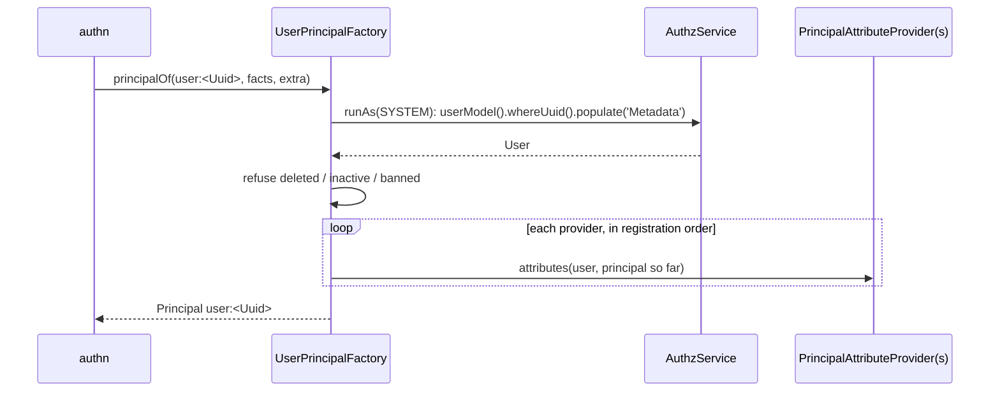

# Principal factory

`UserPrincipalFactory` turns a user into the `Principal` that authz checks: `user:<Uuid>` for sign-ins, jobs, CLI commands and app code, and `agent:<id>` for an agent token acting for a user. It is authn's `PrincipalFactory`; call it yourself when code holds a `User` and must act as that user.

## How it works

### For authn: `principalOf(identity, facts, extra)`

1. authn calls it after the account's status check, with the authn facts of the sign-in and `extra` (`ceiling`, `onBehalfOf`, `delegation`, `attributes`).
2. An `agent` identity goes to the agent path (below).
3. Any other type than `user` throws `InvalidArgument`.
4. `load()` reads the row through `userModel()` by `Uuid`, `Metadata` populated, inside `AuthzService.runAs(SYSTEM, 'principal-factory', ...)`. No row throws `ResourceNotFound`.
5. `build()` refuses an unusable account: soft-deleted (`ResourceNotFound`), inactive (`UserNotActive`), banned (`UserIsBanned`).
6. It starts the attributes from `extra.attributes` (what the strategy asserted) and merges each [`PrincipalAttributeProvider`](10-principal-attribute-providers.md)'s answer over them, in registration order.
7. It returns `{ type: 'user', id: Uuid, authenticated: true, source, authn: facts, ceiling?, onBehalfOf?, delegation?, attributes (frozen), identity: user }`. `source` is `'session'` when `facts.sessionHandle` is set, else `'token'`.

### For a record in hand: `principalOf(user, opts?)`

1. A `User` whose `Metadata` is populated (or that is soft-deleted) is used as is; otherwise it is read again by `Uuid` so its ban is never missed, and `identity` is the row read.
2. Steps 5 to 7 above, with `source = opts.source ?? 'identity'` (`IDENTITY_PRINCIPAL_SOURCE`), `opts.ceiling`, no authn facts and no strategy attributes.

### For judging an account: `rightsPrincipalOf(identity, facts?)`

Builds the principal an account would carry, whatever its state: inactive and banned accounts keep their roles. Only an unknown or soft-deleted user throws `ResourceNotFound`. [`AuthzTargetGuard`](13-impersonation-and-credential-admin-guards.md) uses it to compare rights; it never starts a session.

### Agents: `principalOf({ type: 'agent', id }, facts, extra)`

1. `id` must be non-empty, `extra.onBehalfOf` a `user` principal and `extra.delegation` `'inherit'`, `'intersect'` or unset; otherwise `InvalidArgument`.
2. The owner is loaded and refused like a user (deleted, inactive, banned), because the owner principal may predate a ban.
3. It returns `{ type: 'agent', id, authenticated: true, source, authn: facts, onBehalfOf: owner, delegation?, ceiling?, attributes: extra.attributes }`: no `identity` and no provider attributes, so authz never gives the agent more than its owner.



## Services and extension points

| Service | DI token and lifetime | Default implementation | Alternatives | How to replace or extend |
| --- | --- | --- | --- | --- |
| Principal factory | `PrincipalFactory` (`@spinajs/authn/contracts`), singleton, `@Injectable(PrincipalFactory)` on import; resolved by type | `UserPrincipalFactory` | your subclass; a foreign `PrincipalFactory` | Subclass and `DI.register(Sub).as(PrincipalFactory)` after importing users. Override the protected `load()`, `build()` or `agentPrincipal()`. |
| Attribute providers | `PrincipalAttributeProvider` list, captured when the factory is built | none | any number | See [Principal attribute providers](10-principal-attribute-providers.md). |

`AuthzImpersonationGuard`, `AuthzTargetGuard` and `UserInitiatorPrincipalFactory` use the registered `PrincipalFactory` when it is a `UserPrincipalFactory` (your subclass included), and resolve users' own `UserPrincipalFactory` otherwise. Subclass rather than reimplement, so sessions, guards and jobs build the same principal.

### Custom factory: refuse accounts under a compliance hold

```ts sample
import { DI } from '@spinajs/di';
import { PrincipalFactory } from '@spinajs/authn/contracts';
import type { IdentityRef } from '@spinajs/authn/contracts';
import { User, UserNotActive, UserPrincipalFactory } from '@spinajs/users';

export class ComplianceAwarePrincipalFactory extends UserPrincipalFactory {
  protected async load(id: IdentityRef): Promise<User> {
    const user = await super.load(id);

    if (user.Metadata['compliance:hold'] === true) {
      throw new UserNotActive(`User ${user.Uuid} is on compliance hold`, { user: user.Uuid });
    }

    return user;
  }
}

DI.register(ComplianceAwarePrincipalFactory).as(PrincipalFactory);
```

`load()` runs on the authn, agent-owner and `rightsPrincipalOf` paths, and on the record path when the record's `Metadata` is not populated.

## Important behaviour

- Getting a principal for a deleted, inactive or banned user is an **error**, not a failed login: authn checks the status first.
- Provider attributes win over the strategy's asserted attributes and over earlier providers. The result is frozen.
- The providers are captured once, when the factory singleton is built. A provider registered later is not used.
- The record path trusts a `User` whose `Metadata` is populated. Do not hand it a row whose metadata you edited in memory.
- `onBehalfOf` of a user principal is copied as given; an agent acting for a user does not hold `self` on that user (see [Authz resources and relations](11-authz-resources-and-relations.md)).

## Best practices

- In jobs, CLI commands and scripts, build the principal with `principalOf(user)` and run the work with `AuthzService.runAs(principal, reason, fn)`, so authz checks apply as for that user.
- Pass a `source` that names the caller (`'cli'`, `'import'`); audits show it.
- Resolve the factory through `PrincipalFactory`, not `UserPrincipalFactory`, so an application's subclass applies.

## Patterns and antipatterns

```ts
// Don't: a hand-built principal skips the ban check and the attribute providers
const principal = { type: 'user', id: user.Uuid, authenticated: true, attributes: {} };

// Do
const principal = await ((await DI.resolve(PrincipalFactory)) as UserPrincipalFactory).principalOf(user, { source: 'cli' });
```

## Examples

### Export a user's invoices as that user

```ts sample
import { DI } from '@spinajs/di';
import { AuthzService } from '@spinajs/authz';
import { PrincipalFactory } from '@spinajs/authn/contracts';
import { UserPrincipalFactory, getUser } from '@spinajs/users';

export async function exportAsUser<T>(uuid: string, exportFn: () => Promise<T>): Promise<T> {
  const user = await getUser(uuid);
  const factory = (await DI.resolve(PrincipalFactory)) as UserPrincipalFactory;
  const principal = await factory.principalOf(user, { source: 'export' });

  const authz = (await DI.resolve(AuthzService)) as AuthzService;
  // Every authz check and @AccessResource query inside sees the user's own rights.
  return authz.runAs(principal, 'invoice-export', exportFn);
}
```

## Related

- [Principal attribute providers](10-principal-attribute-providers.md): add attributes to every principal.
- [Impersonation guard and credential admin rule](13-impersonation-and-credential-admin-guards.md): use `rightsPrincipalOf()`.
- [Jobs run as their initiator](16-jobs-run-as-initiator.md): rebuild the principal when a job runs.
- [`@spinajs/authn`](../authn/README.md): where `PrincipalFactory` is called.
- [`@spinajs/authz`](../authz/README.md): what the principal is checked against.
