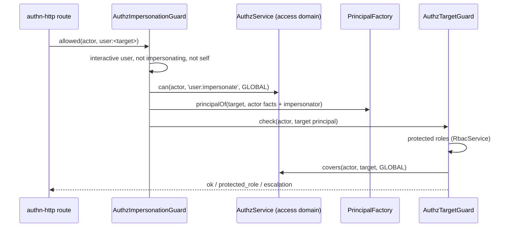

# Impersonation guard and credential admin rule

Who may act **as** another user (impersonation) or **on** another user's credentials (reset their password or MFA, end their sessions or tokens). authn asks the impersonation guard, and runs the credential admin rule as the first before hook of `authn.admin.credentials`. users answers both with authz: a permission at GLOBAL, a protected-role rule and a no-escalation rule. Registering them turns the authn-http routes on; without them, those routes answer 404.

## How it works

### `AuthzImpersonationGuard.allowed(actor, target)`

1. `forbidden` unless all hold: the actor is an authenticated `user`; it signed in interactively (`authn.method` is `password`, `oidc`, `ldap` or `saml`); it is not already impersonating; the target is a `user` other than the actor.
2. `forbidden` unless the actor holds `authz.impersonation.permission` (default `user:impersonate`) at GLOBAL in the access domain (`authz.http.access.domain`, default `root`).
3. It builds the target principal the impersonation session will carry: the actor's sign-in facts (method, strategy, assurance, MFA, time, session handle) plus `impersonator: actor`, through the registered `PrincipalFactory`. An unknown, deleted, inactive or banned target gives `forbidden`.
4. It hands that principal to `AuthzTargetGuard.check(actor, target)`.

### `AuthzCredentialAdminRule.allowed(actor, target, action)`

`AuthzCredentialAdminRule` extends `CredentialAdminRule` of `@spinajs/authn/hooks` and registers with `@Injectable(ActionHook)` on import. It is the first before hook of `authn.admin.credentials` (order `-1000`). Its `before` asks `allowed()` and refuses with the answer's code. authn-http's credential admin routes run that action, and so do users-http's admin routes that end a user's sessions or change its login. `actor` is the caller's whole principal, as a frozen copy.

1. The same `forbidden` pre-checks as step 1 above.
2. `authz.credentials.permission` (default `users:credentials`) must be a non-empty string, or it throws `AuthzConfigError`; the actor must hold it at GLOBAL in the access domain, or `forbidden`.
3. `AuthzTargetGuard.checkIdentity(actor, target)`: the target is judged on its rights with `UserPrincipalFactory.rightsPrincipalOf()`, so an inactive or banned account still counts by its roles. An unknown or soft-deleted target gives `not_found`.
4. Every `action` (`password-reset`, `mfa-reset`, `sessions`, `tokens`) gets the same answer.
5. Any other error, such as an identity store that is down or `AuthzConfigError`, fails the action closed: the runner turns it into `ActionHookFailed`, and the routes answer 403 `hook_error`.

### `AuthzTargetGuard.check(actor, target)`

1. `authz.impersonation.protectedRoles` must be a list, or it throws `AuthzConfigError`.
2. The access domain's container must register its **own** `RbacService`, or it throws `AuthzConfigError` (a child domain does not fall back to the parent's model).
3. With a non-empty protected list, it collects every role the target holds at any scope (directly or through a subject set, without its sign-in or role-switch ceiling) and every role those reach by `extends`, a higher ladder rank or `implies`. A protected role among them gives `protected_role`.
4. `AuthzService.covers(actor, target, GLOBAL)` must hold: the actor's combined GLOBAL permission set, every model and ABAC included, strictly contains the target's. Otherwise `escalation`.
5. Otherwise `{ ok: true }`.



## Configuration

| Key | Type | Default | Allowed values | Meaning |
| --- | --- | --- | --- | --- |
| `authz.http.access.domain` | `string` | `'root'` | an authz domain name | Domain whose rights the guard, the rule and `RbacRoleSource` compare. users registers the schema for this key. |
| `authz.impersonation.permission` | `string` | `'user:impersonate'` | a permission | What an impersonator needs at GLOBAL. |
| `authz.impersonation.protectedRoles` | `string[]` | `['admin']` | role names | Holders of these roles cannot be impersonated or have their credentials administered. `[]` turns the rule off. |
| `authz.credentials.permission` | `string` | `'users:credentials'` | a permission | What a credential administrator needs at GLOBAL. The only key allowed under `authz.credentials`. |

```ts
// config/authz.ts in your app
export default {
  authz: {
    impersonation: {
      permission: 'user:impersonate',
      protectedRoles: ['admin', 'finance.approver'],
    },
    credentials: {
      permission: 'users:credentials',
    },
  },
};
```

## Services and extension points

| Service | DI token and lifetime | Default implementation | Alternatives | How to replace or extend |
| --- | --- | --- | --- | --- |
| Impersonation guard | `ImpersonationGuard` (`@spinajs/authn/contracts`), singleton, `@Injectable` on import; optional in authn | `AuthzImpersonationGuard` | your guard; none: impersonation off | Subclass and override `allowed()` or the protected `sessionPrincipal()`; pass `{ principals, targets }` to `super()`; `DI.register(Sub).as(ImpersonationGuard)`. |
| Credential admin rule | an `ActionHook` class (`@Injectable(ActionHook)`), singleton; authn-http's route gate looks for a `CredentialAdminRule` class | `AuthzCredentialAdminRule` | your rule; none: credential admin routes answer 404, users-http's admin routes 403 `forbidden` | Subclass and narrow per `action`; pass `{ targets }` to `super()`. To replace the shipped rule, `DI.unregister(AuthzCredentialAdminRule)`, then register your class as an `ActionHook`; register a class, not a factory. A rule that only narrows can be added beside the shipped one: every rule must allow. `DI.unregister(AuthzCredentialAdminRule)` alone turns the routes off. |
| Target rule | not in DI; the guard and the rule each do `new AuthzTargetGuard()` unless given `opts.targets` | `AuthzTargetGuard` | your subclass | Subclass and override `check()`; hand it to the guard and the rule through their constructor options. Its own option `users` picks the `UserPrincipalFactory` for `checkIdentity()`. |
| Config schemas | `Bootstrapper` list: `RbacBootstrapper` (`authz.http.access`), `CredentialAdminConfigBootstrapper` (`authz.credentials`) | | | Both also register at import; nothing to replace. |

### Custom target rule: never act across tenants

Add a rule on top of the protected roles and the no-escalation check, and use it in the guard and the rule. The tenant comes from a [principal attribute provider](10-principal-attribute-providers.md).

```ts sample
import { DI } from '@spinajs/di';
import { ImpersonationGuard } from '@spinajs/authn/contracts';
import type { Principal } from '@spinajs/authz';
import { ActionHook } from '@spinajs/hooks';
import { AuthzCredentialAdminRule, AuthzImpersonationGuard, AuthzTargetGuard } from '@spinajs/users';
import type { TargetRuleAnswer } from '@spinajs/users';

export class SameTenantTargetGuard extends AuthzTargetGuard {
  public async check(actor: Principal, target: Principal): Promise<TargetRuleAnswer> {
    if (actor.attributes?.tenant !== target.attributes?.tenant) {
      return { ok: false, code: 'escalation' };
    }
    return super.check(actor, target);
  }
}

export class TenantImpersonationGuard extends AuthzImpersonationGuard {
  constructor() {
    super({ targets: new SameTenantTargetGuard() });
  }
}

export class TenantCredentialAdminRule extends AuthzCredentialAdminRule {
  constructor() {
    super({ targets: new SameTenantTargetGuard() });
  }
}

DI.register(TenantImpersonationGuard).as(ImpersonationGuard);
// The shipped rule would still allow across tenants, and the routes run every registered rule: replace it.
DI.unregister(AuthzCredentialAdminRule);
DI.register(TenantCredentialAdminRule).as(ActionHook);
```

### Custom credential admin rule: no MFA resets through the API

```ts sample
import { DI } from '@spinajs/di';
import type { CredentialAdminAction, IdentityRef, Principal } from '@spinajs/authn/contracts';
import { ActionHook } from '@spinajs/hooks';
import { AuthzCredentialAdminRule } from '@spinajs/users';

export class NoMfaResetRule extends AuthzCredentialAdminRule {
  public async allowed(actor: Principal, target: IdentityRef, action: CredentialAdminAction) {
    // MFA resets go through the help-desk identity check, never through the admin API.
    if (action === 'mfa-reset') {
      return { ok: false as const, code: 'forbidden' as const };
    }
    return super.allowed(actor, target, action);
  }
}

DI.unregister(AuthzCredentialAdminRule);
DI.register(NoMfaResetRule).as(ActionHook);
```

Do both before anything resolves `Hooks`: the runner reads the registered hooks once.

## Important behaviour

- A sign-in by token (`jwt`, API token) or an application's own method fails closed: only `password`, `oidc`, `ldap` and `saml` count as interactive.
- An impersonating session can neither impersonate further nor administer credentials.
- `protected_role` looks at roles held at **any** scope, so a role granted only inside one project still protects the account.
- The escalation rule is strict: an actor with exactly the target's rights may not act on it. Two admins cannot impersonate each other unless one holds more.
- `admin.users` holds `users:credentials` through `users:*` by design; the target rule, not a missing permission, keeps it off accounts it does not cover. Revoke the permission from that role to narrow it.
- `checkIdentity()` judges an inactive or banned account by its roles: a disabled admin account stays protected.
- The guard and the rule build `AuthzTargetGuard` with `new`; it reads its config through `@Config` getters from the root configuration.

## Best practices

- Keep `admin` (and any role holding `user:impersonate` or `users:credentials`) in `protectedRoles`.
- Give impersonation and credential administration to separate roles; they are separate permissions on purpose.
- Narrow by subclassing the shipped guard and rule; reimplementing them drops the interactive sign-in and self checks.

## Patterns and antipatterns

```ts
// Don't: a factory registration skips property injection; Principals stays undefined
DI.register(() => new AuthzImpersonationGuard({ targets: new SameTenantTargetGuard() })).as(ImpersonationGuard);

// Do: a subclass DI builds, which still gets @Autoinject(PrincipalFactory)
class TenantImpersonationGuard extends AuthzImpersonationGuard {
  constructor() { super({ targets: new SameTenantTargetGuard() }); }
}
DI.register(TenantImpersonationGuard).as(ImpersonationGuard);
```

## Related

- [Principal factory](09-principal-factory.md): builds the target principal and `rightsPrincipalOf()`.
- [Authz resources and relations](11-authz-resources-and-relations.md): `user:impersonate` and `users:credentials`.
- [Role switch and access response](14-role-switch-and-access-response.md): the other authn hooks reading `authz.http.access.domain`.
- [`@spinajs/authn`](../authn/README.md): the impersonation flow and [`authn.admin.credentials`](../authn/14-action-hooks.md#authnadmincredentials-and-credentialadminrule).
