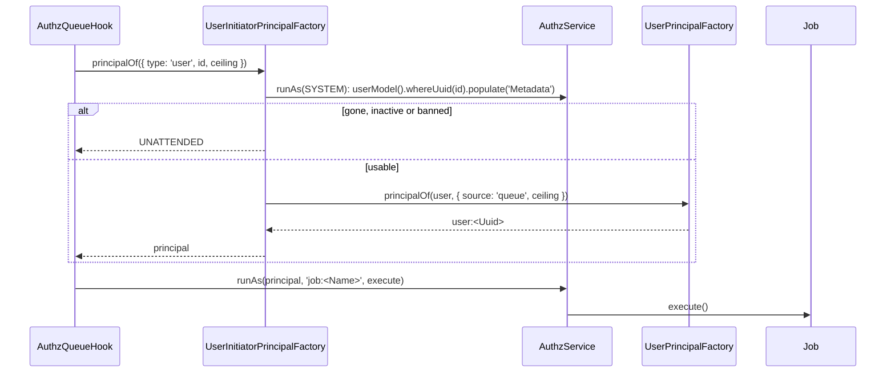

# Jobs run as their initiator

A queue job marked `@Job({ runAs: 'initiator' })` runs with the rights of the user who emitted it. `@spinajs/users/queue` registers `UserInitiatorPrincipalFactory`, which reads that user again when the job runs: a user deactivated, banned or deleted since the job was queued runs it as `UNATTENDED`, and an active one gets their current attributes.

## Install

`@spinajs/authz-queue` is an optional peer dependency. Install it and import the subpath once in the application entry, before the `Configuration` resolves:

```sh
npm install @spinajs/authz-queue
```

```ts
import '@spinajs/users/queue';
```

The subpath imports authz-queue, which registers its queue hook, change bus and job resource, and grants the `user` role `job:read` on the jobs it started (relation `owner`). Installing authz-queue without an import adds nothing.

## How it works

1. On emit, authz-queue's `AuthzQueueHook` stamps the current principal on the message as `Initiator` (`{ type, id, ceiling? }`).
2. When a worker handles a job whose class says `runAs: 'initiator'`, the hook calls `InitiatorPrincipalFactory.principalOf(initiator)`.
3. `UserInitiatorPrincipalFactory.principalOf()`:
   - an `agent` stamp gives `UNATTENDED` (the hook stamps only agents without an owner, which users never builds);
   - a stamp of another type than `user` goes to authz-queue's `StampedInitiatorPrincipalFactory`;
   - a `user` stamp whose `id` is not a UUID, or whose `ceiling` cannot be revived, gives `UNATTENDED`;
   - it reads the user through `userModel()` as `SYSTEM`, `Metadata` populated; unknown, soft-deleted, inactive or banned gives `UNATTENDED`;
   - otherwise it returns the principal [`UserPrincipalFactory`](09-principal-factory.md) builds for that record, with source `'queue'` (`QUEUE_PRINCIPAL_SOURCE`), the stamped ceiling and the attribute providers' attributes.
4. The hook runs the job inside `AuthzService.runAs(principal, 'job:<Name>', ...)`.
5. A failing user store or attribute provider throws, so the job is retried rather than run with the wrong rights.



## Services and extension points

| Service | DI token and lifetime | Default implementation | Alternatives | How to replace or extend |
| --- | --- | --- | --- | --- |
| Initiator principal factory | `InitiatorPrincipalFactory` (`@spinajs/authz-queue`), singleton, `@Injectable` when `@spinajs/users/queue` is imported | `UserInitiatorPrincipalFactory` | authz-queue's `StampedInitiatorPrincipalFactory` (trusts the stamp, no reload) | Subclass and override `principalOf()` or the protected `users()`; `DI.register(Sub).as(InitiatorPrincipalFactory)`. |
| User principal building | `PrincipalFactory`, when it is a `UserPrincipalFactory`; else users' `UserPrincipalFactory` | `UserPrincipalFactory` | your subclass | See [Principal factory](09-principal-factory.md). |

### Custom initiator factory: refuse users under a compliance hold

```ts sample
import { DI } from '@spinajs/di';
import { UNATTENDED } from '@spinajs/authz';
import type { Principal } from '@spinajs/authz';
import { InitiatorPrincipalFactory } from '@spinajs/authz-queue';
import type { Initiator } from '@spinajs/authz-queue';
import { User } from '@spinajs/users';
import { UserInitiatorPrincipalFactory } from '@spinajs/users/queue';

export class HoldAwareInitiatorFactory extends UserInitiatorPrincipalFactory {
  public async principalOf(initiator: Initiator): Promise<Principal> {
    const principal = await super.principalOf(initiator);

    if (principal.type === 'user' && principal.identity instanceof User && principal.identity.Metadata['compliance:hold'] === true) {
      return UNATTENDED;
    }

    return principal;
  }
}

DI.register(HoldAwareInitiatorFactory).as(InitiatorPrincipalFactory);
```

## Important behaviour

- The user is read when the job **runs**, not when it was emitted. A job queued for an hour runs with the user's rights at that point.
- `UNATTENDED` usually fails the job's authz checks; the job then fails rather than runs with stale rights.
- An agent stamp never runs as the agent; it runs `UNATTENDED`.
- `runAs` comes from the job class's own `@Job()` options; a subclass does not inherit it.
- Import the subpath before the `Configuration` resolves, or the `job:read` grant waits for the next resolve.

## Best practices

- Mark jobs that act on a user's data with `runAs: 'initiator'`; use `runAs: 'system'` only for maintenance jobs with their own checks.
- Emit such jobs from code that runs as the user (an HTTP request, `AuthzService.runAs(principal, ...)`), so the stamp names them.

## Examples

### Generate a report as the user who asked for it

```ts sample
import '@spinajs/users/queue';
import { NewInstance } from '@spinajs/di';
import { Job, QueueJob } from '@spinajs/queue';

@NewInstance()
@Job({ runAs: 'initiator' })
export class GenerateSalesReport extends QueueJob {
  public Month: string;

  public async execute() {
    // Runs as the user who emitted it: @AccessResource queries see only their rows.
    return { month: this.Month };
  }
}

export async function requestReport(month: string): Promise<string | undefined> {
  return GenerateSalesReport.emit({ Month: month });
}
```

## Related

- [Principal factory](09-principal-factory.md): builds the principal the job runs as.
- [Message hooks](../queue/06-message-hooks.md): `AuthzQueueHook` and `runAs`.
- [Events and jobs](../queue/01-events-and-jobs.md): `@Job()` and `emit()`.
