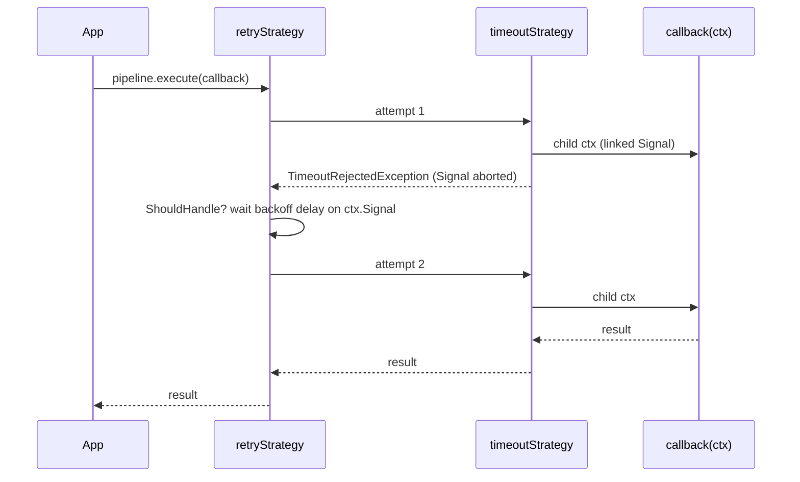

# Resilience pipeline

A composable resilience toolkit modelled after [Polly](https://www.pollydocs.org/). You add strategies (retry, timeout, fallback, circuit breaker, hedging, concurrency limiter) to a `ResiliencePipelineBuilder`, build a `ResiliencePipeline`, and run operations through it. Build the pipeline once and reuse it: the circuit breaker and the concurrency limiter keep their state between calls.

## How it works

1. `new ResiliencePipelineBuilder<T>()` collects strategies. Each `add*` call pushes one `ResilienceStrategy<T>` and returns the builder.
2. `build()` copies the list into a `ResiliencePipeline<T>`.
3. `pipeline.execute(callback, context?)` wraps `callback` in the strategies from last added to first added, so the **first added strategy is the outermost**.
4. It creates the `ResilienceContext`: `Signal` (yours from `context`, or a new one that never aborts by itself), `OperationKey`, and `Properties` (yours, or a new `Map`).
5. The outermost strategy runs; each strategy calls the next one zero, one or many times; the innermost calls `callback(ctx)`.
6. The promise resolves with the callback's result, the value a strategy substituted (fallback), or rejects with the last error or a strategy exception.



### Order matters

```ts
new ResiliencePipelineBuilder<Report>()
  .addRetry({ MaxRetryAttempts: 3 }) // outer: retries the whole inner chain
  .addTimeout(5000)                  // inner: each attempt gets its own 5 s
  .build();
```

Swap the two and one 5 s timeout bounds all attempts and their delays together. A common order, outermost first: concurrency limiter, circuit breaker, retry, per-attempt timeout.

### Context and cancellation

`ResilienceContext` is passed to the callback and to every strategy:

| Field | Type | Meaning |
| --- | --- | --- |
| `Signal` | `AbortSignal` | Aborted when an outer strategy gives up (timeout, hedging loser) or when your own signal aborts. Pass it to `fetch`, database drivers, child processes |
| `OperationKey` | `string \| undefined` | Logical name of the operation for logs and telemetry |
| `Properties` | `Map<string, unknown>` | Per-execution values shared by strategies and the callback |

Pass your own signal to cancel from outside: `pipeline.execute(op, { Signal: controller.signal, OperationKey: 'sync-users' })`. Retry delays and queued concurrency-limiter calls then end with the abort reason.

### Deciding what a strategy handles

Every strategy except the timeout and the concurrency limiter takes `ShouldHandle`, either a `PredicateBuilder<T>` or a function `(outcome: Outcome<T>) => boolean | Promise<boolean>`. `Outcome<T>` is `{ Result?: T; Error?: unknown }`. Without `ShouldHandle`, a strategy handles any error and no result.

| `PredicateBuilder` method | Handles |
| --- | --- |
| `handle(ErrorClass, predicate?)` | Errors that are `instanceof ErrorClass` and match the optional predicate |
| `handleError(predicate)` | Any error matching the predicate |
| `handleResult(predicate)` | A successful result matching the predicate, eg. an HTTP 503 response that did not throw |
| `handleResultValue(value)` | A result `=== value` |
| `build()` | Returns the combined predicate: true when any rule matches; an empty builder handles any error |

## Configuration

Strategies are configured by the options object of each `add*` call. Every duration is a [`TimeSpanLike`](05-timespan.md).

### Retry

`addRetry(options?)` re-runs the inner chain while the outcome is handled.

| Key | Type | Default | Allowed values | Meaning |
| --- | --- | --- | --- | --- |
| `ShouldHandle` | `ShouldHandle<T>` | any error | | Outcomes to retry |
| `MaxRetryAttempts` | `number` | `3` | `>= 0` | Retries after the first call; total calls = `MaxRetryAttempts + 1` |
| `Delay` | `TimeSpanLike` | 2 s | | Base delay |
| `BackoffType` | `BackoffType` | `Constant` | `Constant`, `Linear`, `Exponential` | Delay before retry `n` (1-based): `Delay`, `Delay × n`, `Delay × 2^(n-1)` |
| `UseJitter` | `boolean` | `false` | | Multiplies the delay by a random factor in `[0.5, 1.5)` |
| `MaxDelay` | `TimeSpanLike` | none | | Caps the computed backoff delay |
| `DelayGenerator` | `({ AttemptNumber, Outcome }) => TimeSpanLike \| undefined` (or a promise) | none | | A returned value replaces the backoff delay; `undefined` falls back to it |
| `OnRetry` | `({ AttemptNumber, Outcome, RetryDelay }) => void` (or a promise) | none | | Awaited before each delay |

### Timeout

`addTimeout(options | TimeSpanLike)` rejects with `TimeoutRejectedException` when the inner chain runs too long, and aborts the child `Signal` with that exception.

| Key | Type | Default | Allowed values | Meaning |
| --- | --- | --- | --- | --- |
| `Timeout` | `TimeSpanLike` | required | | Time allowed for the inner chain |
| `OnTimeout` | `({ Timeout, Context }) => void` (or a promise) | none | | Awaited before the rejection |

### Fallback

`addFallback(options)` returns a substitute value when the outcome is handled.

| Key | Type | Default | Allowed values | Meaning |
| --- | --- | --- | --- | --- |
| `ShouldHandle` | `ShouldHandle<T>` | any error | | Outcomes to replace |
| `FallbackAction` | `({ Outcome, Context }) => T` (or a promise) | required | | Produces the substitute |
| `OnFallback` | `({ Outcome, Context }) => void` (or a promise) | none | | Awaited before `FallbackAction` |

### Circuit breaker

`addCircuitBreaker(options?)` stops calling a failing dependency. States: `Closed` → `Open` when the failure ratio trips → `HalfOpen` after `BreakDuration` → `Closed` when the trial call succeeds, or `Open` again. `Isolated` is set by manual control.

| Key | Type | Default | Allowed values | Meaning |
| --- | --- | --- | --- | --- |
| `ShouldHandle` | `ShouldHandle<T>` | any error | | Outcomes that count as failures |
| `FailureRatio` | `number` | `0.1` | `0` to `1` | Opens when failures / samples `>=` this |
| `MinimumThroughput` | `number` | `100` | `>= 1` | Samples needed in the window before the ratio is checked |
| `SamplingDuration` | `TimeSpanLike` | 30 s | | Rolling window of samples |
| `BreakDuration` | `TimeSpanLike` | 5 s | | Time open before one trial call is let through |
| `ManualControl` | `CircuitBreakerManualControl` | none | | `isolate()` rejects every call with `IsolatedCircuitException`; `reset()` closes the circuit |
| `OnOpened` | `({ Outcome?, BreakDuration }) => void` (or a promise) | none | | Awaited on each transition to `Open` |
| `OnClosed` | `() => void` (or a promise) | none | | Awaited when a non-closed circuit closes |
| `OnHalfOpened` | `() => void` (or a promise) | none | | Awaited when the first call after `BreakDuration` arrives |

### Hedging

`addHedging(options?)` starts extra attempts in parallel to cut tail latency. The first attempt whose outcome is not handled wins; the others are aborted through their `Signal`.

| Key | Type | Default | Allowed values | Meaning |
| --- | --- | --- | --- | --- |
| `ShouldHandle` | `ShouldHandle<T>` | any error | | Outcomes that start the next attempt at once instead of winning |
| `MaxHedgedAttempts` | `number` | `1` | `>= 0` | Attempts beyond the first |
| `Delay` | `TimeSpanLike` | 2 s | | Wait for a result before starting the next attempt |
| `ActionGenerator` | `({ AttemptNumber, Context }) => () => Promise<T>` | re-run the inner chain | | The action of each attempt; `AttemptNumber` is 0 for the first |

### Concurrency limiter

`addConcurrencyLimiter(options | number)` limits parallel executions (bulkhead). A number is `PermitLimit`.

| Key | Type | Default | Allowed values | Meaning |
| --- | --- | --- | --- | --- |
| `PermitLimit` | `number` | required | `>= 1` | Executions running at once |
| `QueueLimit` | `number` | `0` | `>= 0` | Callers waiting for a permit, first in first out; one more is rejected with `RateLimiterRejectedException` |

To read the limiter's counters, build the strategy yourself with `concurrencyLimiterStrategy(options)` and pass it to `addStrategy`. Its `stats` object reads live values: `active` (executions holding a permit), `queued` (waiting for one), `peak` (highest `active` seen) and `runs` (executions started; a rejected call is not counted).

```ts
const limiter = concurrencyLimiterStrategy<string>({ PermitLimit: 4, QueueLimit: Infinity });
const pipeline = new ResiliencePipelineBuilder<string>().addStrategy(limiter).build();
// later
log.info({ active: limiter.stats.active, peak: limiter.stats.peak }, 'hash pool');
```

### Exceptions

All extend `Exception` from `@spinajs/exceptions`.

| Exception | Thrown when |
| --- | --- |
| `TimeoutRejectedException` | The timeout elapsed |
| `BrokenCircuitException` | The circuit is open, or half-open with its trial call still running |
| `IsolatedCircuitException` | The circuit was isolated with `ManualControl.isolate()`; extends `BrokenCircuitException` |
| `RateLimiterRejectedException` | No permit is free and the queue is full |
| `HedgingException` | Hedging ended with no outcome to surface |
| `CanceledException` | A delay or queued call was aborted by a signal whose reason is not an `Error` |

## Services and extension points

| Service | DI token and lifetime | Default implementation | Alternatives | How to replace or extend |
| --- | --- | --- | --- | --- |
| `ResiliencePipelineBuilder<T>` / `ResiliencePipeline<T>` | Not registered in DI; build with `new`, keep the pipeline as long as its state should live | | | Add your own strategy with `addStrategy`, see [Custom resilience strategies](08-custom-resilience-strategies.md); share one pipeline through DI as a value |
| `ShouldHandle<T>` | Option of each strategy | Any error | `PredicateBuilder<T>`, a raw async predicate | Pass a function `(outcome) => boolean \| Promise<boolean>` for rules a builder cannot express |
| `CircuitBreakerManualControl` | Created with `new`, passed as `ManualControl` | none | | Keep the instance where an admin endpoint or a health check can call `isolate()` and `reset()` |
| Strategy hooks: `DelayGenerator`, `ActionGenerator`, `FallbackAction`, `OnRetry`, `OnTimeout`, `OnFallback`, `OnOpened`, `OnClosed`, `OnHalfOpened` | Options | none | | Pass functions; each is awaited inline, see [strategy hooks](08-custom-resilience-strategies.md#strategy-hooks) |

### `ShouldHandle`: a custom predicate

A raw predicate can be async and can read the whole outcome. This one retries rate-limited and server errors, and gives up on client errors.

```ts sample
import { BackoffType, Outcome, ResiliencePipelineBuilder, TimeSpan } from '@spinajs/util';

class HttpError extends Error {
  constructor(public readonly status: number, public readonly retryAfterSeconds?: number) {
    super(`HTTP ${status}`);
  }
}

const isTransient = async (outcome: Outcome<Response>): Promise<boolean> => {
  if (outcome.Error instanceof HttpError) {
    return outcome.Error.status === 429 || outcome.Error.status >= 500;
  }
  if (outcome.Error instanceof TypeError) {
    return true; // fetch network failure
  }
  return outcome.Result?.status === 503;
};

const pipeline = new ResiliencePipelineBuilder<Response>()
  .addRetry({
    ShouldHandle: isTransient,
    MaxRetryAttempts: 4,
    Delay: TimeSpan.fromMilliseconds(250),
    BackoffType: BackoffType.Exponential,
    DelayGenerator: ({ Outcome }) => (Outcome.Error instanceof HttpError && Outcome.Error.retryAfterSeconds ? TimeSpan.fromSeconds(Outcome.Error.retryAfterSeconds) : undefined),
  })
  .build();

async function getInvoice(id: string): Promise<Response> {
  return pipeline.execute(async (ctx) => {
    const res = await fetch(`https://billing.example.com/invoices/${id}`, { signal: ctx.Signal });
    if (res.status === 429 || res.status >= 400) {
      throw new HttpError(res.status, Number(res.headers.get('retry-after')) || undefined);
    }
    return res;
  });
}

getInvoice('2026-0042').then((r) => console.log(r.status), console.error);
```

## Important behaviour

- The pipeline holds no state of its own, but the circuit breaker and concurrency limiter strategies do. The state lives in the strategy created by `add*`, so two pipelines from two `build()` calls on one builder share one breaker and one permit pool.
- The timeout is pessimistic: the caller gets `TimeoutRejectedException` at once, but the callback keeps running unless it observes `ctx.Signal`.
- A timeout of `0` rejects on the next timer tick. A missing or empty `Timeout` (`''`) throws `InvalidArgument` when the strategy is added.
- Retry waits on `ctx.Signal`: when an outer timeout or your signal aborts, the pending delay rejects with the abort reason. With a zero delay, retry rejects with the abort reason instead of calling again.
- `MaxDelay` caps the backoff only, not a value from `DelayGenerator`.
- Retry rethrows the last error, or returns the last handled result, after the last attempt.
- Hedging returns the last handled **result** when every attempt was handled and the last one did not throw. In practice `HedgingException` is not reached.
- The circuit breaker records samples only while `Closed`. A call that finishes after the state changed (another call opened the circuit, or `ManualControl` isolated or reset it) does not change the state. `OnHalfOpened` fires on the first call after `BreakDuration`, not on a timer. While the trial call runs, other calls get `BrokenCircuitException`.
- Hooks are awaited inline: a slow `OnRetry` or `OnOpened` delays the call that triggered it.
- An error thrown by `FallbackAction` or a hook propagates to the caller.

## Best practices

- Put the timeout innermost when each attempt needs its own deadline, and an outer timeout around the retry when the caller has a total budget.
- Pass `ctx.Signal` into every I/O call inside the callback; without it a timed-out or losing hedged call keeps using a connection.
- Use `UseJitter: true` with `Exponential` backoff for calls many instances make at once, so retries do not arrive together.
- Build one circuit breaker per dependency, not per request; a breaker built per call never sees enough samples to open.

## Patterns and antipatterns

```ts
// Don't: a new pipeline per call resets the breaker on every request
async function getUser(id: string) {
  const p = new ResiliencePipelineBuilder<User>().addCircuitBreaker({ MinimumThroughput: 20 }).build();
  return p.execute(() => api.getUser(id));
}

// Do: build once, execute many times
const usersApi = new ResiliencePipelineBuilder<User>().addCircuitBreaker({ MinimumThroughput: 20 }).build();
async function getUser(id: string) {
  return usersApi.execute(() => api.getUser(id));
}
```

## Examples

### Protect a pricing service with a breaker, retries and a cached fallback

```ts sample
import {
  BackoffType,
  BrokenCircuitException,
  CircuitBreakerManualControl,
  PredicateBuilder,
  ResiliencePipelineBuilder,
  TimeoutRejectedException,
  TimeSpan,
} from '@spinajs/util';

type Price = { sku: string; amount: number; stale: boolean };

const lastKnown = new Map<string, Price>([['SKU-1', { sku: 'SKU-1', amount: 9.99, stale: true }]]);
const pricingControl = new CircuitBreakerManualControl();

const pricing = new ResiliencePipelineBuilder<Price>()
  .addFallback({
    ShouldHandle: new PredicateBuilder<Price>().handle(BrokenCircuitException).handle(TimeoutRejectedException),
    FallbackAction: ({ Context }) => {
      const cached = lastKnown.get(String(Context.Properties.get('sku')));
      if (!cached) throw new Error('no price available');
      return cached;
    },
  })
  .addConcurrencyLimiter({ PermitLimit: 20, QueueLimit: 50 })
  .addCircuitBreaker({
    FailureRatio: 0.5,
    MinimumThroughput: 10,
    SamplingDuration: '00:01:00',
    BreakDuration: TimeSpan.fromSeconds(30),
    ManualControl: pricingControl,
    OnOpened: ({ BreakDuration }) => console.warn(`pricing circuit open for ${BreakDuration.toString()}`),
  })
  .addRetry({ MaxRetryAttempts: 2, Delay: 200, BackoffType: BackoffType.Exponential, UseJitter: true })
  .addTimeout(TimeSpan.fromSeconds(1))
  .build();

async function priceOf(sku: string): Promise<Price> {
  return pricing.execute(
    async (ctx) => {
      const res = await fetch(`https://pricing.example.com/${sku}`, { signal: ctx.Signal });
      const price = { sku, amount: Number(await res.text()), stale: false };
      lastKnown.set(sku, { ...price, stale: true });
      return price;
    },
    { OperationKey: 'pricing.get', Properties: new Map([['sku', sku]]) },
  );
}

priceOf('SKU-1').then(console.log, console.error);

// maintenance window: serve cached prices only, then resume
pricingControl.isolate();
pricingControl.reset();
```

### Cut tail latency with hedged reads from two replicas

```ts sample
import { ResiliencePipelineBuilder, TimeSpan } from '@spinajs/util';

const replicas = ['https://eu-1.example.com', 'https://eu-2.example.com'];

const hedgedRead = new ResiliencePipelineBuilder<string>()
  .addHedging({
    MaxHedgedAttempts: 1,
    Delay: TimeSpan.fromMilliseconds(150),
    ActionGenerator: ({ AttemptNumber, Context }) => async () => {
      const res = await fetch(`${replicas[AttemptNumber % replicas.length]}/profile/42`, { signal: Context.Signal });
      return res.text();
    },
  })
  .build();

hedgedRead.execute(async () => '').then(console.log, console.error);
```

## Related

- [Custom resilience strategies](08-custom-resilience-strategies.md): write a strategy, use the primitives, share a pipeline through DI.
- [TimeSpan](05-timespan.md): the `TimeSpanLike` every duration option takes.
- [`@spinajs/log`](../log/README.md), [`@spinajs/email-smtp-transport`](../email-smtp-transport/README.md), [`@spinajs/queue-amqp-transport`](../queue-amqp-transport/README.md): packages that wrap their I/O in a pipeline.
