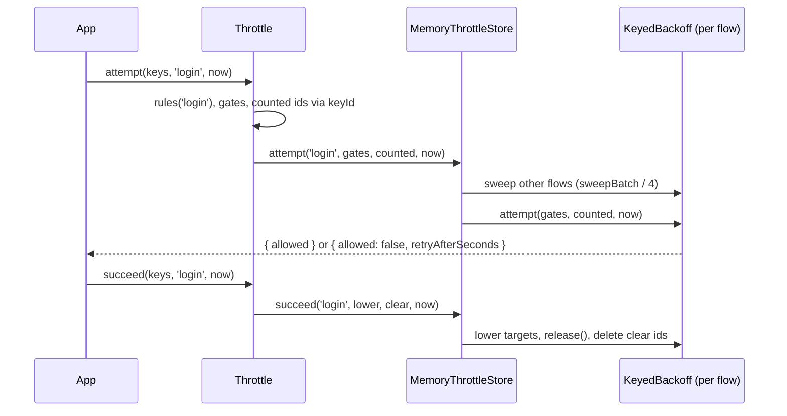

# Throttle

`Throttle` applies per-key backoff by **flow** over pluggable storage. Flow rules say which key kinds gate an attempt, which are only counted, and what a success lowers or clears; a `ThrottleStore` keeps the rows. `MemoryThrottleStore` is the in-process store. Like [`KeyedBackoff`](09-keyed-backoff.md), it never locks a key: a key only waits longer.

Use it for login, MFA, password reset and similar flows where several keys (account, IP, account+IP) take part in one decision.

## How it works

1. `new Throttle({ flows, store, keyId?, name? })` copies and deep-freezes `flows`, and checks that every `onSuccess.lower` kind is a gate of its flow.
2. `attempt(keys, flow, nowMs)`:
   1. Checks `flow` is known and `nowMs` is finite.
   2. Turns each key whose kind is in `gates` into a gate `{ id: keyId(flow, key), backoff }`, de-duplicated.
   3. Turns each key whose kind is in `counted` into an id, dropping ids that are already gates.
   4. Calls `store.attempt(flow, gates, counted, nowMs)` and returns its verdict.
3. `peek(keys, flow, nowMs)` builds the gates and calls `store.peek`; it counts nothing.
4. `succeed(keys, flow, nowMs)` returns at once for a flow without `onSuccess`. Otherwise it builds each `lower` rule (`targets` from the `kind` keys, `by` from the `by` keys), the `clear` ids, and makes **one** `store.succeed` call, even when no key matched.

Keys are `{ kind: string; value: string }`. Kinds a flow does not name are ignored, so you can pass the same key list to every flow.



### What `onSuccess.lower` is for

A shared key such as the IP gates many accounts. When one account logs in successfully, you want to forget **that account's** failures on the IP, not everyone's. Count an `account-ip` key per attempt, then on success lower the `ip` row by what `account-ip` counted:

```ts
onSuccess: { lower: [{ kind: 'ip', by: 'account-ip' }], clear: ['account', 'account-ip'] }
```

The `by` rows are consumed (deleted). Each target is lowered by the largest count among its `by` rows, never their sum. `MemoryThrottleStore` subtracts only `by` rows created after the target row, since older ones counted attempts the target never saw.

### IPv6 prefix keys: `throttleIp`

One IPv6 client usually owns a whole /64, so keying on the full address gives it a fresh row per address. `throttleIp(ip, v6Prefix)` turns a client address into its key form:

| Input | Result |
| --- | --- |
| IPv6, `2001:db8:abcd:12:1:2:3:4` with prefix `64` | The masked network in RFC 5952 form plus the prefix: `2001:db8:abcd:12::/64` |
| IPv6 with a zone id (`fe80::1%eth0`) | The zone id is dropped before masking |
| IPv4-mapped IPv6 (`::ffff:203.0.113.9`) | Unchanged: it is an IPv4 client on a dual-stack socket |
| IPv4, or a string that is not an address | Unchanged |

`v6Prefix` must be an integer from 16 to 128, otherwise `throttleIp` throws `InvalidArgument`. `DEFAULT_IPV6_PREFIX` is `64`. `Throttle` does not call it; build your `ip` keys with it:

```ts sample
import { DEFAULT_IPV6_PREFIX, MemoryThrottleStore, Throttle, throttleIp } from '@spinajs/util';

const signup = new Throttle({
  flows: { signup: { gates: { ip: { free: 3, baseDelayMs: 5_000, maxDelayMs: 600_000 } } } },
  store: new MemoryThrottleStore({ flows: ['signup'], maxRows: 50_000, resetAfterMs: 3600_000 }),
});

// Both addresses share the row 2001:db8:abcd:12::/64.
for (const ip of ['2001:db8:abcd:12::1', '2001:db8:abcd:12::2']) {
  signup.attempt([{ kind: 'ip', value: throttleIp(ip, DEFAULT_IPV6_PREFIX) }], 'signup', Date.now()).then(console.log, console.error);
}
```

`@spinajs/authn` keys every `ip` throttle key this way with `authn.throttle.ipv6Prefix` (see [Throttling](../authn/05-throttling.md#keys-the-service-builds)), and the `@spinajs/http` throttle middleware with `http.throttle.ipv6Prefix` (see [Throttling](../http/18-throttling.md#how-it-works)).

## Configuration

### `ThrottleOptions`

| Key | Type | Default | Allowed values | Meaning |
| --- | --- | --- | --- | --- |
| `flows` | `Record<string, ThrottleFlowRules>` | required | | Rules per flow name |
| `store` | `ThrottleStore` | required | `MemoryThrottleStore`, `DbThrottleStore` (`@spinajs/authn-orm`), your own | Keeps the rows |
| `keyId` | `(flow, key) => string` | `` `${flow}\|${kind}\|${value}` `` | | Maps a key to the opaque id the store sees; hash here |
| `name` | `string` | `'Throttle'` | | Prefix of error messages |

### `ThrottleFlowRules`

| Key | Type | Default | Allowed values | Meaning |
| --- | --- | --- | --- | --- |
| `gates` | `Record<string, BackoffParams>` | required | | Kinds that can refuse an attempt, each with `{ free, baseDelayMs, maxDelayMs }` |
| `counted` | `string[]` | `[]` | | Kinds counted without gating, for `lower` |
| `onSuccess.lower` | `{ kind, by }[]` | none | `kind` must be in `gates` | Lower each `kind` row by what the `by` rows counted, in order |
| `onSuccess.clear` | `string[]` | none | | Kinds whose rows a success deletes, after `lower` |

### `MemoryThrottleStoreOptions`

| Key | Type | Default | Allowed values | Meaning |
| --- | --- | --- | --- | --- |
| `flows` | `string[]` | required | | Every flow the store serves; one table each |
| `maxRows` | `number` | required | integer `>= 1` | Rows per flow |
| `resetAfterMs` | `number` | required | finite `> 0` | Idle expiry, see [Keyed backoff](09-keyed-backoff.md#expiry-and-capacity) |
| `sweepBatch` | `number` | `8` | integer `>= 1` | Rows swept in the attempt's flow; every other flow gets `ceil(sweepBatch / 4)` |
| `fullRetryMs` | `number` | `60000` | finite `> 0` | Passed to each table |
| `holdOffMs` | `number` | `1000` | finite `>= 0` | Passed to each table |
| `delay` | `(p, n) => number` | `backoffDelayMs` | | Passed to each table |
| `onFull` | `(flow: string) => void` | none | | Called once per full episode of a flow's table |
| `limiter` | `(flow, options) => KeyedBackoff` | `new KeyedBackoff(options)` | A new instance per flow | Builds each flow's table, see [Custom throttle stores](11-custom-throttle-stores.md#memorythrottlestore-limiter-factory) |

```ts
const throttle = new Throttle({
  flows: {
    login: { gates: { account: ACCOUNT, ip: IP }, counted: ['account-ip'], onSuccess: { lower: [{ kind: 'ip', by: 'account-ip' }], clear: ['account', 'account-ip'] } },
    reset: { gates: { account: { free: 1, baseDelayMs: 60_000, maxDelayMs: 60_000 } } },
  },
  store: new MemoryThrottleStore({ flows: ['login', 'reset'], maxRows: 100_000, resetAfterMs: 86_400_000 }),
});
```

## Services and extension points

| Service | DI token and lifetime | Default implementation | Alternatives | How to replace or extend |
| --- | --- | --- | --- | --- |
| `ThrottleStore` | Not registered by util; passed as `store` | `MemoryThrottleStore` | `DbThrottleStore` in `@spinajs/authn-orm`; your own (Redis, DynamoDB) | Implement the interface, see [Custom throttle stores](11-custom-throttle-stores.md) |
| Key id, `keyId(flow, key)` | Option | `` `${flow}\|${kind}\|${value}` `` | A hash | Pass a function; it must include the flow when a store ignores the `flow` argument |
| `Throttle` | Not registered by util; `@spinajs/authn` builds one inside its throttle services | `Throttle` | | Construct it with your rules; share one instance per process, eg. as a DI value |
| `KeyedBackoff` per flow | `MemoryThrottleStoreOptions.limiter` | `new KeyedBackoff(options)` | A subclass such as authn's `FlowLimiter` | Pass a factory returning a new instance per flow |

### `keyId`: hash raw keys before they reach the store

`@spinajs/util` does not use `node:crypto`, so the default id contains the raw value. Pass a `keyId` that hashes, so neither the memory table nor a database keeps logins or IP addresses.

```ts sample
import { createHmac } from 'node:crypto';
import { MemoryThrottleStore, Throttle, ThrottleKey } from '@spinajs/util';

const secret = process.env.THROTTLE_KEY_SECRET ?? 'dev-only-secret';
const hashedId = (flow: string, key: ThrottleKey) => createHmac('sha256', secret).update(`${flow}\u0000${key.kind}\u0000${key.value}`).digest('base64url');

const store = new MemoryThrottleStore({ flows: ['signup'], maxRows: 50_000, resetAfterMs: 3600_000 });
const signupThrottle = new Throttle({
  name: 'SignupThrottle',
  keyId: hashedId,
  store,
  flows: { signup: { gates: { ip: { free: 3, baseDelayMs: 5_000, maxDelayMs: 600_000 } } } },
});

signupThrottle
  .attempt([{ kind: 'ip', value: '198.51.100.23' }], 'signup', Date.now())
  .then((v) => console.log(v, [...store.limiter('signup').entries()].map(([id]) => id)));
```

## Important behaviour

- Every argument is checked before the store is called: an unknown flow, a non-finite `nowMs`, or a non-string `value` of a key the operation uses throws `InvalidArgument`. A key of an ignored kind may carry anything.
- A kind inherited from `Object.prototype` (eg. `toString`) is never treated as a gate.
- Editing the `flows` object after construction changes nothing: the throttle keeps a frozen copy.
- An id that is both a gate and counted is a gate.
- `succeed` calls the store even when no key matched, because a store may end a full-table refusal there (`MemoryThrottleStore` calls `release()`).
- `MemoryThrottleStore` throws `InvalidArgument` for a flow not in its `flows` list. It builds every flow's table on the first call for any flow.
- `MemoryThrottleStore` methods never await internally, so each call is atomic in one process: a burst of parallel attempts on a fresh key lets exactly `free` through.
- `MemoryThrottleStore.peek` ignores a full table; only `attempt` refuses for capacity.
- `throttleIp` only masks; it does not validate that the caller's address is real. Pass the address your proxy setup trusts, not a client-set header.

## Best practices

- Give every flow its own name and rules; one table per flow means a flood on sign-up cannot evict login rows.
- Pass `nowMs` from one clock read per request, so `attempt` and a later `succeed` agree.
- Call `succeed` only after the whole flow succeeded (password and MFA), and `attempt` before you verify the credential, so a refused attempt costs no hashing.
- In a cluster use a shared store; `MemoryThrottleStore` limits each instance separately.

## Patterns and antipatterns

```ts
// Don't: clearing the IP on success lets an attacker reset the IP counter with one valid account
onSuccess: { clear: ['account', 'ip'] }

// Do: lower the IP only by this account's attempts
counted: ['account-ip'],
onSuccess: { lower: [{ kind: 'ip', by: 'account-ip' }], clear: ['account', 'account-ip'] }
```

## Examples

### Slow down password guessing per account and per IP

```ts sample
import { BackoffParams, MemoryThrottleStore, Throttle, ThrottleKey } from '@spinajs/util';

const ACCOUNT: BackoffParams = { free: 5, baseDelayMs: 1_000, maxDelayMs: 60_000 };
const IP: BackoffParams = { free: 20, baseDelayMs: 1_000, maxDelayMs: 300_000 };

const throttle = new Throttle({
  flows: {
    login: {
      gates: { account: ACCOUNT, ip: IP },
      counted: ['account-ip'],
      onSuccess: { lower: [{ kind: 'ip', by: 'account-ip' }], clear: ['account', 'account-ip'] },
    },
  },
  store: new MemoryThrottleStore({ flows: ['login'], maxRows: 100_000, resetAfterMs: 86_400_000, onFull: (flow) => console.warn(`${flow} throttle table full`) }),
});

const keysFor = (login: string, ip: string): ThrottleKey[] => [
  { kind: 'account', value: login.toLowerCase() },
  { kind: 'ip', value: ip },
  { kind: 'account-ip', value: `${ip}/${login.toLowerCase()}` },
];

async function login(user: string, password: string, ip: string): Promise<string> {
  const now = Date.now();
  const keys = keysFor(user, ip);
  const verdict = await throttle.attempt(keys, 'login', now);
  if (!verdict.allowed) {
    return `429 Too Many Requests, Retry-After: ${verdict.retryAfterSeconds}`;
  }
  if (password !== 'correct horse battery staple') {
    return '401 Unauthorized';
  }
  await throttle.succeed(keys, 'login', now);
  return '200 OK';
}

(async () => {
  for (let i = 0; i < 6; i++) console.log(await login('Ann', 'guess', '203.0.113.9'));
})().catch(console.error);
```

## Related

- [Keyed backoff](09-keyed-backoff.md): the per-flow table inside `MemoryThrottleStore` and the delay formula.
- [Custom throttle stores](11-custom-throttle-stores.md): the `ThrottleStore` contract and a shared store.
- [`@spinajs/authn`](../authn/README.md): `MemoryAuthnThrottle` and `StoreAuthnThrottle` build their flows on `Throttle`.
