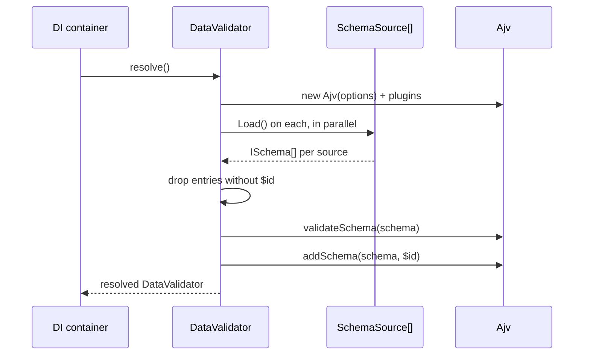

# Schema sources

A `SchemaSource` hands `DataValidator` the schemas to register at startup. `FileSystemSource` ships as the default and reads `.json`, `.js`, `.cjs` and `.mjs` files from `system.dirs.schemas`. Add your own source to load schemas from code, a database or a remote registry.

## How it works

1. `DataValidator.Sources` is `@Autoinject(SchemaSource)` on an array property: every class registered under `SchemaSource`, as `Array.ofType(SchemaSource)`.
2. `DataValidator.resolve()` throws `InvalidOperation('No schema sources avaible. Register any in DI container')` when the list is empty.
3. It calls `Load()` on every source in parallel and concatenates the results (`ISchema[]`).
4. It drops, with an `error` log naming `ISchema.file`, each entry whose `schema` is missing, not an object or has no `$id`.
5. It runs Ajv's `validateSchema(schema, true)` on the rest and drops, with an `error` log, each one that fails or throws.
6. It calls `addSchema(schema, schema.$id)` for each survivor. A duplicate `$id` is skipped with a `warn` log: the first source in the list wins.



### `FileSystemSource.Load()`

1. `LoadJSSchema()`: for each directory in `SchemaDirs` that exists, globs `**/*.+(js|cjs|mjs)`, imports each file with `import(pathToFileURL(file))` and takes its `default` export.
   - An import that fails: `error` log `Cannot load schema file <file>`, file skipped.
   - No `default` export: `warn` log `Schema file <file> has no default export, skipped`.
2. `LoadJSONSchema()`: for each existing directory, globs `**/*.json` and parses each file.
   - A parse error: `error` log `Cannot parse schema file <file>`, file skipped.
3. Returns the JS schemas followed by the JSON schemas, each as `{ schema, file: <base name> }`.

A bad file never stops the others.

## Configuration

| Key | Type | Default | Allowed values | Meaning |
| --- | --- | --- | --- | --- |
| `system.dirs.schemas` | `string[]` | not set: `FileSystemSource` loads nothing | Directory paths | Directories searched recursively for schema files. Missing directories are skipped. |

```ts
// config/app.ts
import { join } from 'path';

export default {
  system: {
    dirs: {
      schemas: [join(process.cwd(), 'schemas'), join(process.cwd(), 'node_modules/@acme/billing-schemas/lib')],
    },
  },
};
```

## Types

| Type | Shape | Meaning |
| --- | --- | --- |
| `ISchema` | `{ schema: ISchemaObject; file?: string }` | One entry a source returns. `file` only labels log lines. |
| `ISchemaObject` | `{ $id: string; [key: string]: any }` | A JSON schema with a mandatory `$id`. |
| `SchemaSource` | `abstract class { abstract Load(): Promise<ISchema[]> }` | The extension contract. |

## Services and extension points

| Service | DI token and lifetime | Default implementation | Alternatives | How to replace or extend |
| --- | --- | --- | --- | --- |
| `SchemaSource` | Abstract class `SchemaSource`; list resolved by `DataValidator` with `@Autoinject(SchemaSource)`; each element a singleton (default lifetime) | `FileSystemSource` | None shipped | Add: `@Injectable(SchemaSource)` on your class. Remove: `DI.unregister(Impl)`. Both before `DataValidator` resolves |
| `FileSystemSource` | Registered with `@Injectable(SchemaSource)` when `@spinajs/validation` is imported; singleton | — | Your subclass | Subclass and override `Load()`, `LoadJSSchema()` or `LoadJSONSchema()`; register the subclass under `SchemaSource` and `DI.unregister(FileSystemSource)` |

Sources are read **once**, in `DataValidator.resolve()`. A source registered after the validator resolved is never asked; add those schemas with [`addSchema()`](04-runtime-schemas.md).

### `SchemaSource`: custom implementation

Write a source when schemas live outside the schema directories: in code next to the feature, in a database table, in a schema registry service. Implement `Load()`; return `[]` when there is nothing to load. A source that throws makes `DataValidator`'s resolve reject, and every service that injects the validator fails to resolve. Catch and log what may fail at runtime.

Register the class before the first `DI.resolve(DataValidator)`. A module imported at startup with `@Injectable(SchemaSource)` on the class is enough.

```ts sample
import { Config } from '@spinajs/configuration';
import { Injectable } from '@spinajs/di';
import { DataValidator, ISchema, ISchemaObject, SchemaSource } from '@spinajs/validation';
import { DI } from '@spinajs/di';

/** Loads the published event schemas of other services from a schema registry over HTTP. */
@Injectable(SchemaSource)
export class EventRegistrySchemaSource extends SchemaSource {
  @Config('billing.schemaRegistry.url', { defaultValue: '' })
  protected RegistryUrl!: string;

  @Config('billing.schemaRegistry.subjects', { defaultValue: [] })
  protected Subjects!: string[];

  public async Load(): Promise<ISchema[]> {
    if (!this.RegistryUrl) {
      return [];
    }

    const loaded = await Promise.all(
      this.Subjects.map(async (subject): Promise<ISchema | null> => {
        try {
          const response = await fetch(`${this.RegistryUrl}/subjects/${encodeURIComponent(subject)}/latest`);
          if (!response.ok) {
            return null;
          }
          const schema = (await response.json()) as ISchemaObject;
          return { schema, file: `registry:${subject}` };
        } catch {
          // an unreachable registry must not stop the application from booting
          return null;
        }
      }),
    );

    return loaded.filter((s): s is ISchema => s !== null);
  }
}

export async function validateEvent(subjectId: string, event: object) {
  const validator = await DI.resolve(DataValidator);
  validator.validate(subjectId, event);
}
```

### Schemas kept in code

A source is also the simplest way to ship schemas as typed constants with the feature that owns them:

```ts sample
import { Injectable } from '@spinajs/di';
import { ISchema, SchemaSource } from '@spinajs/validation';

export const ADDRESS_SCHEMA = {
  $id: 'http://app/address.schema.json',
  type: 'object',
  properties: {
    street: { type: 'string', minLength: 1 },
    city: { type: 'string', minLength: 1 },
    postalCode: { type: 'string', pattern: '^[0-9]{2}-[0-9]{3}$' },
  },
  required: ['street', 'city', 'postalCode'],
};

export const CUSTOMER_SCHEMA = {
  $id: 'http://app/customer.schema.json',
  type: 'object',
  properties: {
    name: { type: 'string' },
    billingAddress: { $ref: 'http://app/address.schema.json' },
  },
  required: ['name', 'billingAddress'],
};

@Injectable(SchemaSource)
export class CustomerSchemas extends SchemaSource {
  public async Load(): Promise<ISchema[]> {
    return [
      { schema: ADDRESS_SCHEMA, file: 'customer-schemas.ts' },
      { schema: CUSTOMER_SCHEMA, file: 'customer-schemas.ts' },
    ];
  }
}
```

### `FileSystemSource`: subclass or remove

Subclass `FileSystemSource` to change which files count as schemas, or to post-process them. Its public methods are the hooks:

| Method | Default | Override to |
| --- | --- | --- |
| `Load()` | `LoadJSSchema()` then `LoadJSONSchema()` | Filter, rewrite or add entries |
| `LoadJSSchema()` | Imports `*.js`, `*.cjs`, `*.mjs`; takes `default` | Read other module shapes |
| `LoadJSONSchema()` | Parses `*.json` | Read other text formats |
| `SchemaDirs` | `@Config('system.dirs.schemas')` | Point at other directories |

Replace the default: register the subclass under `SchemaSource` and unregister `FileSystemSource`, both before `DataValidator` resolves. Without the `unregister`, both run and every file loads twice (the second copy is skipped with a duplicate warning).

```ts sample
import { DI } from '@spinajs/di';
import { FileSystemSource, ISchema, SchemaSource } from '@spinajs/validation';

/** Only files named *.schema.json / *.schema.mjs count; other JSON in the folder is ignored. */
export class NamedSchemaFiles extends FileSystemSource {
  public async Load(): Promise<ISchema[]> {
    const all = await super.Load();
    return all.filter((s) => /\.schema\.(json|js|cjs|mjs)$/.test(s.file ?? ''));
  }
}

// at startup, before anything resolves DataValidator
DI.unregister(FileSystemSource);
DI.register(NamedSchemaFiles).as(SchemaSource);
```

Removing every source makes `DataValidator` fail to resolve with `InvalidOperation`. A project with no schema files keeps `FileSystemSource`: without `system.dirs.schemas` it returns `[]`.

## Important behaviour

- **Every schema needs `$id`.** It is the registry key; schemas without one are logged and dropped.
- **Startup is all-or-nothing per source, not per file.** A file or entry that is bad is skipped; a source whose `Load()` rejects fails the whole `DataValidator` resolve.
- **First source wins on duplicates.** Sources load in list order (registration order); a later schema with the same `$id` is skipped with a warning.
- **JS schema files are executed.** `FileSystemSource` imports every `.js`, `.cjs` and `.mjs` file under the directories. Point `system.dirs.schemas` only at directories that hold schemas, not at a compiled source tree.
- **Only Ajv's meta-schema check runs at startup.** An unknown `format` passes it and fails on the first validation; see [Runtime schemas](04-runtime-schemas.md#validateschemaschema-check-a-schema-before-you-store-it).

## Best practices

- Name files after their `$id` (`invoice.schema.json` for `http://billing/invoice.schema.json`) so a log line leads to the file.
- Ship a package's schemas as a `SchemaSource` in that package: the schemas load wherever the package is imported, with no directory to configure.
- Use `$ref` by `$id` between schemas from different sources; the load order does not matter because Ajv compiles lazily.

## Patterns and antipatterns

```ts
// Don't: a source that throws when a remote is down stops the whole application from booting
public async Load() {
  const res = await fetch(this.RegistryUrl);
  return (await res.json()) as ISchema[];
}

// Do: degrade to no schemas, and log
public async Load() {
  try {
    const res = await fetch(this.RegistryUrl);
    return res.ok ? ((await res.json()) as ISchema[]) : [];
  } catch (err) {
    this.Log.warn(err as Error, 'Schema registry unavailable');
    return [];
  }
}
```

## Related

- [Runtime schemas](04-runtime-schemas.md): adding schemas after startup.
- [Value schemas](../configuration-http/03-value-schemas.md): a `SchemaSource` for configuration value rules.
- [Multiple implementations](../di/06-multiple-implementations.md): how the `SchemaSource` list is collected.
